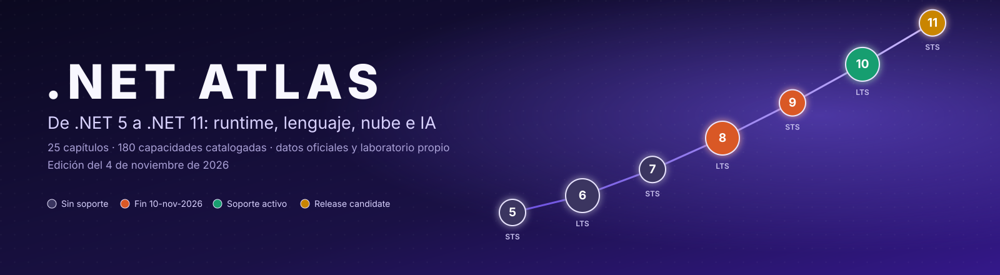
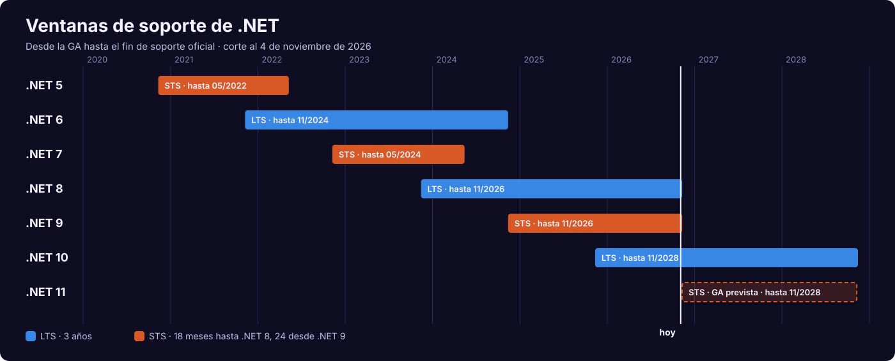
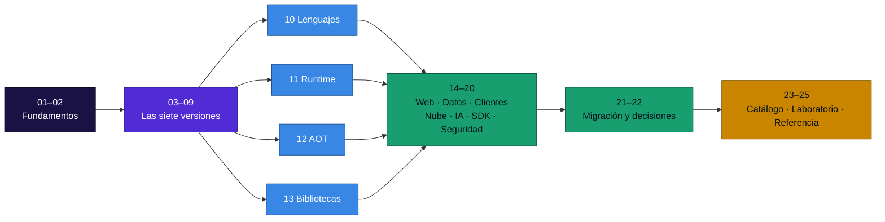
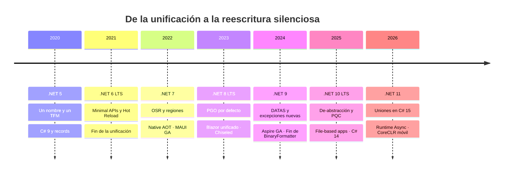
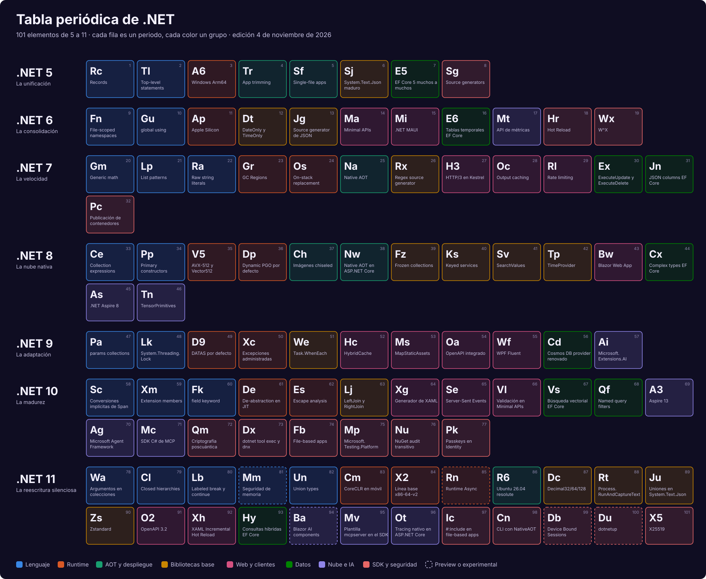
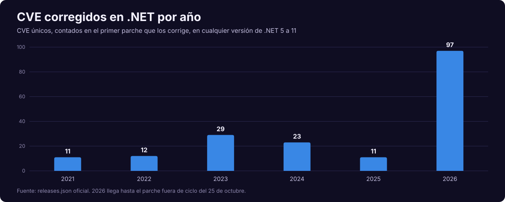
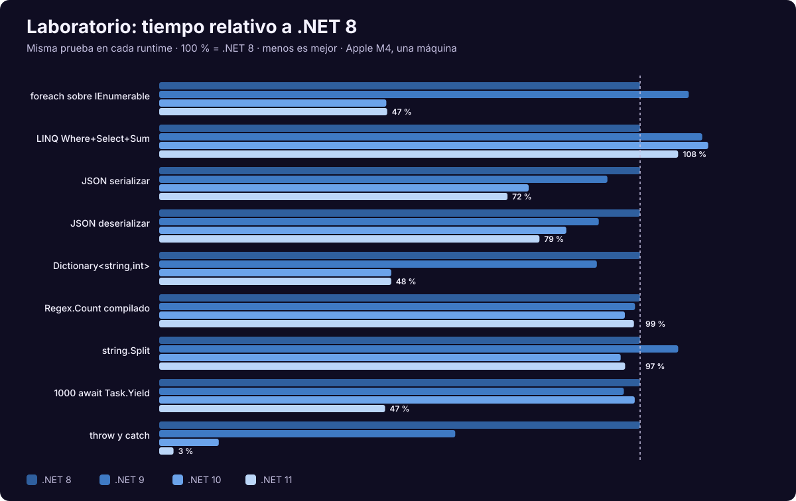

<p align="center">
  
</p>

<p align="center">
  
  
  
  
  
  
</p>

<p align="center">
  <b>.NET Atlas</b> es una guía técnica en español sobre la evolución de la plataforma <b>.NET, de la versión 5 a la 11</b>:<br>
  runtime, lenguaje, web, datos, nube, IA y seguridad, con datos oficiales, ejemplos ejecutados<br>
  y mediciones propias, verificados al <b>4 de noviembre de 2026</b>.
</p>

> [!CAUTION]
> **El 10 de noviembre de 2026 termina el soporte de .NET 8, .NET 9 y del modelo *in-process* de Azure Functions.**
> Si tienes alguno en producción, empieza por el [plan de acción](docs/02-ciclo-de-vida-y-soporte.md#3-el-10-de-noviembre-de-2026).

---

## Contenido

- [La plataforma hoy](#la-plataforma-hoy)
- [Cómo usar este atlas](#cómo-usar-este-atlas)
- [Seis años en un mapa](#seis-años-en-un-mapa)
- [Tabla periódica de .NET](#tabla-periódica-de-net)
- [Índice de capítulos](#índice-de-capítulos)
- [Las siete versiones](#las-siete-versiones)
- [Cinco ideas que explican la evolución](#cinco-ideas-que-explican-la-evolución)
- [.NET en cifras](#net-en-cifras)
- [Laboratorio: lo que medimos](#laboratorio-lo-que-medimos)
- [Qué cambia con .NET 11](#qué-cambia-con-net-11)
- [Recomendación por perfil](#recomendación-por-perfil)
- [Qué corrige esta edición](#qué-corrige-esta-edición)
- [Estructura del repositorio](#estructura-del-repositorio)
- [Convenciones](#convenciones)
- [Metodología y fuentes](#metodología-y-fuentes)

---

## La plataforma hoy

<p align="center">
  
</p>

| Versión | Estado | Parche | Fin de soporte | Decisión |
|---|---|---|---|---|
| **.NET 11** | 🟡 RC3 con *go-live* | 11.0.0-rc.3 | Noviembre de 2028 | Probar ahora; GA prevista durante .NET Conf, del 10 al 13 de noviembre |
| **.NET 10** | 🟢 LTS activa | 10.0.14 | 14-nov-2028 | **Destino recomendado** |
| **.NET 9** | 🟠 Mantenimiento | 9.0.22 | **10-nov-2026** | Migrar ya |
| **.NET 8** | 🟠 Mantenimiento | 8.0.33 | **10-nov-2026** | Migrar ya |
| .NET 7, 6, 5 | ⛔ Sin soporte | 7.0.20, 6.0.36, 5.0.17 | Terminado | Migrar directo a .NET 10 |

---

## Cómo usar este atlas

| Si eres… | Empieza por | Sigue con | Termina en |
|---|---|---|---|
| **Con urgencia de migrar** | [02 · Ciclo de vida](docs/02-ciclo-de-vida-y-soporte.md) | [21 · Migración](docs/21-migracion-y-cambios-disruptivos.md) | [20 · Seguridad](docs/20-seguridad-y-cadena-de-suministro.md) |
| **Nuevo en .NET** | [01 · Genealogía](docs/01-genealogia-y-arquitectura.md) | [10 · Lenguajes](docs/10-lenguajes-csharp-fsharp-vb.md) | [25 · Referencia](docs/25-referencia-rapida-y-glosario.md) |
| **Arquitecto/a** | [22 · Decisiones](docs/22-guias-de-decision.md) | [17 · Cloud native](docs/17-cloud-native-aspire-y-observabilidad.md) | [12 · AOT](docs/12-aot-despliegue-y-contenedores.md) |
| **Desarrollador/a backend** | [14 · ASP.NET Core](docs/14-aspnet-core-y-blazor.md) | [15 · Datos](docs/15-datos-y-ef-core.md) | [13 · Bibliotecas](docs/13-bibliotecas-base.md) |
| **Interesado/a en rendimiento** | [11 · Runtime](docs/11-runtime-jit-y-gc.md) | [24 · Laboratorio](docs/24-laboratorio.md) | [12 · AOT](docs/12-aot-despliegue-y-contenedores.md) |
| **Operaciones / SRE** | [17 · Cloud native](docs/17-cloud-native-aspire-y-observabilidad.md) | [12 · Contenedores](docs/12-aot-despliegue-y-contenedores.md) | [20 · Seguridad](docs/20-seguridad-y-cadena-de-suministro.md) |
| **IA** | [18 · IA en .NET](docs/18-ia-en-net.md) | [15 · Vectores](docs/15-datos-y-ef-core.md#6-búsqueda-vectorial-y-rag) | [17 · Observabilidad](docs/17-cloud-native-aspire-y-observabilidad.md) |
| **Móvil y escritorio** | [16 · Clientes](docs/16-clientes-maui-wpf-winforms.md) | [09 · .NET 11](docs/09-net-11-la-reescritura-silenciosa.md#7-coreclr-llega-a-móvil-y-avanza-en-webassembly) | [21 · Migración](docs/21-migracion-y-cambios-disruptivos.md) |



---

## Seis años en un mapa



---

## Tabla periódica de .NET

<p align="center">
  
</p>

Generada desde [`data/caracteristicas.csv`](data/caracteristicas.csv). El [catálogo A–Z](docs/23-catalogo-a-z.md) contiene las 180 capacidades.

---

## Índice de capítulos

| # | Capítulo | De qué trata |
|:---:|---|---|
| 01 | [Genealogía y arquitectura](docs/01-genealogia-y-arquitectura.md) | Framework, Mono y Core; capas, motores, arranque, TFM |
| 02 | [Ciclo de vida y soporte](docs/02-ciclo-de-vida-y-soporte.md) | LTS, STS, fases, parches, sistemas, **fe de erratas** |
| 03 | [.NET 5: la unificación](docs/03-net-5-la-unificacion.md) | C# 9, generadores, JSON, despliegue |
| 04 | [.NET 6: la consolidación](docs/04-net-6-la-consolidacion.md) | Minimal APIs, Hot Reload, C# 10 |
| 05 | [.NET 7: la velocidad](docs/05-net-7-la-velocidad.md) | OSR, Native AOT, matemática genérica, regex |
| 06 | [.NET 8: la nube nativa](docs/06-net-8-la-nube-nativa.md) | PGO, AOT web, Blazor, contenedores seguros |
| 07 | [.NET 9: la adaptación](docs/07-net-9-la-adaptacion.md) | DATAS, excepciones, OpenAPI, HybridCache |
| 08 | [.NET 10: la madurez](docs/08-net-10-la-madurez.md) | De-abstracción, C# 14, PQC, scripts |
| 09 | [.NET 11: la reescritura silenciosa](docs/09-net-11-la-reescritura-silenciosa.md) | Runtime Async, uniones, CoreCLR móvil |
| 10 | [Lenguajes](docs/10-lenguajes-csharp-fsharp-vb.md) | C# 9 a 15, F#, Visual Basic |
| 11 | [Runtime, JIT y GC](docs/11-runtime-jit-y-gc.md) | Niveles, PGO, regiones, DATAS, SIMD |
| 12 | [AOT, despliegue y contenedores](docs/12-aot-despliegue-y-contenedores.md) | Recorte, Native AOT, imágenes, Kubernetes |
| 13 | [Bibliotecas base](docs/13-bibliotecas-base.md) | JSON, LINQ, colecciones, numéricos, red |
| 14 | [ASP.NET Core y Blazor](docs/14-aspnet-core-y-blazor.md) | API, OpenAPI, autenticación, tiempo real |
| 15 | [Datos y EF Core](docs/15-datos-y-ef-core.md) | Modelado, consultas, JSON, vectores |
| 16 | [Clientes](docs/16-clientes-maui-wpf-winforms.md) | MAUI, CoreCLR móvil, WPF, Windows Forms |
| 17 | [Cloud native y Aspire](docs/17-cloud-native-aspire-y-observabilidad.md) | Aspire 13, OpenTelemetry, salud, resiliencia |
| 18 | [IA en .NET](docs/18-ia-en-net.md) | `IChatClient`, agentes, MCP, RAG, tensores |
| 19 | [SDK, herramientas y pruebas](docs/19-sdk-herramientas-y-pruebas.md) | CLI, file-based apps, NuGet, MTP |
| 20 | [Seguridad y cadena de suministro](docs/20-seguridad-y-cadena-de-suministro.md) | CVE, PQC, NuGet, endurecimiento |
| 21 | [Migración y cambios disruptivos](docs/21-migracion-y-cambios-disruptivos.md) | Rutas, cambios por versión, Functions, Framework |
| 22 | [Guías de decisión](docs/22-guias-de-decision.md) | Árboles y matrices para elegir |
| 23 | [Catálogo A–Z](docs/23-catalogo-a-z.md) | 180 capacidades con versión y estado |
| 24 | [Laboratorio](docs/24-laboratorio.md) | Mediciones reproducibles de .NET 8 a 11 |
| 25 | [Referencia y glosario](docs/25-referencia-rapida-y-glosario.md) | Comandos, propiedades, términos |

---

## Las siete versiones

| .NET | Fecha | Tipo | C# | Lo que deja | Función insignia |
|:---:|---|:---:|:---:|---|---|
| [**5**](docs/03-net-5-la-unificacion.md) | 10-nov-2020 | STS | 9 | Un nombre y cadencia anual | `record` |
| [**6**](docs/04-net-6-la-consolidacion.md) | 8-nov-2021 | LTS | 10 | SDK y BCL unificados | Minimal APIs |
| [**7**](docs/05-net-7-la-velocidad.md) | 8-nov-2022 | STS | 11 | Infraestructura de rendimiento | OSR y Native AOT |
| [**8**](docs/06-net-8-la-nube-nativa.md) | 14-nov-2023 | LTS | 12 | Contenedores seguros por defecto | PGO por defecto |
| [**9**](docs/07-net-9-la-adaptacion.md) | 12-nov-2024 | STS | 13 | Memoria que sigue a la carga | DATAS |
| [**10**](docs/08-net-10-la-madurez.md) | 11-nov-2025 | LTS | 14 | Abstracciones más baratas | Miembros de extensión |
| [**11**](docs/09-net-11-la-reescritura-silenciosa.md) | Nov-2026 (prevista) | STS | 15 | `async` en el runtime | Uniones |

---

## Cinco ideas que explican la evolución

| # | Idea | Cómo se ve | Dónde leer |
|:---:|---|---|---|
| 1 | **Mover trabajo del arranque a la compilación** | Generadores de JSON, regex, logging y validación hacen posible Native AOT | [03](docs/03-net-5-la-unificacion.md#4-generadores-de-código) · [12](docs/12-aot-despliegue-y-contenedores.md) |
| 2 | **Hacer gratuita la abstracción** | OSR, PGO, devirtualización y asignación en pila | [11](docs/11-runtime-jit-y-gc.md#3-el-proyecto-de-abstracción) |
| 3 | **Adaptarse al contenedor** | Regiones, DATAS, imágenes chiseled, usuario no root | [12](docs/12-aot-despliegue-y-contenedores.md#5-imágenes-de-contenedor) |
| 4 | **Que el compilador impida el error** | `required`, nulabilidad, uniones, `closed` | [10](docs/10-lenguajes-csharp-fsharp-vb.md#3-línea-1-modelar-datos) |
| 5 | **Observabilidad en la plataforma** | `Activity`, `Meter`, OTel nativo en ASP.NET Core 11 | [17](docs/17-cloud-native-aspire-y-observabilidad.md) |

---

## .NET en cifras

| Indicador | Valor |
|---|---:|
| Años de cadencia anual ininterrumpida | 6 |
| Lanzamientos de .NET 5 a 11 en metadatos oficiales | 209 |
| Parches estables publicados | 138 |
| CVE únicos corregidos desde 2021 | 183 |
| CVE únicos corregidos en 2026, hasta octubre | **97** |
| Duración de STS desde .NET 9 | 24 meses |

<p align="center">
  
</p>

Las fuentes consultadas no explican este aumento; su lectura y las consecuencias operativas están en el
[capítulo 20](docs/20-seguridad-y-cadena-de-suministro.md).

---

## Laboratorio: lo que medimos

<p align="center">
  
</p>

Con los últimos parches, en Apple M4:

| Prueba | .NET 8 | .NET 10 | .NET 11 RC3 |
|---|---:|---:|---:|
| `foreach` sobre `IEnumerable` | 565 ns · 32 B | 267 ns · **0 B** | 268 ns · **0 B** |
| `throw` y `catch` | 17.8 µs | 2.2 µs | **0.53 µs** |
| 1 000 `await Task.Yield` | 511 µs | 505 µs | **240 µs** |
| LINQ `Where`+`Select`+`Sum` | 1.14 µs | 1.30 µs | 1.23 µs |
| API AOT hasta primera respuesta | 33 ms | 33 ms | **15 ms** |

> [!NOTE]
> Una máquina, pruebas sintéticas y una RC: observa la tendencia, no el número. También publicamos lo que empeoró.
> [Método, datos y limitaciones](docs/24-laboratorio.md).

---

## Qué cambia con .NET 11

```csharp
public record Exito(string Mensaje);
public record Fallo(int Codigo);

public union Resultado(Exito, Fallo);          // C# 15

static string Describir(Resultado r) => r switch
{
    Exito(var m) => m,
    Fallo(var c) => $"error {c}",
};                                              // exhaustivo, sin rama por defecto
```

| Área | Cambio | Estado |
|---|---|---|
| Lenguaje | `union`, `closed`, `with(...)`, saltos etiquetados | 🟡 RC |
| Runtime | **Runtime Async**: ya en las bibliotecas, opt-in para tu código | 🟡 Preview |
| Móvil | **CoreCLR** reemplaza a Mono como predeterminado | 🟡 RC |
| Hardware | Línea base **x86-64-v2** | 🟡 RC |
| Web | OTel nativo, OpenAPI 3.2, Zstandard | 🟡 RC |
| Bibliotecas | `Decimal64`, `Process.RunAndCaptureText`, `FullJoin` | 🟡 RC |
| SDK | CLI con Native AOT, `#:include`, pruebas móviles | 🟡 RC |
| Memoria segura | Nuevo modelo de `unsafe` | 🟡 Preview dentro de C# |

Detalle en el [capítulo 09](docs/09-net-11-la-reescritura-silenciosa.md).

---

## Recomendación por perfil

| Situación | Elige | Motivo |
|---|---|---|
| Sistema empresarial nuevo | **.NET 10** | LTS estable, con dos años de soporte por delante |
| Migración urgente | **.NET 10** | Disponible hoy y sin depender de la GA de .NET 11 |
| Despliegue continuo | .NET 11 tras GA | Termina al mismo tiempo que .NET 10 |
| MAUI | Probar .NET 11 ya | CoreCLR exige validación propia |
| Functions *in-process* | *Isolated worker* con .NET 10 | El modelo termina el 10 de noviembre |
| .NET Framework | Migración incremental con YARP | Sin fusión entre plataformas |

Más árboles de decisión en el [capítulo 22](docs/22-guias-de-decision.md).

---

## Qué corrige esta edición

La edición anterior de este repositorio contenía errores que se corrigieron contra las fuentes oficiales. Los más
importantes:

- **.NET 9 no terminó en mayo de 2026**: sigue soportado hasta el 10 de noviembre.
- **.NET Framework nunca se fusionó** con .NET Core.
- Se retiraron funciones sin respaldo atribuidas a .NET 9, 10 y 11, como *bindings* de CUDA o ejecución híbrida AOT/JIT.
- Se corrigieron las funciones atribuidas a C# 12, 13 y 14.
- 6 de los 7 enlaces de "más información" devolvían 404.

[Lista completa en la fe de erratas](docs/02-ciclo-de-vida-y-soporte.md#8-fe-de-erratas-de-la-edición-anterior).

---

## Estructura del repositorio

```text
.
├── README.md                     ← estás aquí
├── docs/                         ← 25 capítulos
│   ├── 01, 02                    ← fundamentos y soporte
│   ├── 03 … 09                   ← una versión por capítulo
│   ├── 10 … 20                   ← capítulos temáticos
│   ├── 21, 22                    ← migración y decisiones
│   ├── 23-catalogo-a-z.md        ← generado desde data/caracteristicas.csv
│   ├── 24-laboratorio.md
│   └── 25-referencia-rapida-y-glosario.md
├── data/                         ← fuentes de datos en CSV
├── ejemplos/                     ← un programa ejecutable por versión
├── laboratorio/                  ← código de las mediciones
├── tools/
│   ├── actualizar_datos.py       ← descarga los metadatos oficiales
│   ├── generar_atlas.py          ← regenera catálogo y gráficos
│   └── validar_ejemplos.sh       ← compila y ejecuta los ejemplos
├── assets/                       ← banner, póster y gráficos en SVG
└── LICENSE                       ← Apache 2.0
```

```bash
python3 tools/actualizar_datos.py   # Descarga los datos oficiales de versiones
python3 tools/generar_atlas.py      # Regenera catálogo y gráficos, sin dependencias
./tools/validar_ejemplos.sh         # Requiere el SDK de .NET 11
dotnet run ejemplos/net11-uniones.cs
```

---

## Convenciones

| Símbolo | Significado |
|---|---|
| 🟢 | GA o soporte activo |
| 🟡 | Preview o Release Candidate |
| 🧪 | Experimental |
| 🟠 | Fin de soporte inminente |
| ⛔ | Sin soporte |
| 🆕 | Novedad de .NET 11 |
| Recuadros *Note*, *Tip*, *Important*, *Warning*, *Caution* | Notas, consejos, puntos clave, advertencias y precauciones |

Colores de los diagramas: **violeta** = plataforma · **azul** = entrada y lenguaje · **naranja** = runtime ·
**verde** = resultado y despliegue · **ámbar** = bibliotecas y configuración · **rosa** = web y clientes.

---

## Metodología y fuentes

- **Fecha de corte:** 4 de noviembre de 2026. La GA de .NET 11 y los anuncios de .NET Conf no están incluidos.
- **Fuentes primarias:** `releases.json` y notas de versión de `dotnet/core`, Markdown de `dotnet/docs`, `AspNetCore.Docs`,
  `EntityFramework.Docs` y `docs-maui`, páginas de ciclo de vida de Microsoft, NuGet y los blogs oficiales. Algunos hitos
  del ecosistema, como Agent Framework 1.0, proceden de prensa técnica y están citados.
- **Validación:** los 7 ejemplos se ejecutaron con `11.0.100-rc.3.26522.148`. Los fragmentos principales de ASP.NET Core,
  EF Core 10, criptografía, IA y MCP se compilaron contra sus paquetes. Los diagramas se validaron con el analizador de
  Mermaid y los enlaces con un verificador propio.
- **Mediciones:** propias, de una máquina, con [código público](laboratorio/).
- **Límites:** .NET 11 todavía puede cambiar antes de GA. Verifica en la documentación oficial antes de una decisión
  contractual. Este atlas no es documentación oficial de Microsoft, y .NET es una marca de Microsoft.
- **Contribuir:** abre un *issue* o *pull request*. Para el catálogo, edita `data/caracteristicas.csv` y ejecuta el generador.

---

<p align="center">
  Hecho para la comunidad hispanohablante de .NET · Licencia <a href="LICENSE">Apache 2.0</a> ·
  <a href="https://dotnet.microsoft.com/">dotnet.microsoft.com</a>
</p>
