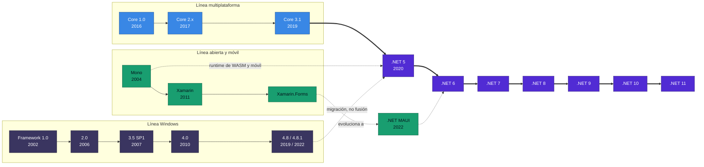
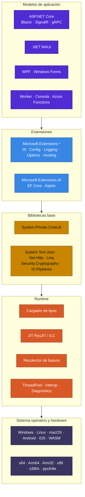
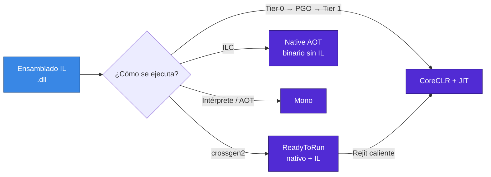
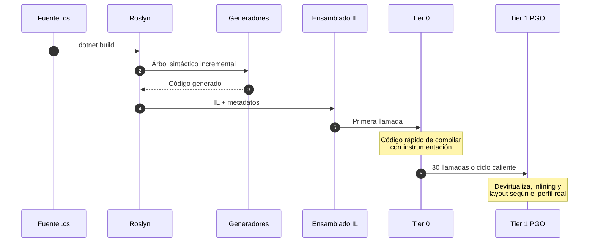
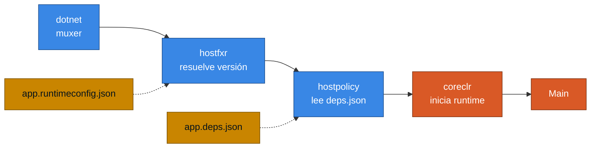

<div align="center">

# 01 · Genealogía y arquitectura

**De .NET Framework a una sola plataforma: runtimes, host, TFM, ensamblados y cómo arranca realmente una aplicación**

[🏠 Índice](../README.md) · [02 · Ciclo de vida ➡](02-ciclo-de-vida-y-soporte.md)

</div>

> [!NOTE]
> **Leyenda de estado** usada en todo el atlas: 🟢 GA o soporte activo · 🟡 Preview o RC · 🧪 Experimental ·
> 🟠 Fin de soporte inminente · ⛔ Sin soporte · 🆕 Novedad de .NET 11. Estado verificado al **4 de noviembre de 2026**.

---

## Contenido

1. [Por qué existe ".NET 5"](#1-por-qué-existe-net-5)
2. [Árbol genealógico](#2-árbol-genealógico)
3. [Las capas de la plataforma](#3-las-capas-de-la-plataforma)
4. [Los cuatro motores de ejecución](#4-los-cuatro-motores-de-ejecución)
5. [Del código fuente a la instrucción de máquina](#5-del-código-fuente-a-la-instrucción-de-máquina)
6. [Cómo arranca una aplicación](#6-cómo-arranca-una-aplicación)
7. [Target Framework Monikers](#7-target-framework-monikers)
8. [Frameworks compartidos y modos de despliegue](#8-frameworks-compartidos-y-modos-de-despliegue)
9. [Selección de versión: SDK y runtime](#9-selección-de-versión-sdk-y-runtime)
10. [Lo que no se migró](#10-lo-que-no-se-migró)
11. [Referencias](#11-referencias)

---

## 1. Por qué existe ".NET 5"

.NET 5 no es la fusión de .NET Framework con .NET Core. Es la **siguiente versión de .NET Core después de la 3.1**,
renombrada por dos motivos que Microsoft dejó por escrito:

- Se saltó el número 4 para no confundirlo con .NET Framework 4.x.
- Se retiró la palabra "Core" para señalar que esta es la implementación principal de .NET en adelante.

.NET Framework siguió existiendo y sigue soportado como componente de Windows. La unificación real tampoco ocurrió en
.NET 5: el propio Microsoft sitúa en **.NET 6** "las últimas piezas del plan de unificación", cuando el SDK, las
bibliotecas base y el runtime quedaron alineados para móvil, escritorio, IoT y nube.

> [!IMPORTANT]
> Conviene fijar esta idea porque aparece mal en muchos textos, incluida la edición anterior de este repositorio.
> **.NET Framework nunca se fusionó con .NET Core.** Las tecnologías que no se portaron están en la
> [sección 10](#10-lo-que-no-se-migró).

Los nombres históricos tienen una excepción: **ASP.NET Core** y **Entity Framework Core** conservaron "Core" para no
confundirse con ASP.NET MVC 5 y Entity Framework 5/6.

---

## 2. Árbol genealógico



| Año | Hito | Por qué importa hoy |
|---|---|---|
| 2002 | .NET Framework 1.0 | Nacen el CLR, el IL y C#; el estándar ECMA-335 sigue describiendo el formato de ensamblados |
| 2004 | Mono 1.0 | Implementación abierta del CLR; décadas después será el runtime de móvil y WebAssembly |
| 2014 | Microsoft abre el código de .NET Core | Cambia el modelo de desarrollo a GitHub |
| 2016 | .NET Core 1.0 y compra de Xamarin | Aparecen un runtime multiplataforma y la línea móvil dentro de Microsoft |
| 2019 | .NET Core 3.0/3.1 | WPF y Windows Forms llegan a Core, solo en Windows |
| 2020 | **.NET 5** | Un solo nombre; TFM `net5.0` |
| 2021 | **.NET 6** | Se completa la unificación de SDK, BCL y runtime |
| 2022 | **.NET MAUI** GA | Sucesor de Xamarin.Forms |
| 2023 | **.NET 8** | Native AOT llega a ASP.NET Core y Blazor unifica sus modelos |
| 2025 | **.NET 10** | LTS vigente; las abstracciones cuestan menos en el JIT |
| 2026 | **.NET 11** (RC) | 🆕 CoreCLR reemplaza a Mono como predeterminado en MAUI; el propio runtime asume `async` |

> [!TIP]
> El arco de 2004 a 2026 tiene una lectura técnica: Mono empezó siendo la alternativa y terminó sosteniendo móvil y
> WebAssembly durante una década. .NET 11 es el punto donde **CoreCLR recupera esos escenarios**
> ([capítulo 16](16-clientes-maui-wpf-winforms.md)).

---

## 3. Las capas de la plataforma



| Capa | Paquete o ensamblado | Cadencia | Observación |
|---|---|---|---|
| CoreLib | `System.Private.CoreLib` | Con el runtime | Está acoplada al runtime; contiene `Object`, `String`, `Task`, `Span<T>` |
| BCL | `Microsoft.NETCore.App` | Con el runtime | Framework compartido; lo actualizan los parches mensuales |
| Extensiones | `Microsoft.Extensions.*` | Con .NET; algunas fuera de banda | 🆕 En .NET 11 algunas pasan al framework compartido |
| Web | `Microsoft.AspNetCore.App` | Con .NET | Framework compartido propio |
| Escritorio | `Microsoft.WindowsDesktop.App` | Con .NET | Solo Windows |
| Datos | `Microsoft.EntityFrameworkCore` | Anual, con .NET | Paquete NuGet, no forma parte del framework compartido |
| Orquestación | `Aspire.*` | Independiente | 13.x en 2026, con ritmo propio |

---

## 4. Los cuatro motores de ejecución

"El runtime de .NET" es una simplificación. Hay cuatro formas de ejecutar el mismo IL:

| Motor | Compilación | Dónde se usa en 2026 | Fortaleza | Límite |
|---|---|---|---|---|
| **CoreCLR + RyuJIT** | JIT por niveles con PGO | Servidores, escritorio y, en .NET 11, móvil por defecto 🆕 | Máximo rendimiento sostenido | Arranque y memoria mayores que AOT |
| **CoreCLR + ReadyToRun** | AOT parcial, con JIT disponible | Las propias bibliotecas de .NET, apps con arranque crítico | Mejor arranque, sin perder JIT | Binario más grande |
| **Native AOT** | AOT total con ILC | CLI, funciones, microservicios, y .NET 11 CLI 🆕 | Arranque mínimo, sin JIT | Sin carga dinámica de código; requiere código compatible con recorte |
| **Mono** | JIT, intérprete o AOT | WebAssembly hoy; sigue disponible en móvil | Portabilidad | En retirada de móvil: en .NET 11 deja de ser predeterminado |



> [!NOTE]
> ReadyToRun y Native AOT se confunden con frecuencia. ReadyToRun **conserva el IL** y permite que el JIT reemplace
> el código precompilado cuando un método se calienta. Native AOT **elimina el IL y el JIT**. Detalle en el
> [capítulo 12](12-aot-despliegue-y-contenedores.md).

---

## 5. Del código fuente a la instrucción de máquina



Tres consecuencias prácticas:

1. **Una aplicación recién iniciada no rinde igual que una caliente.** Por eso los benchmarks serios hacen calentamiento.
2. **Un método largo puede cambiar de código mientras corre**, gracias a *On-Stack Replacement* desde .NET 7.
3. **Los generadores de código son una fase de compilación, no un truco.** Son la base que permite que JSON, logging,
   regex y configuración funcionen sin reflexión bajo Native AOT.

---

## 6. Cómo arranca una aplicación

Cuando escribes `dotnet app.dll`, ocurre una cadena que conviene conocer antes de diagnosticar un error de arranque:



| Componente | Responsabilidad | Falla típica |
|---|---|---|
| `dotnet` (muxer) | Decide si el comando es del SDK o de una app | `Could not execute because the application was not found` |
| `hostfxr` | Elige la versión del framework compartido | `You must install or update .NET` |
| `hostpolicy` | Construye la lista de ensamblados desde `deps.json` | `An assembly specified in the application dependencies manifest was not found` |
| `coreclr` | Inicia GC, JIT y carga la aplicación | Fallo de CPU no soportada, en .NET 11: `The current CPU is missing one or more of the baseline instruction sets` |

```json
{
  "runtimeOptions": {
    "tfm": "net10.0",
    "framework": { "name": "Microsoft.AspNetCore.App", "version": "10.0.0" },
    "configProperties": {
      "System.GC.Server": true,
      "System.Runtime.TieredPGO": true
    }
  }
}
```

> [!WARNING]
> 🆕 En .NET 11, `configProperties` de `.runtimeconfig.dev.json` **sobrescribe** a `.runtimeconfig.json`. Es un cambio
> de comportamiento listado entre los cambios disruptivos de despliegue.

---

## 7. Target Framework Monikers

| TFM | Qué significa | Estado en noviembre de 2026 |
|---|---|---|
| `netstandard2.0` | Contrato común para .NET Framework y .NET moderno | Útil para bibliotecas que aún deban cargar en .NET Framework |
| `netstandard2.1` | No lo implementa .NET Framework | Pocas razones para elegirlo hoy |
| `net48`, `net481` | .NET Framework | 🟢 Soportado como parte de Windows |
| `net5.0`, `net6.0`, `net7.0` | .NET sin soporte | ⛔ |
| `net8.0`, `net9.0` | Últimos días de soporte | 🟠 Hasta el 10 de noviembre de 2026 |
| `net10.0` | LTS vigente | 🟢 Hasta noviembre de 2028 |
| `net11.0` | STS, RC con licencia *go-live* | 🟡 GA prevista durante .NET Conf, 10 al 13 de noviembre |
| `net10.0-windows`, `-android`, `-ios`, `-maccatalyst`, `-browser` | TFM con plataforma | API específicas del sistema operativo |

Patrón recomendado para una biblioteca pública en 2026:

```xml
<PropertyGroup>
  <!-- netstandard2.0 solo si todavía hay consumidores en .NET Framework -->
  <TargetFrameworks>netstandard2.0;net10.0</TargetFrameworks>
  <IsAotCompatible Condition="'$(TargetFramework)' == 'net10.0'">true</IsAotCompatible>
  <EnablePackageValidation>true</EnablePackageValidation>
</PropertyGroup>
```

`IsAotCompatible` activa los analizadores de recorte y AOT en compilación. Es la forma más barata de saber si una
biblioteca sobrevive a Native AOT.

---

## 8. Frameworks compartidos y modos de despliegue

| Modo | Comando | Incluye runtime | Arranque | Tamaño | Actualización de seguridad |
|---|---|:---:|---|---|---|
| Dependiente del framework | `dotnet publish` | No | Normal | Mínimo | **La aplica el sistema** |
| Autocontenido | `--self-contained` | Sí | Normal | Grande | **Debes republicar** |
| Archivo único | `-p:PublishSingleFile=true` | Según modo | Normal | Grande | Según modo |
| ReadyToRun | `-p:PublishReadyToRun=true` | Según modo | Mejor | Mayor | Según modo |
| Recortado | `-p:PublishTrimmed=true` | Sí | Normal | Menor | Debes republicar |
| Native AOT | `-p:PublishAot=true` | Compilado dentro | Mínimo | Pequeño | **Debes recompilar** |

> [!CAUTION]
> Elegir autocontenido o Native AOT traslada a tu equipo la responsabilidad de reconstruir ante cada CVE. En un año como
> 2026, con 97 CVE únicos hasta octubre, esa decisión tiene costo operativo real
> ([capítulo 20](20-seguridad-y-cadena-de-suministro.md)).

---

## 9. Selección de versión: SDK y runtime

El SDK y el runtime se versionan por separado:

```text
SDK       10.0.403          Runtime  10.0.14
          │ │ │└┴─ parche           │ │ └─ parche mensual
          │ │ └─── banda 4xx        │ └─── menor
          │ └───── menor            └───── mayor
          └─────── mayor
```

Fija el SDK del repositorio con `global.json`:

```json
{
  "sdk": {
    "version": "10.0.400",
    "rollForward": "latestFeature",
    "allowPrerelease": false
  }
}
```

| Ajuste | Dónde | Efecto |
|---|---|---|
| `rollForward` en `global.json` | SDK | Controla qué SDK se elige |
| `RollForward` en `.csproj` | Aplicación | Controla qué runtime se acepta: `Minor`, `Major`, `LatestMajor`, `Disable` |
| `DOTNET_ROLL_FORWARD` | Entorno | Sobrescribe lo anterior en un despliegue concreto |
| `CheckSdkVulnerabilities` | MSBuild | Avisa con `NETSDK1239` si el SDK está fuera de soporte |

> [!TIP]
> Actualiza el **SDK** aunque tu aplicación apunte a una versión anterior. El SDK más reciente compila TFM anteriores y
> trae mejores analizadores, compilador y auditoría de NuGet.

---

## 10. Lo que no se migró

| Tecnología de .NET Framework | Situación | Alternativa |
|---|---|---|
| ASP.NET Web Forms | No se portó | Blazor o Razor Pages |
| WCF servidor | No se portó | **CoreWCF** o gRPC |
| WCF cliente | Portado | Paquetes `System.ServiceModel.*` |
| Windows Workflow Foundation | No se portó | Elsa Workflows o Durable Functions |
| .NET Remoting | No se portó | gRPC, HTTP, named pipes |
| AppDomains múltiples | No soportados | Procesos separados o `AssemblyLoadContext` |
| Code Access Security | Sin efecto | Límites del sistema operativo y contenedores |
| `BinaryFormatter` | Eliminado en .NET 9: siempre lanza excepción | `System.Text.Json`, MessagePack, protobuf |

Ciclo de vida de .NET Framework según Microsoft: **3.5 SP1** tiene fin el 9 de enero de 2029; **4.6.2** el 12 de enero
de 2027; **4.7 y posteriores** siguen el ciclo del sistema operativo en el que se instalan.

---

## 11. Referencias

- [What's new in .NET 5](https://learn.microsoft.com/dotnet/core/whats-new/dotnet-5)
- [What's new in .NET 6](https://learn.microsoft.com/dotnet/core/whats-new/dotnet-6)
- [Releases and support for .NET](https://learn.microsoft.com/dotnet/core/releases-and-support)
- [Target frameworks](https://learn.microsoft.com/dotnet/standard/frameworks)
- [Microsoft .NET Framework lifecycle](https://learn.microsoft.com/lifecycle/products/microsoft-net-framework)

---

<div align="center">

[🏠 Índice](../README.md) · [02 · Ciclo de vida ➡](02-ciclo-de-vida-y-soporte.md)

</div>
