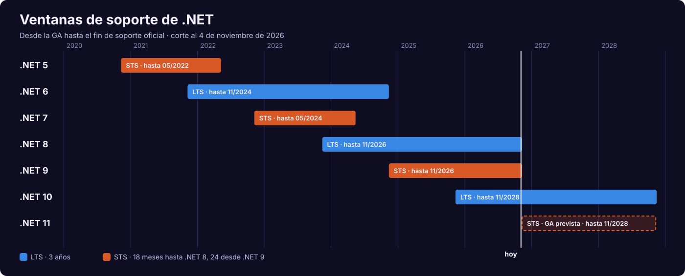
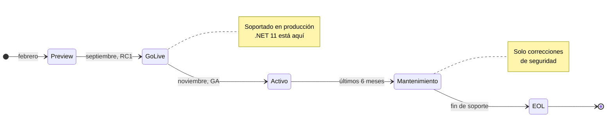
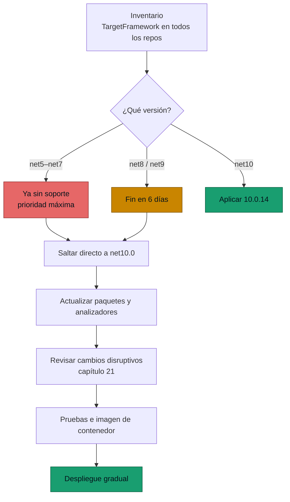

<div align="center">

# 02 · Ciclo de vida y soporte

**LTS, STS, fases, parches, bandas del SDK, sistemas operativos y qué ocurre el 10 de noviembre de 2026**

[⬅ 01 · Genealogía](01-genealogia-y-arquitectura.md) · [🏠 Índice](../README.md) · [03 · .NET 5 ➡](03-net-5-la-unificacion.md)

</div>

> [!CAUTION]
> **Faltan 6 días.** El **10 de noviembre de 2026** terminan a la vez **.NET 8**, **.NET 9** y el modelo *in-process* de
> Azure Functions. Después de esa fecha no recibirán parches de seguridad. Plan de acción en la
> [sección 3](#3-el-10-de-noviembre-de-2026).

---

## Contenido

1. [Estado de todas las versiones](#1-estado-de-todas-las-versiones)
2. [Las reglas del juego](#2-las-reglas-del-juego)
3. [El 10 de noviembre de 2026](#3-el-10-de-noviembre-de-2026)
4. [Parches y bandas del SDK](#4-parches-y-bandas-del-sdk)
5. [Sistemas operativos y hardware](#5-sistemas-operativos-y-hardware)
6. [Componentes con ciclo propio](#6-componentes-con-ciclo-propio)
7. [Calendario hacia adelante](#7-calendario-hacia-adelante)
8. [Fe de erratas de la edición anterior](#8-fe-de-erratas-de-la-edición-anterior)
9. [Referencias](#9-referencias)

---

## 1. Estado de todas las versiones

<p align="center">
  
</p>

| Versión | Tipo | GA | Fin de soporte | Último parche | Último SDK | Fase |
|---|:---:|---|---|---|---|---|
| .NET 5 | STS | 10-nov-2020 | 10-may-2022 | 5.0.17 | 5.0.408 | ⛔ Sin soporte |
| .NET 6 | LTS | 8-nov-2021 | 12-nov-2024 | 6.0.36 | 6.0.428 | ⛔ Sin soporte |
| .NET 7 | STS | 8-nov-2022 | 14-may-2024 | 7.0.20 | 7.0.410 | ⛔ Sin soporte |
| .NET 8 | LTS | 14-nov-2023 | **10-nov-2026** | 8.0.33 | 8.0.427 | 🟠 Mantenimiento |
| .NET 9 | STS | 12-nov-2024 | **10-nov-2026** | 9.0.22 | 9.0.320 | 🟠 Mantenimiento |
| .NET 10 | LTS | 11-nov-2025 | 14-nov-2028 | 10.0.14 | 10.0.403 | 🟢 Activo |
| .NET 11 | STS | Prevista 10–13 nov 2026 | Noviembre de 2028 | 11.0.0-rc.3 | 11.0.100-rc.3.26522.148 | 🟡 *Go-live* |

> [!NOTE]
> Datos tomados de `releases-index.json` y `releases.json` oficiales el 4 de noviembre de 2026. Puedes regenerarlos con
> `python3 tools/actualizar_datos.py`. Al cierre de esta edición **no existe anuncio de GA de .NET 11**.

---

## 2. Las reglas del juego

### 2.1 LTS y STS

| Concepto | LTS | STS |
|---|---|---|
| Duración | Mínimo 3 años, o 1 año después de la siguiente LTS si es más tarde | **24 meses** desde .NET 9; antes 18 |
| Año de publicación | Impares | Pares |
| Número de versión | Par (6, 8, 10) | Impar (5, 7, 9, 11) |
| Calidad | Igual | Igual |
| Diferencia real | Solo la duración | Solo la duración |

> [!IMPORTANT]
> **STS no significa beta.** Microsoft usa los mismos procesos de ingeniería, seguridad y compatibilidad en ambas.
> LTS y STS difieren únicamente en duración.

### 2.2 El cambio de 2025: STS a 24 meses

El 16 de septiembre de 2025 Microsoft extendió STS de 18 a 24 meses, empezando por .NET 9:

| | Antes | Después |
|---|---|---|
| .NET 9 fin de soporte | 12-may-2026 | **10-nov-2026** |
| .NET 8 fin de soporte | 10-nov-2026 | Sin cambios |
| Regla STS | 18 meses | Hasta 12 meses después de su sucesora |

El motivo declarado tiene más profundidad de la que parece: algunos paquetes fuera de banda arrastran dependencias de
.NET 9 hacia aplicaciones que están en .NET 8 LTS. Alinear ambas fechas evita que una aplicación LTS dependa de un
componente STS ya sin soporte.

### 2.3 Fases de soporte



| Fase | ¿Producción? | Qué recibe |
|---|:---:|---|
| Preview | No | Sin soporte |
| Go-Live | Sí | Soporte de Microsoft para RC con licencia *go-live* |
| Activo | Sí | Mejoras funcionales, seguridad, nuevos sistemas operativos |
| Mantenimiento | Sí | Solo seguridad; dura 6 meses |
| EOL | Bajo tu propio riesgo | Nada |

### 2.4 Condición que casi nadie lee

Para calificar al soporte hay que estar en **el último parche**. Si existe 10.0.14 y ejecutas 10.0.8, Microsoft te
pedirá actualizar como primer paso: un parche solo se considera soportado hasta que sale el siguiente.

---

## 3. El 10 de noviembre de 2026

### 3.1 Qué termina

| Elemento | Consecuencia |
|---|---|
| .NET 8 | Último parche previsto: el del ciclo de noviembre, si Microsoft lo publica |
| .NET 9 | Igual |
| Azure Functions *in-process* | Fin de soporte; .NET 10 solo funciona con *isolated worker* |
| .NET 8 y .NET 9 en Azure Functions | Fin de soporte en ambos modelos |
| Linux Consumption | Sin .NET 10: migrar a Flex Consumption |
| PowerShell 7.4 en Functions | Fin de soporte |

### 3.2 Qué no ocurre

- Tus aplicaciones **no dejan de funcionar** ese día en tu infraestructura.
- Las imágenes de contenedor existentes siguen disponibles, pero **dejan de recibir parches**.
- El proveedor de nube puede retirar el runtime según su propio calendario.

### 3.3 Plan de acción de emergencia



Inventario rápido desde la raíz de una organización de repositorios:

```bash
# Target frameworks declarados en proyectos y props compartidos
grep -rhoE '<TargetFrameworks?>[^<]+' --include='*.csproj' --include='*.props' . | sort | uniq -c | sort -rn

# Imágenes base en Dockerfiles
grep -rhE '^FROM .*dotnet' --include='Dockerfile*' . | sort | uniq -c

# Runtimes y SDK instalados en una máquina
dotnet --list-runtimes && dotnet --list-sdks
```

> [!TIP]
> Si no puedes migrar antes del 10 de noviembre, aplica ya **8.0.33** o **9.0.22**. Esos parches del 25 de octubre
> corrigen fallos, entre ellos un *out-of-bounds write* en el decodificador Brotli. Quedarte en un parche antiguo es
> peor que quedarte en el último.

### 3.4 ¿.NET 10 o .NET 11?

Para quien migra esta semana la respuesta corta es **.NET 10**: LTS, con dos años por delante y un año de parches
acumulados. Ambos terminan casi juntos en **noviembre de 2028**, de modo que .NET 11 no ofrece menos tiempo restante,
pero todavía no es GA. Árbol completo en el [capítulo 22](22-guias-de-decision.md).

---

## 4. Parches y bandas del SDK

### 4.1 Cadencia real

La política dice "segundo martes de cada mes" para parches con seguridad. Los datos muestran además parches fuera de
ciclo, como el del **25 de octubre de 2026** y el 10.0.7 del 21 de abril.

| Versión | Parches publicados | Con seguridad | Proporción | CVE acumulados |
|---|---:|---:|---:|---:|
| .NET 5 | 17 | 11 | 65 % | 18 |
| .NET 6 | 34 | 25 | 74 % | 49 |
| .NET 7 | 19 | 16 | 84 % | 41 |
| .NET 8 | 32 | 26 | 81 % | 128 |
| .NET 9 | 22 | 17 | 77 % | 108 |
| .NET 10 | 14 | 11 | 79 % | 97 |

Conteo sobre las versiones estables de `releases.json`. La mayoría de los CVE de .NET 8 y 9 se publicó en 2026
([capítulo 20](20-seguridad-y-cadena-de-suministro.md)).

### 4.2 Bandas del SDK

| Banda | Se alinea con | Qué puede cambiar |
|---|---|---|
| `10.0.1xx` | GA | Primera banda |
| `10.0.2xx` – `4xx` | Versiones menores de Visual Studio | Nuevas versiones de MSBuild, NuGet y compilador |
| Dentro de una banda | Parches | Sin funciones nuevas |

Instalar 10.0.403 sustituye a 10.0.402, pero no a 10.0.1xx. Las bandas conviven porque pueden no ser compatibles entre sí.

---

## 5. Sistemas operativos y hardware

### 5.1 .NET 11 (lista del 28 de septiembre de 2026)

| Familia | Versiones | Arquitecturas |
|---|---|---|
| Android | 17, 16, 15, 14 (API mínima 24) | Arm32, Arm64, x64 |
| iOS / iPadOS | 27, 26, 18 | Arm64 |
| macOS | 27, 26, 15 | Arm64, x64 |
| tvOS | 27 | Arm64 |
| Alpine | 3.24, 3.23 | Arm32, Arm64, x64 |
| Azure Linux | 3.0 | Arm64, x64 |
| CentOS Stream | 10, 9 | Arm64, ppc64le, s390x, x64 |
| Debian | 13 | Arm32, Arm64, x64 |
| Fedora | 45, 44 | Arm32, Arm64, x64 |
| openSUSE Leap | 16.0 | Arm64, x64 |
| RHEL | 10, 9, 8 | Arm64, ppc64le, s390x, x64 |
| SUSE Linux Enterprise | 16.0, 15.7 | Arm64, x64 |
| Ubuntu | 26.04, 24.04, 22.04 | Arm32, Arm64, x64 |
| Windows | 11 (26H1, 25H2, 24H2), 10 LTSC | Arm64, x64, x86 |
| Windows Server | 2025, 23H2, 2022, 2019, 2016 | x64 |

Bibliotecas C mínimas: **glibc 2.27** en x64 y Arm64, **glibc 2.35** en Arm32, **musl 1.2.3** en Alpine. QEMU no está
soportado para ejecutar aplicaciones .NET, algo a considerar al emular Arm64 en CI.

### 5.2 Línea base de CPU 🆕

.NET 11 eleva por primera vez la línea base mínima:

| Plataforma | Mínimo anterior | Mínimo en .NET 11 | Destino ReadyToRun en .NET 11 |
|---|---|---|---|
| x86/x64 Windows y Linux | x86-64-v1 | **x86-64-v2** | x86-64-v3 |
| x86/x64 macOS | x86-64-v1 | **x86-64-v2** | x86-64-v2 |
| Arm64 Windows | armv8.0-a | **armv8.0-a + LSE** | armv8.2-a + RCPC |
| Arm64 Linux | armv8.0-a | Sin cambio | armv8.0-a + LSE |
| Apple Silicon | M1 | Sin cambio | Sin cambio |

Una CPU por debajo de la línea base imprime `The current CPU is missing one or more of the baseline instruction sets`
y no arranca. En hardware soportado pero sin el destino R2R, el arranque puede costar más porque hay más código por JIT.

---

## 6. Componentes con ciclo propio

| Componente | Ciclo | Situación a noviembre de 2026 |
|---|---|---|
| ASP.NET Core | Igual que .NET | — |
| EF Core | Mismos años que .NET; LTS y STS análogos | EF Core 10 es la línea LTS |
| .NET MAUI | **Política propia** por dependencias de Xcode y Android SDK | Soporte ligado a su propia página |
| Aspire | Independiente | 13.x |
| Azure Functions | Política propia | Solo host 4.x |
| .NET Framework 4.8.x | Componente de Windows | 🟢 Soportado |
| .NET Framework 4.6.2 | Fecha fija | 🟠 12-ene-2027 |
| .NET Framework 3.5 SP1 | Fecha fija | 9-ene-2029 |
| Visual Studio 2026 | Propio | Versión 18, publicada junto con .NET 10 |

> [!WARNING]
> Un error frecuente es migrar la aplicación a .NET 10 y olvidar paquetes con TFM anterior. **Lo que manda es el
> soporte de cada dependencia**, no solo el de la aplicación.

---

## 7. Calendario hacia adelante

| Fecha | Evento | Certeza |
|---|---|---|
| 10-nov-2026 | Fin de .NET 8, .NET 9 y *in-process* | ✅ Confirmado |
| 10–13 nov 2026 | .NET Conf 2026 y lanzamiento de .NET 11 | ✅ Evento confirmado, día exacto de GA no publicado |
| 12-ene-2027 | Fin de .NET Framework 4.6.2 | ✅ Confirmado |
| Noviembre de 2027 | .NET 12 LTS | Por política, sin anuncio específico consultado |
| Noviembre de 2028 | Fin de .NET 10 y .NET 11 | ✅ Según páginas oficiales |
| 30-sep-2028 | Retiro de Linux Consumption en Azure Functions | ✅ Confirmado |
| 9-ene-2029 | Fin de .NET Framework 3.5 SP1 | ✅ Confirmado |

---

## 8. Fe de erratas de la edición anterior

Esta edición reemplaza un README que contenía datos desactualizados y afirmaciones que no se sostienen frente a las
fuentes oficiales. Se listan para que nadie las siga repitiendo.

| Afirmación anterior | Realidad verificada |
|---|---|
| ".NET 9 reached end-of-life in May 2026" | Termina el **10-nov-2026**. Hoy sigue soportado |
| ".NET 5 fue la unificación de .NET Core y .NET Framework" | .NET 5 sucede a Core 3.1; **Framework no se fusionó** |
| ".NET 8 is the most recent LTS" | La LTS vigente es .NET 10 |
| "STS" sin precisar duración | STS pasó a 24 meses en 2025 |
| "Native AOT" en .NET 6 | No formó parte de .NET 6; llegó con .NET 7 |
| OSR "improved live debugging and dynamic runtime updates" | OSR cambia código de métodos en ejecución para **rendimiento** |
| C# 12 "improved interpolated strings" | No figura; C# 12 trae constructores primarios, colecciones, alias, entre otros |
| C# 13 "list patterns, required members" | Son de **C# 11** |
| C# 14 "enhanced pattern matching, runtime code generation" | C# 14 trae `extension`, `field`, conversiones de `Span`, entre otros |
| .NET 9 "built-in connectors, ONNX, Dapr templates" | No son funciones de la plataforma .NET 9 |
| .NET 10 "DirectML and CUDA bindings, persistent memory, confidential computing" | Sin respaldo en la documentación de .NET 10 |
| .NET 10 "threaded WebAssembly" | Sin respaldo en la documentación de .NET 10 |
| .NET 11 "Hybrid AOT/JIT adaptive execution", "distributed actor models" | Sin respaldo; lo real es Runtime Async, CoreCLR en móvil y uniones |
| Enlaces `docs.microsoft.com/dotnet/core/dotnet-six` y siguientes | 6 de 7 enlaces devolvían **404** |

---

## 9. Referencias

- [.NET Support Policy](https://dotnet.microsoft.com/platform/support/policy/dotnet-core)
- [.NET release policies](https://github.com/dotnet/core/blob/main/release-policies.md)
- [Releases index JSON](https://github.com/dotnet/core/blob/main/release-notes/releases-index.json)
- [.NET STS releases supported for 24 months](https://devblogs.microsoft.com/dotnet/dotnet-sts-releases-supported-for-24-months/)
- [.NET 11 supported OS](https://github.com/dotnet/core/blob/main/release-notes/11.0/supported-os.md)
- [Compare Azure Functions runtime versions](https://learn.microsoft.com/azure/azure-functions/functions-versions)
- [.NET Conf](https://www.dotnetconf.net/)

---

<div align="center">

[⬅ 01 · Genealogía](01-genealogia-y-arquitectura.md) · [🏠 Índice](../README.md) · [03 · .NET 5 ➡](03-net-5-la-unificacion.md)

</div>
