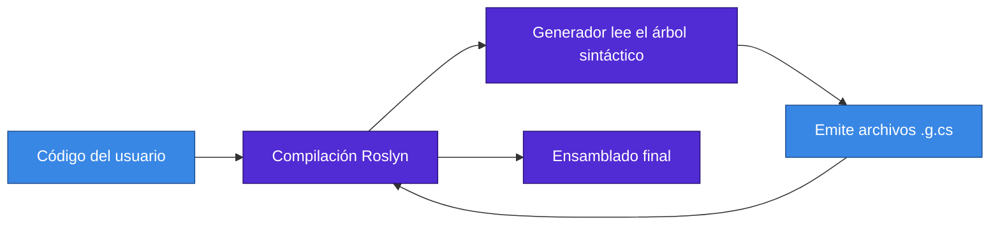

<div align="center">

# 03 · .NET 5: la unificación

**10 de noviembre de 2020 · STS · C# 9 · F# 5 · Un nombre, un TFM y el inicio de la cadencia anual**

[⬅ 02 · Ciclo de vida](02-ciclo-de-vida-y-soporte.md) · [🏠 Índice](../README.md) · [04 · .NET 6 ➡](04-net-6-la-consolidacion.md)

</div>

> [!WARNING]
> ⛔ **.NET 5 terminó su soporte el 10 de mayo de 2022.** Último parche: 5.0.17. Se documenta por su valor histórico y
> como punto de partida de migraciones.

---

## Contenido

1. [Ficha técnica](#1-ficha-técnica)
2. [El significado de esta versión](#2-el-significado-de-esta-versión)
3. [C# 9: el lenguaje cambia de tono](#3-c-9-el-lenguaje-cambia-de-tono)
4. [Generadores de código](#4-generadores-de-código)
5. [Runtime y rendimiento](#5-runtime-y-rendimiento)
6. [System.Text.Json se vuelve utilizable](#6-systemtextjson-se-vuelve-utilizable)
7. [Despliegue](#7-despliegue)
8. [Web y datos](#8-web-y-datos)
9. [Herencia](#9-herencia)
10. [Referencias](#10-referencias)

---

## 1. Ficha técnica

| Dato | Valor |
|---|---|
| Publicación | 10 de noviembre de 2020 |
| Tipo | STS (18 meses en la política de entonces) |
| Fin de soporte | 10 de mayo de 2022 |
| Último parche | 5.0.17 |
| Parches publicados | 17, de los cuales 11 con seguridad |
| CVE corregidos | 18 |
| Lenguajes | C# 9 · F# 5 · Visual Basic 15.9 |
| Visual Studio | 16.8 |
| TFM | `net5.0` |

---

## 2. El significado de esta versión

.NET 5 hizo tres cosas que siguen vigentes:

1. **Estableció la cadencia anual de noviembre**, que no se ha roto desde 2020.
2. **Reemplazó `netcoreapp` y `netstandard` por un TFM único** para aplicaciones y bibliotecas nuevas: `net5.0`.
3. **Quitó "Core" del nombre**, señalando dónde estaría la inversión.

También dejó clara una frontera: `.NET 5 doesn't replace .NET Standard` y tampoco reemplazó a .NET Framework. Para
compartir código con .NET Framework la respuesta siguió siendo `netstandard2.0`, y sigue siéndolo en 2026.

> [!NOTE]
> Lo que .NET 5 no logró fue la unificación completa de escenarios: Xamarin siguió aparte. Esa parte llegaría con
> .NET 6, y la unificación de runtime en móvil tardaría hasta .NET 11.

---

## 3. C# 9: el lenguaje cambia de tono

C# 9 marcó el giro hacia datos inmutables, menos ceremonia y patrones más expresivos.

```csharp
// Top-level statements: sin clase ni Main
using System;

var original = new Persona("Ada", "Lovelace");

// Mutación no destructiva
var casada = original with { Apellido = "King" };

// Igualdad por valor, generada por el compilador
Console.WriteLine(original == new Persona("Ada", "Lovelace")); // True

// Patrones relacionales y lógicos
static string Etapa(int edad) => edad switch
{
    < 0 => "inválida",
    < 18 => "menor",
    >= 18 and < 65 => "adulta",
    _ => "mayor",
};

Console.WriteLine(Etapa(36));

public record Persona(string Nombre, string Apellido);
```

| Función | Qué resolvió | Sigue siendo idiomática |
|---|---|:---:|
| `record` | Igualdad por valor, `ToString`, deconstrucción y `with` | ✅ |
| `init` | Inmutabilidad con sintaxis de inicializador | ✅ |
| Top-level statements | Quita ceremonia del programa de entrada | ✅ |
| Patrones `and`, `or`, `not`, relacionales | Lógica declarativa en `switch` | ✅ |
| `new()` con tipo destino | Menos repetición | ✅ |
| `nint`, `nuint` | Enteros nativos | ✅ |
| Punteros a función `delegate*` | Exponen `ldftn` y `calli` | ✅ Interop |
| `[ModuleInitializer]` | Inicialización sin constructor estático | Solo bibliotecas |

---

## 4. Generadores de código

Los *source generators* no parecían gran cosa en 2020. Con el tiempo fueron la pieza que hizo posible Native AOT:
reemplazan reflexión en tiempo de ejecución por código producido durante la compilación.



| Generador | Llegó en | Reemplaza |
|---|---|---|
| JSON (`JsonSerializerContext`) | .NET 6 | Reflexión en serialización |
| Logging (`LoggerMessage`) | .NET 6 | Formato en tiempo de ejecución |
| Regex (`GeneratedRegex`) | .NET 7 | `Reflection.Emit` de `RegexOptions.Compiled` |
| Interop (`LibraryImport`) | .NET 7 | Código de *marshalling* generado en runtime |
| Configuración y validación de opciones | .NET 8 | Reflexión en `Bind` y `ValidateDataAnnotations` |
| Minimal API (`RequestDelegateGenerator`) | .NET 8 | `Expression` compiladas en arranque |
| Validación de Minimal API | .NET 10 | Reflexión en validación |

Esta tabla resume la tesis de cinco años de plataforma: **mover trabajo del arranque a la compilación**.

---

## 5. Runtime y rendimiento

- **Windows Arm64 e intrínsecos de Arm64.** Primer paso serio del ciclo que termina con Arm64 como plataforma de primera clase.
- **Pooling de `ValueTask` asíncronos**, disponible de forma opcional.
- Mejoras en GC, JSON y `Regex`.
- **Imágenes de contenedor** más pequeñas.
- Herramientas de depuración de volcados.
- **80 % de las bibliotecas anotadas** para tipos de referencia anulables.

> [!TIP]
> Las anotaciones de nulabilidad son rendimiento para humanos: convierten un `NullReferenceException` en una
> advertencia de compilación. Activa `<Nullable>enable</Nullable>` en todo proyecto. Las plantillas lo traen desde .NET 6.

---

## 6. System.Text.Json se vuelve utilizable

Introducido en .NET Core 3.0, en esta versión recibió lo que faltaba para sustituir a Newtonsoft.Json en muchos casos:

| Capacidad | API |
|---|---|
| Referencias circulares | `ReferenceHandler.Preserve` |
| `HttpClient` con JSON | `GetFromJsonAsync`, `PostAsJsonAsync` |
| Números entre comillas | `JsonNumberHandling` |
| Inmutabilidad y records | Constructores con parámetros |
| Campos | `JsonSerializerOptions.IncludeFields` |
| Ignorar según condición | `JsonIgnoreCondition.WhenWritingNull` |
| Diccionarios con clave no cadena | Soportado |
| Valores web por defecto | `JsonSerializerDefaults.Web` |

---

## 7. Despliegue

| Función | En .NET 5 | Evolución posterior |
|---|---|---|
| Archivo único | Sin extracción de ensamblados administrados | Base de muchas CLI |
| Recorte | Sobre todo por ensamblado | .NET 6 recorta tipos y miembros, con advertencias |
| Contenedores | Imágenes más pequeñas | Publicación OCI desde el SDK en .NET 7 |

---

## 8. Web y datos

**ASP.NET Core 5**: Blazor con aislamiento de CSS y carga diferida de ensamblados en WebAssembly, mejoras de gRPC y de
Kestrel, `Model binding` para records.

**EF Core 5**: muchos a muchos sin entidad intermedia explícita, herencia TPT, consultas divididas con `AsSplitQuery`,
`Include` filtrado y logging simple con `LogTo`.

```csharp
var pedidos = await db.Clientes
    .Include(c => c.Pedidos.Where(p => p.Total > 100))
    .AsSplitQuery()
    .ToListAsync();
```

---

## 9. Herencia

| Idea que nació aquí | Dónde está hoy |
|---|---|
| Un TFM para todo | `net10.0` y sufijos de plataforma |
| Publicación anual | Ritmo de 2020 a 2026 sin interrupción |
| `record` | Base de modelos de dominio y DTO |
| Generadores | Fundamento de Native AOT |
| Arm64 | Plataforma de primera clase con SVE en .NET 9 y 11 |

> [!IMPORTANT]
> Si aún tienes .NET 5 en producción, **no migres a .NET 6, 7, 8 o 9**. Salta directamente a `net10.0`. La ruta se
> describe en el [capítulo 21](21-migracion-y-cambios-disruptivos.md).

---

## 10. Referencias

- [What's new in .NET 5](https://learn.microsoft.com/dotnet/core/whats-new/dotnet-5)
- [Performance Improvements in .NET 5](https://devblogs.microsoft.com/dotnet/performance-improvements-in-net-5/)
- [C# language version history](https://learn.microsoft.com/dotnet/csharp/whats-new/csharp-version-history)
- [Ejemplo ejecutable](../ejemplos/net05-records.cs)

---

<div align="center">

[⬅ 02 · Ciclo de vida](02-ciclo-de-vida-y-soporte.md) · [🏠 Índice](../README.md) · [04 · .NET 6 ➡](04-net-6-la-consolidacion.md)

</div>
