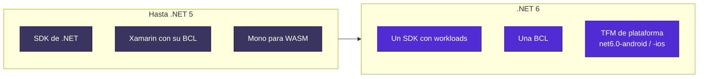

<div align="center">

# 04 · .NET 6: la consolidación

**8 de noviembre de 2021 · LTS · C# 10 · F# 6 · Minimal APIs, Hot Reload y el fin de la unificación**

[⬅ 03 · .NET 5](03-net-5-la-unificacion.md) · [🏠 Índice](../README.md) · [05 · .NET 7 ➡](05-net-7-la-velocidad.md)

</div>

> [!WARNING]
> ⛔ **.NET 6 terminó su soporte el 12 de noviembre de 2024.** Último parche: 6.0.36. Fue la primera LTS de la era
> unificada, y por eso es la versión heredada más común en las empresas.

---

## Contenido

1. [Ficha técnica](#1-ficha-técnica)
2. [Por qué esta versión definió una era](#2-por-qué-esta-versión-definió-una-era)
3. [C# 10: menos ruido por archivo](#3-c-10-menos-ruido-por-archivo)
4. [Minimal APIs](#4-minimal-apis)
5. [Runtime](#5-runtime)
6. [Bibliotecas](#6-bibliotecas)
7. [Hot Reload y herramientas](#7-hot-reload-y-herramientas)
8. [MAUI, un parto largo](#8-maui-un-parto-largo)
9. [Datos: EF Core 6](#9-datos-ef-core-6)
10. [Seguridad y observabilidad](#10-seguridad-y-observabilidad)
11. [Referencias](#11-referencias)

---

## 1. Ficha técnica

| Dato | Valor |
|---|---|
| Publicación | 8 de noviembre de 2021 |
| Tipo | LTS |
| Fin de soporte | 12 de noviembre de 2024 |
| Último parche | 6.0.36 |
| Parches publicados | 34, de los cuales 25 con seguridad |
| CVE corregidos | 49 |
| Lenguajes | C# 10 · F# 6 · Visual Basic 16.9 |
| Visual Studio | 2022 (17.0) |

---

## 2. Por qué esta versión definió una era

La propia documentación lo resume: .NET 6 **entrega las últimas partes del plan de unificación** y unifica SDK,
bibliotecas base y runtime para móvil, escritorio, IoT y nube.



Tres cambios explican su adopción: el estilo mínimo de la plantilla, Visual Studio 2022 de 64 bits y Hot Reload.

---

## 3. C# 10: menos ruido por archivo

```csharp
// GlobalUsings.cs
global using System.Text.Json;

// Pedido.cs
namespace Tienda.Dominio;   // file-scoped: sin llaves ni sangría

public readonly record struct Dinero(decimal Monto, string Moneda);

public record Pedido(int Id, Dinero Total)
{
    // Patrón extendido de propiedades
    public bool EsGrande => this is { Total.Monto: > 1000m };
}
```

| Función | Aporte |
|---|---|
| `global using` y *implicit usings* | Encabezados de archivo casi vacíos |
| *File-scoped namespaces* | Un nivel de sangría menos en todo el código |
| `record struct` | Igualdad por valor sin montículo |
| Tipo natural en lambdas | `var f = (int x) => x * 2;` hace posibles las Minimal APIs |
| Atributos en lambdas | Metadatos en endpoints |
| *Interpolated string handlers* | `$"..."` sin asignaciones cuando el nivel de log está apagado |
| `CallerArgumentExpression` | Base de `ArgumentNullException.ThrowIfNull` |
| Cadenas `const` interpoladas | Cuando todos los valores son constantes |

---

## 4. Minimal APIs

```csharp
var builder = WebApplication.CreateBuilder(args);
var app = builder.Build();

app.MapGet("/saludo/{nombre}", (string nombre) => new { Mensaje = $"Hola, {nombre}" });

app.Run();
```

El detalle técnico interesante: esto solo fue posible porque C# 10 dio **tipo natural a las lambdas**. El lenguaje y
el framework se diseñaron juntos.

| Modelo | Fortaleza | Cuándo elegirlo hoy |
|---|---|---|
| Minimal APIs | Menor costo, compatible con AOT | Microservicios y API nuevas |
| Controladores MVC | Convenciones maduras | Aplicaciones grandes existentes; sin AOT |
| Razor Pages | HTML en servidor | Formularios y portales |
| Blazor | UI interactiva en C# | Equipos de C# de extremo a extremo |

`WebApplication` también unificó `Startup.cs` y `Program.cs`, retirando una generación de código repetitivo.

---

## 5. Runtime

| Mejora | Detalle |
|---|---|
| **PGO dinámico** | Disponible, pero **deshabilitado por defecto**; se activa con `DOTNET_TieredPGO`. Será predeterminado en .NET 8 |
| **Crossgen2** | Reemplaza a Crossgen; está escrito en C# |
| **`FileStream` reescrito** | Nunca bloquea con E/S asíncrona en Windows |
| **Arm64** | Soporte de macOS Apple Silicon y Windows Arm64, nativo y emulación x64 |
| **Recorte** | Elimina tipos y miembros, con advertencias activas por defecto |
| **HTTP/3** | Preview |

> [!NOTE]
> Native AOT **no** formó parte de .NET 6. El trabajo de esa época seguía en un repositorio experimental y llegaría
> como función soportada en .NET 7.

---

## 6. Bibliotecas

**Nuevos tipos que se volvieron cotidianos:**

```csharp
DateOnly cumple = new(1815, 12, 10);
TimeOnly apertura = new(9, 30);

var cola = new PriorityQueue<string, int>();
cola.Enqueue("baja", 10);
cola.Enqueue("alta", 1);
Console.WriteLine(cola.Dequeue()); // alta

var mayor = new[] { 3, 9, 2 }.MaxBy(x => x);
var lotes = Enumerable.Range(1, 10).Chunk(3);
var ultimos = Enumerable.Range(1, 10).Take(^3..);
```

| Área | Novedad |
|---|---|
| LINQ | `Chunk`, `MaxBy`, `MinBy`, `DistinctBy`, `ExceptBy`, `IntersectBy`, `UnionBy`, `TryGetNonEnumeratedCount`, `Take(Range)` |
| JSON | Generador, `JsonNode` editable, `IAsyncEnumerable`, `WriteRawValue`, `IgnoreCycles` |
| Fechas | `DateOnly`, `TimeOnly`; zonas horarias IANA y Windows en cualquier sistema |
| Colecciones | `PriorityQueue<TElement, TPriority>` |
| Logging | `[LoggerMessage]` con generador |
| Reflexión | `NullabilityInfoContext` |
| DI | `CreateAsyncScope` |
| Matemática genérica | Preview |

---

## 7. Hot Reload y herramientas

| Herramienta | Novedad |
|---|---|
| Hot Reload | Aplica cambios a una app en ejecución desde Visual Studio 2022 o `dotnet watch` |
| Workloads | `dotnet workload install maui`: el SDK deja de crecer con todo |
| Validación de paquetes | Detecta cambios incompatibles entre versiones de paquete NuGet |
| Fuente completa | Tarball de código fuente para que distribuciones como Red Hat compilen el SDK |
| TFM de plataforma | `net6.0-android`, `net6.0-ios`, `net6.0-macos` |

---

## 8. MAUI, un parto largo

.NET MAUI **no** llegó con .NET 6: en noviembre de 2021 seguía en preview. La GA se alcanzó en **mayo de 2022**, ya sobre
.NET 6. Ver [capítulo 16](16-clientes-maui-wpf-winforms.md).

---

## 9. Datos: EF Core 6

| Función | Uso |
|---|---|
| Tablas temporales de SQL Server | `ToTable(t => t.IsTemporal())` y `TemporalAsOf` |
| Modelos compilados | Reducen el arranque en modelos grandes |
| Migration bundles | Ejecutable autónomo para aplicar migraciones |
| Configuración previa a convenciones | `ConfigureConventions` |

---

## 10. Seguridad y observabilidad

- **W^X** en preview: ninguna página de memoria es escribible y ejecutable a la vez. Por defecto en Apple Silicon y,
  desde .NET 7, en todas las plataformas.
- **Intel CET** en preview en Windows x64.
- **`System.Diagnostics.Metrics`**: API alineada con la especificación de métricas de OpenTelemetry: `Counter<T>`,
  `Histogram<T>`, `ObservableCounter<T>`, `ObservableGauge<T>`.

> [!IMPORTANT]
> .NET 6 lleva dos años sin parches. Sus CVE posteriores a noviembre de 2024 no reciben corrección. Migra directamente a
> `net10.0`.

---

## 11. Referencias

- [What's new in .NET 6](https://learn.microsoft.com/dotnet/core/whats-new/dotnet-6)
- [Announcing .NET 6](https://devblogs.microsoft.com/dotnet/announcing-net-6/)
- [Performance Improvements in .NET 6](https://devblogs.microsoft.com/dotnet/performance-improvements-in-net-6/)
- [Ejemplo ejecutable](../ejemplos/net06-consolidacion.cs)

---

<div align="center">

[⬅ 03 · .NET 5](03-net-5-la-unificacion.md) · [🏠 Índice](../README.md) · [05 · .NET 7 ➡](05-net-7-la-velocidad.md)

</div>
