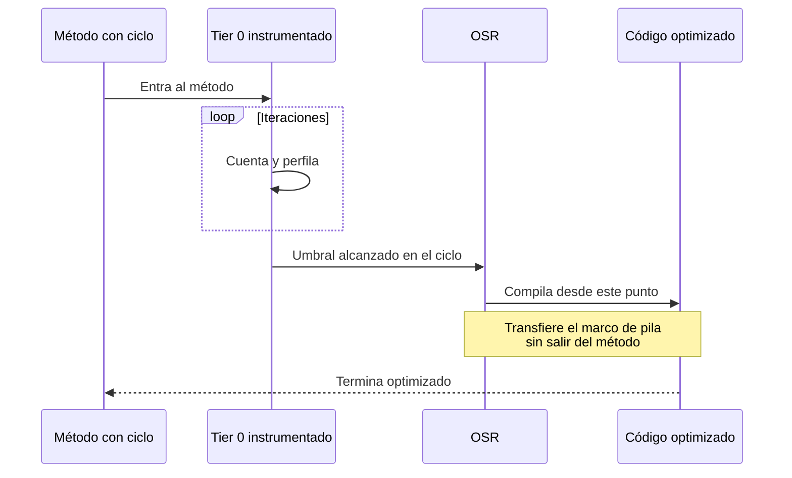

<div align="center">

# 05 · .NET 7: la velocidad

**8 de noviembre de 2022 · STS · C# 11 · F# 7 · OSR, Native AOT, matemática genérica y regex renovado**

[⬅ 04 · .NET 6](04-net-6-la-consolidacion.md) · [🏠 Índice](../README.md) · [06 · .NET 8 ➡](06-net-8-la-nube-nativa.md)

</div>

> [!WARNING]
> ⛔ **.NET 7 terminó su soporte el 14 de mayo de 2024.** Último parche: 7.0.20, publicado el 28 de mayo.

---

## Contenido

1. [Ficha técnica](#1-ficha-técnica)
2. [Una versión de ingeniería pura](#2-una-versión-de-ingeniería-pura)
3. [OSR: cambiar el motor en marcha](#3-osr-cambiar-el-motor-en-marcha)
4. [Native AOT llega al producto](#4-native-aot-llega-al-producto)
5. [C# 11 y matemática genérica](#5-c-11-y-matemática-genérica)
6. [Regex: un motor nuevo](#6-regex-un-motor-nuevo)
7. [System.Text.Json](#7-systemtextjson)
8. [ASP.NET Core 7](#8-aspnet-core-7)
9. [EF Core 7](#9-ef-core-7)
10. [Contenedores sin Dockerfile](#10-contenedores-sin-dockerfile)
11. [Referencias](#11-referencias)

---

## 1. Ficha técnica

| Dato | Valor |
|---|---|
| Publicación | 8 de noviembre de 2022 |
| Tipo | STS |
| Fin de soporte | 14 de mayo de 2024 |
| Último parche | 7.0.20 |
| Parches publicados | 19, de los cuales 16 con seguridad |
| CVE corregidos | 41 |
| Lenguajes | C# 11 · F# 7 |
| Visual Studio | 17.4 |

---

## 2. Una versión de ingeniería pura

La documentación oficial declara el foco: *unified, modern, simple and fast*. Casi cada función relevante es de
infraestructura; lo que un equipo nota es que su código, sin tocarlo, corre mejor.

| Capa | Función clave | Efecto |
|---|---|---|
| JIT | OSR, PGO con OSR | Métodos largos dejan de quedar atrapados en código sin optimizar |
| GC | **Regiones** | Reemplazan segmentos; más flexibilidad para mover memoria entre generaciones |
| Compilador | Native AOT | Binario sin JIT |
| Lenguaje | `static abstract` | Algoritmos numéricos genéricos sin costo de abstracción |
| Bibliotecas | Regex, LINQ, JSON | Vectorización y generadores |
| Seguridad | W^X por defecto | Menor superficie de ataque, con un costo de arranque |

---

## 3. OSR: cambiar el motor en marcha

Antes de .NET 7, un método con ciclos se compilaba directamente optimizado, porque quedarse en Tier 0 dentro de un
ciclo largo era peligroso. Eso perdía la oportunidad de recoger perfil.



OSR tiene un efecto en cadena: con él, `TieredCompilation` puede aplicarse a métodos con ciclos, y PGO recopila datos de
más código. Esto preparó el terreno para activar PGO dinámico por defecto en .NET 8.

> [!NOTE]
> OSR **no** es una función de depuración ni de actualización en vivo. Es una optimización del JIT.

---

## 4. Native AOT llega al producto

```xml
<PropertyGroup>
  <PublishAot>true</PublishAot>
</PropertyGroup>
```

En .NET 7, Native AOT se centró en aplicaciones de consola y exigió que la aplicación fuera recortable. No había
soporte para ASP.NET Core: eso llegó en .NET 8. El [capítulo 12](12-aot-despliegue-y-contenedores.md) explica sus límites.

Compañero indispensable: `[LibraryImport]`, que genera el *marshalling* de P/Invoke en compilación. Requiere
`<AllowUnsafeBlocks>true</AllowUnsafeBlocks>` en el proyecto.

```csharp
using System.Runtime.InteropServices;

internal static partial class Nativo
{
    [LibraryImport("libc", EntryPoint = "getpid")]
    internal static partial int ObtenerPid();
}
```

---

## 5. C# 11 y matemática genérica

Los miembros `static abstract` en interfaces habilitan algo que C# no podía expresar: **operadores sobre un tipo genérico**.

```csharp
using System.Numerics;

static T Sumar<T>(ReadOnlySpan<T> valores) where T : INumber<T>
{
    T total = T.Zero;
    foreach (var v in valores) total += v;
    return total;
}

Console.WriteLine(Sumar<int>(new[] { 1, 2, 3 }));
Console.WriteLine(Sumar<decimal>(new[] { 1.5m, 2.5m }));
```

```csharp
// List patterns, raw strings y required
int[] datos = { 1, 2, 3, 4 };

if (datos is [1, .. var medio, 4])
    Console.WriteLine(medio.Length); // 2

var json = """
    { "nombre": "Ada", "lenguaje": "C#" }
    """;

var c = new Cuenta { Numero = "A-1" };

ReadOnlySpan<byte> utf8 = "HTTP/1.1"u8;

class Cuenta
{
    public required string Numero { get; init; }
}
```

| Función | Aporte |
|---|---|
| Matemática genérica | Interfaces `INumber<T>`, `IAdditionOperators<...>` en la BCL |
| Literales de cadena sin formato | Sin escapes, ideal para JSON, SQL y XML |
| *List patterns* | Coincidencia estructural con `[a, .., z]` |
| `required` | Inicialización obligatoria verificada por el compilador |
| Literales UTF-8 | `"texto"u8` sin conversión en ejecución |
| Atributos genéricos | `[Validar<T>]` |
| Campos `ref` y `scoped` | Fundamento de `Span<T>` escrito en C# |
| Tipos `file` | Visibilidad de archivo para generadores |

---

## 6. Regex: un motor nuevo

```csharp
using System.Text.RegularExpressions;

public static partial class Patrones
{
    [GeneratedRegex(@"\b[\w.]+@[\w.]+\.\w+\b", RegexOptions.IgnoreCase)]
    public static partial Regex Correo();
}
```

| Modo | Costo en arranque | Rendimiento | Compatible con AOT |
|---|---|---|:---:|
| Interpretado | Bajo | Bajo | ✅ |
| `RegexOptions.Compiled` | Alto (`Reflection.Emit`) | Alto | ❌ |
| `[GeneratedRegex]` | **Cero** | Alto | ✅ |
| `RegexOptions.NonBacktracking` | Medio | Lineal garantizado | ✅ |

> [!IMPORTANT]
> `NonBacktracking` garantiza tiempo lineal respecto a la entrada y protege contra **ReDoS** cuando el patrón o la
> entrada no son de confianza. Tiene restricciones, como no permitir búsqueda de derecha a izquierda.

---

## 7. System.Text.Json

- **Personalización de contratos** con `DefaultJsonTypeInfoResolver`.
- **Polimorfismo** con `[JsonPolymorphic]` y `[JsonDerivedType]`.
- **Miembros requeridos** en deserialización.

```csharp
[JsonPolymorphic(TypeDiscriminatorPropertyName = "tipo")]
[JsonDerivedType(typeof(Tarjeta), "tarjeta")]
[JsonDerivedType(typeof(Transferencia), "transferencia")]
public abstract record Pago(decimal Monto);

public record Tarjeta(decimal Monto, string Ultimos4) : Pago(Monto);
public record Transferencia(decimal Monto, string Clabe) : Pago(Monto);
```

---

## 8. ASP.NET Core 7

| Función | Uso |
|---|---|
| Rate limiting | `AddRateLimiter` con ventana fija, deslizante, token bucket y concurrencia |
| Output caching | `AddOutputCache` |
| Endpoint filters | Lógica transversal en Minimal APIs |
| Route groups | `MapGroup("/api/v1")` |
| Typed results | `TypedResults.Ok(...)` con metadatos para OpenAPI |
| HTTP/3 | Soportado en Kestrel |
| `dotnet user-jwts` | Tokens para desarrollo |
| gRPC JSON transcoding | Expone gRPC como REST |

---

## 9. EF Core 7

```csharp
// Sin cargar entidades en memoria
await db.Pedidos
    .Where(p => p.Fecha < limite)
    .ExecuteDeleteAsync();

await db.Productos
    .Where(p => p.Categoria == "A")
    .ExecuteUpdateAsync(s => s.SetProperty(p => p.Precio, p => p.Precio * 1.1m));
```

También trajo columnas JSON, herencia TPC e interceptores adicionales.

---

## 10. Contenedores sin Dockerfile

El SDK de .NET 7 empezó a construir imágenes OCI directamente:

```bash
dotnet publish --os linux --arch x64 /t:PublishContainer
```

Una idea simple con mucho alcance: **la imagen se vuelve otro artefacto de compilación**. Desde .NET 8 produce imágenes
*non-root* por defecto.

> [!NOTE]
> Por qué importa una versión que duró solo 18 meses: casi todo lo que hoy se percibe como "el rendimiento de .NET 8" se
> construyó aquí.

---

## 11. Referencias

- [What's new in .NET 7](https://learn.microsoft.com/dotnet/core/whats-new/dotnet-7)
- [Performance Improvements in .NET 7](https://devblogs.microsoft.com/dotnet/performance_improvements_in_net_7/)
- [Regular expression improvements in .NET 7](https://devblogs.microsoft.com/dotnet/regular-expression-improvements-in-dotnet-7/)
- [Ejemplo ejecutable](../ejemplos/net07-matematica-generica.cs)

---

<div align="center">

[⬅ 04 · .NET 6](04-net-6-la-consolidacion.md) · [🏠 Índice](../README.md) · [06 · .NET 8 ➡](06-net-8-la-nube-nativa.md)

</div>
