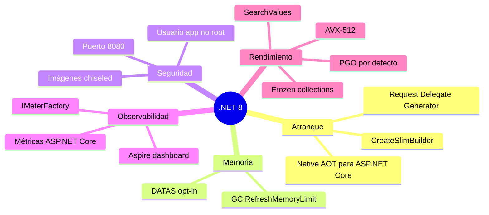
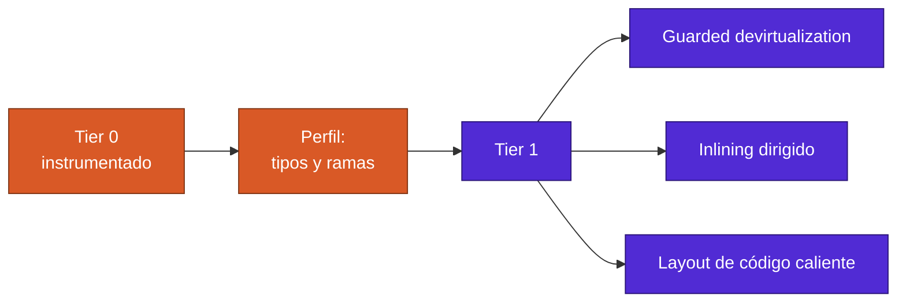
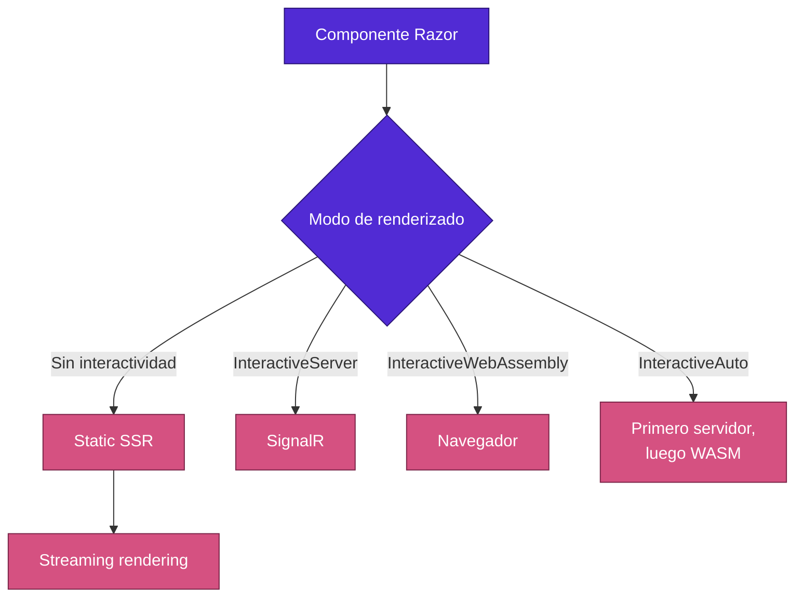

<div align="center">

# 06 · .NET 8: la nube nativa

**14 de noviembre de 2023 · LTS · C# 12 · F# 8 · PGO por defecto, Native AOT web, Blazor unificado y Aspire**

[⬅ 05 · .NET 7](05-net-7-la-velocidad.md) · [🏠 Índice](../README.md) · [07 · .NET 9 ➡](07-net-9-la-adaptacion.md)

</div>

> [!CAUTION]
> 🟠 **.NET 8 termina su soporte el 10 de noviembre de 2026, dentro de 6 días.** Último parche disponible al cierre: 8.0.33.
> Migra a `net10.0` ([capítulo 21](21-migracion-y-cambios-disruptivos.md)).

---

## Contenido

1. [Ficha técnica](#1-ficha-técnica)
2. [La tesis: optimizar para contenedores](#2-la-tesis-optimizar-para-contenedores)
3. [Runtime: PGO dinámico, AVX-512 y memoria](#3-runtime-pgo-dinámico-avx-512-y-memoria)
4. [Native AOT llega a la web](#4-native-aot-llega-a-la-web)
5. [C# 12](#5-c-12)
6. [Bibliotecas orientadas a rendimiento](#6-bibliotecas-orientadas-a-rendimiento)
7. [Extensiones: DI, opciones y métricas](#7-extensiones-di-opciones-y-métricas)
8. [Blazor se unifica](#8-blazor-se-unifica)
9. [Contenedores seguros por defecto](#9-contenedores-seguros-por-defecto)
10. [EF Core 8](#10-ef-core-8)
11. [Aspire nace](#11-aspire-nace)
12. [Referencias](#12-referencias)

---

## 1. Ficha técnica

| Dato | Valor |
|---|---|
| Publicación | 14 de noviembre de 2023 |
| Tipo | LTS |
| Fin de soporte | **10 de noviembre de 2026** |
| Último parche | 8.0.33 (25-oct-2026) |
| Parches publicados | 32, de los cuales 26 con seguridad |
| CVE corregidos | 128 |
| Lenguajes | C# 12 · F# 8 |
| Visual Studio | 17.8 |

---

## 2. La tesis: optimizar para contenedores

.NET 8 asume que el destino por defecto es un contenedor Linux con límites de CPU y memoria, que escala hacia arriba y
hacia abajo, y al que se le exige arrancar rápido.



---

## 3. Runtime: PGO dinámico, AVX-512 y memoria

### 3.1 PGO dinámico por defecto

Es el cambio de mayor efecto por menor esfuerzo de los últimos años: **sin tocar código**, el JIT usa datos reales de
ejecución para decidir qué devirtualizar y qué inlinear.

Microsoft reporta en la documentación de .NET 8 que **en promedio aumenta el rendimiento alrededor de 15 %**, y que en
un conjunto de cerca de 4 600 pruebas, **el 23 % mejoró 20 % o más**.



### 3.2 SIMD: AVX-512 y `Vector512<T>`

| Elemento | Detalle |
|---|---|
| `Vector512<T>` | Registros de 512 bits con API portable |
| `Avx512F`, `Avx512BW`, etc. | Intrínsecos específicos |
| Desenrollado | JIT y Native AOT vectorizan copia, comparación y puesta a cero cuando conocen el tamaño |

### 3.3 Memoria en la nube

```csharp
AppContext.SetData("GCHeapHardLimit", (ulong)100 * 1_024 * 1_024);
GC.RefreshMemoryLimit();
```

`GC.RefreshMemoryLimit` permite reducir el límite de memoria sin reiniciar. Si el escalado es demasiado agresivo, la
llamada falla; entonces conviene compactar con `GC.Collect(2, GCCollectionMode.Aggressive)` y reintentar.

**DATAS** llegó como opción: adapta el tamaño del heap en Server GC al de los datos activos. Se volvió predeterminado en
.NET 9.

---

## 4. Native AOT llega a la web

Mejoras de .NET 8 sobre Native AOT:

| Sistema | .NET 7 | .NET 8 |
|---|---:|---:|
| Linux x64 (con `StripSymbols`) | 3.76 MB | 1.84 MB |
| Windows x64 | 2.85 MB | 1.77 MB |

Datos oficiales para "Hello World". Además añadió macOS x64 y Arm64, y plataformas similares a iOS de forma
experimental.

```csharp
using System.Text.Json.Serialization;

var builder = WebApplication.CreateSlimBuilder(args);

builder.Services.ConfigureHttpJsonOptions(o =>
    o.SerializerOptions.TypeInfoResolverChain.Insert(0, ContextoJson.Default));

var app = builder.Build();
app.MapGet("/saludo", () => new Saludo("hola"));
app.Run();

public record Saludo(string Texto);

[JsonSerializable(typeof(Saludo))]
internal partial class ContextoJson : JsonSerializerContext { }
```

| Soporte en .NET 8 | Estado |
|---|:---:|
| Minimal APIs | Parcial, con generador |
| gRPC | ✅ |
| JWT | ✅ |
| MVC | ❌ |
| Blazor Server | ❌ |
| SignalR | Parcial |
| EF Core | ❌ |

`CreateSlimBuilder` retira funciones poco usadas en contenedores, como HTTPS en Kestrel por defecto, y reduce el tamaño.
La plantilla `webapiaot` arma el escenario.

El **Request Delegate Generator** reemplaza `Expression` compiladas por código generado, y lo intercepta con la función
experimental *interceptors* de C# 12.

---

## 5. C# 12

```csharp
// Constructores primarios: parámetros disponibles en toda la clase
public class ServicioPedidos(IRepositorio repo, ILogger<ServicioPedidos> log)
{
    public async Task<Pedido?> ObtenerAsync(int id)
    {
        log.LogInformation("Buscando {Id}", id);
        return await repo.BuscarAsync(id);
    }
}

// Expresiones de colección
int[] primos = [2, 3, 5, 7];
List<int> mas = [.. primos, 11, 13];
ReadOnlySpan<char> vocales = ['a', 'e', 'i', 'o', 'u'];

// Alias de cualquier tipo
using Punto = (double X, double Y);
```

| Función | Observación experta |
|---|---|
| Constructores primarios | Los parámetros **no** son propiedades; si se capturan, generan un campo mutable |
| Expresiones de colección | El compilador elige la forma más eficiente según el tipo destino |
| Alias de cualquier tipo | Tuplas nombradas reutilizables |
| Lambdas con valores por defecto | `(int x = 1) => x` |
| `ref readonly` | Parámetros de solo lectura por referencia |
| Inline arrays | `[InlineArray(n)]`, búferes seguros de tamaño fijo |
| `[Experimental]` | Marca API experimentales con diagnósticos propios |
| Interceptors | 🧪 Experimental en C# 12 |

---

## 6. Bibliotecas orientadas a rendimiento

```csharp
using System.Buffers;
using System.Collections.Frozen;

// Se crea una vez, se lee millones de veces
FrozenDictionary<string, int> codigos =
    new Dictionary<string, int> { ["MX"] = 52, ["ES"] = 34 }.ToFrozenDictionary();

// Búsqueda vectorizada de un conjunto de caracteres
SearchValues<char> separadores = SearchValues.Create(",;|");
int i = "a,b;c".AsSpan().IndexOfAny(separadores);

// Tiempo comprobable
TimeProvider reloj = TimeProvider.System;
var ahora = reloj.GetUtcNow();
```

| API | Problema que resuelve |
|---|---|
| `FrozenDictionary`, `FrozenSet` | Lecturas más rápidas a cambio de un costo de creación mayor |
| `SearchValues<T>` | Conjuntos de búsqueda optimizados una vez y vectorizados |
| `CompositeFormat` | Formato compuesto preanalizado |
| `TimeProvider`, `ITimer` | Abstracción oficial del tiempo para pruebas |
| `Random.GetItems`, `Shuffle` | Muestreo y barajado |
| `IUtf8SpanFormattable` | Formato directo a UTF-8 |
| `ZipFile` con `Stream` | Sin pasar por disco |
| `TensorPrimitives` | Operaciones numéricas vectorizadas para IA |

**JSON**: interfaz de jerarquías, nuevas políticas de nombres (`snake_case`, `kebab-case`), miembros no públicos,
`JsonSerializerOptions.MakeReadOnly`, API de deserialización en *streaming* y una opción para deshabilitar la reflexión
por defecto.

---

## 7. Extensiones: DI, opciones y métricas

```csharp
builder.Services.AddKeyedSingleton<IAlmacen, AlmacenBlob>("blob");
builder.Services.AddKeyedSingleton<IAlmacen, AlmacenLocal>("local");

public class Exportador([FromKeyedServices("blob")] IAlmacen almacen);
```

| Función | Uso |
|---|---|
| Keyed services | Varios servicios para una interfaz, sin factorías manuales |
| `IHostedLifecycleService` | Ganchos antes y después de iniciar y detener |
| Generadores de configuración y validación de opciones | Compatibles con AOT |
| `IMeterFactory` | Métricas integradas con DI |
| `MetricCollector<T>` | Pruebas de métricas |

---

## 8. Blazor se unifica

La plantilla **Blazor Web App** combina todos los modos en una aplicación:



Además: navegación mejorada, QuickGrid, secciones, UI de Identity, Jiterpreter y empaquetado Webcil.

**Otras novedades de ASP.NET Core 8:** `MapIdentityApi`, `IExceptionHandler`, enlace a formularios en Minimal APIs,
antiforgery, reconexión con estado en SignalR, tiempos de espera de solicitud y métricas integradas.

---

## 9. Contenedores seguros por defecto

| Cambio | Antes | .NET 8 |
|---|---|---|
| Puerto predeterminado | 80 | **8080** (`ASPNETCORE_HTTP_PORTS`) |
| Usuario | root | Existe `app`, UID **1654** (`APP_UID`) |
| Distro | Debian | Debian, más opciones *chiseled* |
| Imagen mínima | Alpine | **Ubuntu chiseled**: sin shell ni gestor de paquetes |
| `dotnet publish` | Root | **Non-root** por defecto |

```dockerfile
FROM mcr.microsoft.com/dotnet/aspnet:8.0-jammy-chiseled
COPY --from=build /app .
USER $APP_UID
ENTRYPOINT ["dotnet", "App.dll"]
```

> [!WARNING]
> El cambio al puerto 8080 rompió muchos manifiestos de Kubernetes y proxies. Las imágenes *chiseled* no incluyen
> globalización: usa la variante `-extra` si requieres `icu` y `tzdata`.

---

## 10. EF Core 8

| Función | Ejemplo |
|---|---|
| Tipos complejos | Objetos de valor sin clave: `[ComplexType]` |
| Colecciones primitivas | `List<int>` se almacena como JSON |
| Mejoras de columnas JSON | Consultas en más proveedores |
| `HierarchyId` | Para SQL Server |
| SQL crudo sobre tipos no mapeados | `SqlQuery<T>` |
| Valores centinela | Detección de valores predeterminados |

---

## 11. Aspire nace

Anunciado junto a .NET 8 en preview, **.NET Aspire 8** alcanzó GA en **mayo de 2024**: orquestación local, descubrimiento
de servicios, componentes con telemetría y un panel de OpenTelemetry. Se detalla en el
[capítulo 17](17-cloud-native-aspire-y-observabilidad.md).

---

## 12. Referencias

- [What's new in .NET 8](https://learn.microsoft.com/dotnet/core/whats-new/dotnet-8/overview)
- [What's new in the .NET 8 runtime](https://learn.microsoft.com/dotnet/core/whats-new/dotnet-8/runtime)
- [.NET 8 container enhancements](https://learn.microsoft.com/dotnet/core/whats-new/dotnet-8/containers)
- [What's new in ASP.NET Core 8](https://learn.microsoft.com/aspnet/core/release-notes/aspnetcore-8.0)
- [What's new in EF Core 8](https://learn.microsoft.com/ef/core/what-is-new/ef-core-8.0/whatsnew)
- [Ejemplo ejecutable](../ejemplos/net08-rendimiento.cs)

---

<div align="center">

[⬅ 05 · .NET 7](05-net-7-la-velocidad.md) · [🏠 Índice](../README.md) · [07 · .NET 9 ➡](07-net-9-la-adaptacion.md)

</div>
