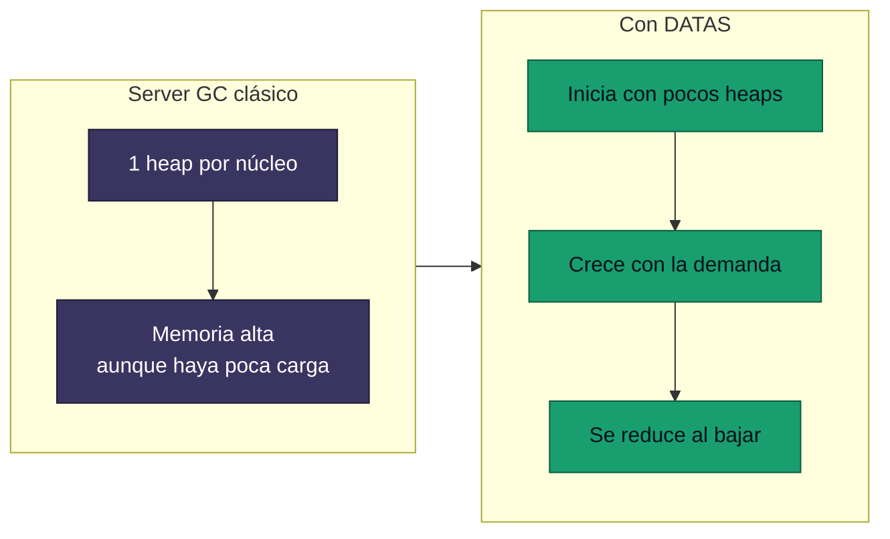

<div align="center">

# 07 · .NET 9: la adaptación

**12 de noviembre de 2024 · STS de 24 meses · C# 13 · F# 9 · DATAS por defecto, excepciones nuevas, OpenAPI y HybridCache**

[⬅ 06 · .NET 8](06-net-8-la-nube-nativa.md) · [🏠 Índice](../README.md) · [08 · .NET 10 ➡](08-net-10-la-madurez.md)

</div>

> [!CAUTION]
> 🟠 **.NET 9 termina su soporte el 10 de noviembre de 2026**, no en mayo de 2026 como decía la edición anterior.
> La política STS se amplió a 24 meses en septiembre de 2025. Último parche al cierre: 9.0.22.

---

## Contenido

1. [Ficha técnica](#1-ficha-técnica)
2. [El runtime se adapta a la carga](#2-el-runtime-se-adapta-a-la-carga)
3. [Excepciones más rápidas](#3-excepciones-más-rápidas)
4. [JIT: ciclos y pila](#4-jit-ciclos-y-pila)
5. [C# 13](#5-c-13)
6. [Bibliotecas](#6-bibliotecas)
7. [BinaryFormatter desaparece](#7-binaryformatter-desaparece)
8. [ASP.NET Core 9](#8-aspnet-core-9)
9. [Clientes y datos](#9-clientes-y-datos)
10. [SDK](#10-sdk)
11. [La primera capa de IA](#11-la-primera-capa-de-ia)
12. [Referencias](#12-referencias)

---

## 1. Ficha técnica

| Dato | Valor |
|---|---|
| Publicación | 12 de noviembre de 2024 |
| Tipo | STS, primera con 24 meses |
| Fin de soporte | **10 de noviembre de 2026** |
| Último parche | 9.0.22 (25-oct-2026) |
| Parches publicados | 22, de los cuales 17 con seguridad |
| CVE corregidos | 108 |
| Lenguajes | C# 13 · F# 9 |
| Visual Studio | 17.12 |

---

## 2. El runtime se adapta a la carga

**DATAS** (*Dynamic Adaptation To Application Sizes*) pasa a estar **activado por defecto** con Server GC. Su meta: que
el tamaño del heap sea más o menos proporcional a los datos activos, y no a la cantidad de núcleos.



| Variable | Efecto |
|---|---|
| `System.GC.DynamicAdaptationMode=0` | Deshabilita DATAS |
| `DOTNET_GCDynamicAdaptationMode=0` | Igual, por entorno |

> [!TIP]
> Para servicios de alto rendimiento con carga constante, DATAS puede sacrificar algo de rendimiento por menor memoria.
> Si tu límite de contenedor sobra y tu prioridad es el throughput, mide con DATAS encendido y apagado.

---

## 3. Excepciones más rápidas

CoreCLR adoptó el modelo de excepciones de NativeAOT y dejó atrás la emulación de SEH en Unix. Microsoft reporta que
la nueva implementación es **de 2 a 4 veces más rápida** en microbenchmarks. Funciona en todos los entornos excepto
Windows x86 de 32 bits.

El [laboratorio de este atlas](24-laboratorio.md) incluye una medición propia en Apple M4.

> [!NOTE]
> Que lanzar una excepción sea más rápido no la convierte en flujo de control. Sigue siendo mucho más cara que un valor
> de retorno; lo que cambia es el costo durante un incidente, cuando se lanzan por miles.

---

## 4. JIT: ciclos y pila

| Optimización | Qué hace |
|---|---|
| Ampliación de variables de inducción | Evita extensiones repetidas de índice de 32 a 64 bits |
| Direccionamiento post-indexado en Arm64 | Combina carga e incremento |
| Reducción de fuerza | Sustituye multiplicaciones por sumas |
| Dirección del contador | Cuenta hacia cero cuando conviene |
| PGO en verificaciones de tipo | Casts más rápidos cuando el perfil lo justifica |
| Asignación en pila de *boxes* | Objetos en caja que no escapan no van al heap |
| Arm64 SVE | Soporte inicial |
| AVX10v1 | Soporte inicial |
| Plegado constante en SIMD y coma flotante | Más cálculo en compilación |

---

## 5. C# 13

```csharp
using System.Threading;

// params con Span: sin array en el heap
static int Sumar(params ReadOnlySpan<int> numeros)
{
    int total = 0;
    foreach (var n in numeros) total += n;
    return total;
}

Console.WriteLine(Sumar(1, 2, 3));

// Tipo Lock dedicado
var candado = new Lock();
lock (candado)
{
    Console.WriteLine("sección crítica");
}

// Secuencia de escape para ESC
Console.WriteLine("\e[1mnegrita\e[0m");
```

| Función | Para quién |
|---|---|
| `params` con colecciones | Autores de API; evita asignaciones |
| `System.Threading.Lock` | Código concurrente; `lock` lo reconoce y usa su `EnterScope` |
| `\e` | Terminales |
| Índice implícito `^` en inicializadores | Uso general |
| `ref` y `unsafe` en iteradores y `async` | Código de bajo nivel |
| `allows ref struct` | Genéricos sobre `Span<T>` |
| Interfaces en `ref struct` | Código de bajo nivel |
| Propiedades e indexadores `partial` | Generadores, como `[GeneratedRegex]` en propiedades |
| `[OverloadResolutionPriority]` | Autores de bibliotecas |

> [!WARNING]
> En C# 13, `field` existía solo como preview. Se estabilizó en C# 14.

---

## 6. Bibliotecas

```csharp
using System.Buffers.Text;

// Procesar tareas según terminan
var tareas = Enumerable.Range(1, 3).Select(async i =>
{
    await Task.Delay(100 * (4 - i));
    return i;
});

await foreach (var t in Task.WhenEach(tareas))
    Console.WriteLine(await t);

// Agregaciones sin GroupBy intermedio
var conteo = new[] { "a", "b", "a" }.CountBy(x => x);

// UUID v7 ordenable por tiempo
Guid id = Guid.CreateVersion7();

// Base64 seguro para URL
string token = Base64Url.EncodeToString([1, 2, 3]);
```

| Área | Novedad |
|---|---|
| LINQ | `CountBy`, `AggregateBy`, `Index` |
| Colecciones | `OrderedDictionary<TKey,TValue>`, `ReadOnlySet<T>`, búsquedas con `Span` en diccionarios, `PriorityQueue.Remove` |
| Tareas | `Task.WhenEach` |
| Canales | `Channel.CreateUnboundedPrioritized` |
| JSON | `JsonSchemaExporter`, `RespectNullableAnnotations`, `RespectRequiredConstructorParameters`, `JsonSerializerOptions.Web`, `JsonStringEnumMemberName`, varias raíces en un stream |
| Regex | `[GeneratedRegex]` en propiedades, `Regex.EnumerateSplits` |
| Cripto | `CryptographicOperations.HashData`, KMAC, `X509CertificateLoader` |
| Red | `System.Net.ServerSentEvents`, keep-alive de WebSocket, `SocketsHttpHandler` por defecto en `HttpClientFactory` |
| Compresión | **zlib-ng** reemplaza a zlib |
| Reflexión | `PersistedAssemblyBuilder` guarda ensamblados emitidos |
| Numéricos | `Tensor<T>` (experimental), límite de `BigInteger`, `BigMul` |
| Diagnóstico | `Activity.AddLink`, `Metrics.Gauge`, `Debug.Assert` informa la condición |

---

## 7. BinaryFormatter desaparece

> [!CAUTION]
> Desde .NET 9 las API de `BinaryFormatter` siguen presentes, pero su implementación **siempre lanza excepción**. Es la
> conclusión de años de advertencias por deserialización insegura. El paquete de compatibilidad no es una estrategia:
> migra a `System.Text.Json`, MessagePack o protobuf.

Otros cambios relevantes en esta versión:

- `HttpClientFactory` deja de registrar valores de encabezados por defecto.
- Conversiones de coma flotante a entero **saturan** en x86/x64.
- CET activado por defecto en Windows.
- Las variables de entorno tienen precedencia sobre `runtimeconfig.json`.

---

## 8. ASP.NET Core 9

| Función | Detalle |
|---|---|
| `MapStaticAssets` | Compresión, ETag y huellas en compilación; reemplaza a `UseStaticFiles` en muchas apps |
| `Microsoft.AspNetCore.OpenApi` | Documentos OpenAPI integrados; Swashbuckle sale de las plantillas |
| **HybridCache** | Caché L1 y L2, protección contra estampida y serialización configurable |
| Blazor | `RendererInfo`, `AssignedRenderMode`, reconexión mejorada, plantilla MAUI + Blazor Web |
| SignalR | Hubs con tipos polimórficos, trazas de actividad |
| Certificado de desarrollo | Mejor confianza en Linux |
| Autenticación | Nuevas opciones para OIDC |

```csharp
public class Catalogo(HybridCache cache, IProductos productos)
{
    public ValueTask<Producto?> ObtenerAsync(int id, CancellationToken ct) =>
        cache.GetOrCreateAsync(
            $"producto:{id}",
            async token => await productos.BuscarAsync(id, token),
            cancellationToken: ct);
}
```

> [!NOTE]
> `HybridCache` se publicó como paquete `Microsoft.Extensions.Caching.Hybrid`, no como parte del framework compartido.

---

## 9. Clientes y datos

**.NET MAUI 9**: foco en calidad, nuevos controles `HybridWebView` y `TitleBar`, y `CollectionView` y `CarouselView`
con nuevos manejadores opcionales en iOS y Mac Catalyst.

**WPF**: tema Fluent para Windows 11.

**Windows Forms**: API asíncronas de formularios y modo oscuro experimental.

**EF Core 9**:

| Función | Estado |
|---|---|
| Proveedor Cosmos DB renovado | 🟢 Claves de partición jerárquicas, mejor LINQ |
| AOT y consultas precompiladas | 🧪 Experimental |
| Bloqueo de migraciones | 🟢 Evita aplicar migraciones concurrentes |
| `HierarchyId` | 🟢 Mejorado |
| `UseSeeding` | 🟢 Nuevo modelo de datos iniciales |

---

## 10. SDK

| Función | Uso |
|---|---|
| Terminal Logger por defecto | Salida de compilación legible |
| Resolución de NuGet más rápida | Nuevo algoritmo para repositorios grandes |
| BuildChecks | Analizadores de scripts de MSBuild |
| Workload sets | Versiones coherentes de workloads |
| Pruebas en paralelo | `dotnet test` por TFM |
| Herramientas | `--allow-roll-forward` para ejecutar en runtimes más nuevos |
| Contenedores | Publicación a registros inseguros |

---

## 11. La primera capa de IA

Sin "conectores integrados" en el runtime: la capa de IA de .NET llega como paquetes.

- **`Microsoft.Extensions.AI`**: `IChatClient`, abstracciones comunes.
- **`Tensor<T>`** y más `TensorPrimitives`.
- **`Microsoft.ML.Tokenizers`**.

Detalle en el [capítulo 18](18-ia-en-net.md).

---

## 12. Referencias

- [What's new in .NET 9](https://learn.microsoft.com/dotnet/core/whats-new/dotnet-9/overview)
- [What's new in the .NET 9 runtime](https://learn.microsoft.com/dotnet/core/whats-new/dotnet-9/runtime)
- [What's new in .NET 9 libraries](https://learn.microsoft.com/dotnet/core/whats-new/dotnet-9/libraries)
- [What's new in EF Core 9](https://learn.microsoft.com/ef/core/what-is-new/ef-core-9.0/whatsnew)
- [Ejemplo ejecutable](../ejemplos/net09-adaptacion.cs)

---

<div align="center">

[⬅ 06 · .NET 8](06-net-8-la-nube-nativa.md) · [🏠 Índice](../README.md) · [08 · .NET 10 ➡](08-net-10-la-madurez.md)

</div>
