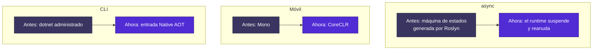
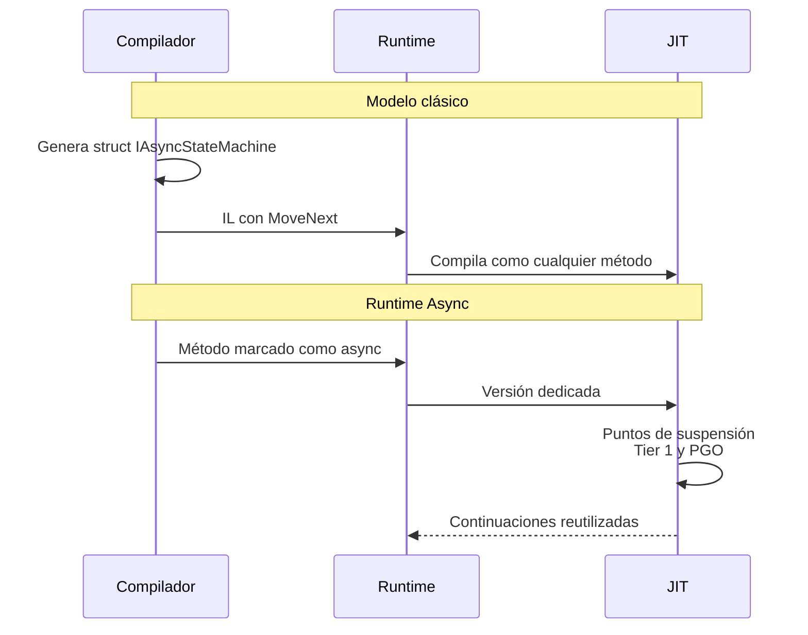

<div align="center">

# 09 · .NET 11: la reescritura silenciosa

**GA prevista en .NET Conf, 10 al 13 de noviembre de 2026 · STS · C# 15 · F# 11 · Uniones, Runtime Async y CoreCLR en móvil**

[⬅ 08 · .NET 10](08-net-10-la-madurez.md) · [🏠 Índice](../README.md) · [10 · Lenguajes ➡](10-lenguajes-csharp-fsharp-vb.md)

</div>

> [!IMPORTANT]
> 🟡 **Estado al 4 de noviembre de 2026: Release Candidate 3, con licencia *go-live*.** No hay GA todavía. Todo este
> capítulo describe RC3 (`11.0.100-rc.3.26522.148`) y puede variar en detalle en la versión final. Los ejemplos de C# 15
> de este atlas se **compilaron y ejecutaron** contra ese SDK.

---

## Contenido

1. [Ficha técnica](#1-ficha-técnica)
2. [Por qué "reescritura silenciosa"](#2-por-qué-reescritura-silenciosa)
3. [Runtime Async](#3-runtime-async)
4. [C# 15: uniones y jerarquías cerradas](#4-c-15-uniones-y-jerarquías-cerradas)
5. [Modelo de seguridad de memoria](#5-modelo-de-seguridad-de-memoria)
6. [JIT y hardware](#6-jit-y-hardware)
7. [CoreCLR llega a móvil y avanza en WebAssembly](#7-coreclr-llega-a-móvil-y-avanza-en-webassembly)
8. [Bibliotecas](#8-bibliotecas)
9. [ASP.NET Core 11](#9-aspnet-core-11)
10. [EF Core 11](#10-ef-core-11)
11. [SDK: la CLI se compila a sí misma](#11-sdk-la-cli-se-compila-a-sí-misma)
12. [Clientes](#12-clientes)
13. [F# 11](#13-f-11)
14. [Cambios disruptivos más sensibles](#14-cambios-disruptivos-más-sensibles)
15. [¿Debes adoptarla?](#15-debes-adoptarla)
16. [Referencias](#16-referencias)

---

## 1. Ficha técnica

| Dato | Valor |
|---|---|
| Estado | RC3 con *go-live* |
| Previas | 7 previews y 3 RC, de febrero a octubre de 2026 |
| GA | Prevista durante .NET Conf, del 10 al 13 de noviembre; fecha exacta sin anuncio |
| Tipo | STS |
| Fin de soporte | Noviembre de 2028 |
| SDK | `11.0.100-rc.3.26522.148` |
| Lenguajes | C# 15 · F# 11 |
| TFM | `net11.0` |
| IDE | Visual Studio 2026 Insiders y C# Dev Kit para RC1 |

| Previa | Fecha | Nota |
|---|---|---|
| Preview 1 | 10-feb-2026 | Inicio |
| Preview 2 | 10-mar-2026 | Uniones entran en C# 15 |
| Preview 4 | 12-may-2026 | CoreCLR predeterminado en MAUI |
| Preview 7 | 11-ago-2026 | `break` y `continue` etiquetados; CoreCLR predeterminado en apps .NET 11 móviles |
| RC1 | 8-sep-2026 | *Go-live*; C# 15 por defecto |
| RC2 | 13-oct-2026 | Fiabilidad |
| RC3 | 25-oct-2026 | **Fuera de ciclo**, de seguridad: incluye CVE-2026-111497 en Brotli |

> [!NOTE]
> Varias fuentes secundarias llaman a RC2 "la última". El `releases.json` oficial muestra **RC3 el 25 de octubre**,
> publicada como actualización de seguridad fuera de ciclo.

---

## 2. Por qué "reescritura silenciosa"

Lo más profundo de esta versión no se nota al escribir código. Tres piezas estructurales se reemplazan por debajo:



Mientras tanto, en la superficie llega el cambio de lenguaje más pedido de la historia de C#: las **uniones**.

---

## 3. Runtime Async

### 3.1 El problema

Desde C# 5, `async` se implementa en el compilador: cada método se convierte en una máquina de estados. Funciona, pero
el runtime no sabe que hay una operación asíncrona; solo ve clases generadas.

### 3.2 La solución

El runtime conoce `async` como concepto propio y maneja suspensión y reanudación.



### 3.3 Estado exacto

Conviene leerlo despacio, porque es fácil exagerarlo:

| Pregunta | Respuesta en RC |
|---|---|
| ¿Lo usan las bibliotecas de .NET? | **Sí.** Las bibliotecas del runtime compilan con `runtime-async=on` y ya no contienen máquinas de estado generadas |
| ¿Y las de ASP.NET Core? | Sí, las exclusivas del framework compartido. Las que también son NuGet no, por incompatibilidad con WebAssembly |
| ¿Tu código lo usa automáticamente? | **No.** Es opt-in |
| ¿Cómo se activa? | `<Features>runtime-async=on</Features>` |
| ¿Hace falta `EnablePreviewFeatures`? | No, en proyectos `net11.0` |
| ¿Cómo se desactiva por proyecto? | `<UseRuntimeAsync>false</UseRuntimeAsync>` |
| ¿Sirve con Native AOT y R2R? | Sí |
| ¿Es función preview? | La documentación del runtime aún la describe como *preview feature* |

```xml
<PropertyGroup>
  <TargetFramework>net11.0</TargetFramework>
  <Features>$(Features);runtime-async=on</Features>
</PropertyGroup>
```

### 3.4 Qué se gana

**Pilas legibles.** Ejemplo oficial de una cadena de cuatro métodos: **13 marcos** sin Runtime Async, **5** con él.

```text
   at Program.<<Main>$>g__InnerAsync|0_2() in Program.cs:line 24
   at Program.<<Main>$>g__MiddleAsync|0_1() in Program.cs:line 14
   at Program.<<Main>$>g__OuterAsync|0_0() in Program.cs:line 8
   at Program.<Main>$(String[] args) in Program.cs:line 3
   at Program.<Main>(String[] args)
```

| Mejora | Detalle |
|---|---|
| Pilas en vivo | Depuradores, perfiladores y `new StackTrace()` ven la cadena real |
| Pilas de excepción | Sin cambio: ya se veían limpias |
| Depuración | Los puntos de interrupción funcionan y se puede avanzar paso a paso sobre `await` |
| Compilación por niveles | Las versiones `async` calientes llegan a Tier 1 |
| Intrínsecos | `Task.FromResult`, `Task.CompletedTask`, `ValueTask.FromResult` |
| `ExecutionContext` | Las continuaciones omiten capturar y restaurar si no hay nada: beneficia también al modelo clásico |
| `await Task.Yield()` | Sin asignaciones adicionales en el camino runtime-async |

### 3.5 Riesgos

Microsoft pide reportes sobre pilas de excepción, flujo de `AsyncLocal` y cualquier regresión. Las variables
`DOTNET_RuntimeAsync` y `UNSUPPORTED_RuntimeAsync` se eliminaron.

---

## 4. C# 15: uniones y jerarquías cerradas

### 4.1 Uniones

```csharp
public record Exito(string Mensaje);
public record Fallo(int Codigo);

public union Resultado(Exito, Fallo);

static string Describir(Resultado r) => r switch
{
    Exito(var m) => m,
    Fallo(var c) => $"error {c}",
};   // exhaustivo: sin rama por defecto
```

Son **uniones de tipos**: los casos son tipos definidos por separado, no variantes anidadas como en F#. Existe conversión
implícita desde cada caso.

**Semántica de coincidencia.** Un patrón se prueba primero contra la instancia de la unión y, si falla, contra su valor
contenido.

| Integración | Soporte |
|---|---|
| `System.Text.Json` | ✅ Serializa el caso. `JsonTypeInfoKind.Union` |
| Cuerpos de Minimal APIs y MVC | ✅ |
| Rutas, query, encabezados, formularios | ❌ |
| OpenAPI | `anyOf`, sin discriminador `$type` |
| SignalR | Solo protocolo JSON; **no** MessagePack ni Newtonsoft |
| Blazor | Interop JS y estado persistente |
| Roslyn | `ITypeSymbol.UnionCaseTypes` |
| Base de tiempo de ejecución | `UnionAttribute` e `IUnion` en `System.Runtime.CompilerServices` |

Salida real en RC3 de `JsonSerializer.Serialize<Resultado>(new Exito("hola"))`:

```json
{"Mensaje":"hola"}
```

> [!WARNING]
> Las uniones **no llevan discriminador**. Si dos casos producen la misma forma JSON, hay ambigüedad al deserializar.
> ASP.NET Core recomienda un clasificador `[JsonUnion]` para ese escenario.

### 4.2 Jerarquías cerradas

```csharp
public closed record class EstadoPuerta;
public record class Cerrada : EstadoPuerta;
public record class Abierta(float Porcentaje) : EstadoPuerta;

string Texto(EstadoPuerta e) => e switch
{
    Cerrada => "cerrada",
    Abierta(var p) => $"{p}% abierta",
};   // sin advertencia
```

Una clase `closed` solo se deriva dentro de su ensamblado, y es implícitamente `abstract`. La derivación **no es
transitiva**: marca también los intermedios.

| Decide entre | `union` | `closed` |
|---|---|---|
| Los casos ya existen o son ajenos | ✅ | ❌ |
| Los casos comparten estado o comportamiento | ❌ | ✅ |
| Incluir `int` o `string` como caso | ✅ | ❌ |
| Evolución dentro de un mismo ensamblado | Regular | ✅ |

### 4.3 El resto de C# 15

```csharp
// Argumentos en expresiones de colección
List<string> nombres = [with(capacity: 32), .. origen];
HashSet<string> sin = [with(StringComparer.OrdinalIgnoreCase), "Hola", "HOLA"];

// Indexadores de extensión
public static class Secuencias
{
    extension(IEnumerable<int> s)
    {
        public int this[int i] => s.ElementAt(i);
    }
}

// break y continue etiquetados
fila: foreach (var r in malla)
{
    foreach (var celda in r)
    {
        if (celda == 2) continue fila;
        if (celda == 3) break fila;
    }
}
```

La regla de estilo **IDE0410** señala banderas booleanas y `goto` que un salto etiquetado puede reemplazar. También se
permiten miembros estáticos no virtuales de interfaz en runtimes antiguos.

---

## 5. Modelo de seguridad de memoria

🟡 **Preview dentro de C#**: es independiente de C# 15 y exige `LangVersion=preview`.

```xml
<PropertyGroup>
  <LangVersion>preview</LangVersion>
  <AllowUnsafeBlocks>true</AllowUnsafeBlocks>
  <Features>$(Features);updated-memory-safety-rules</Features>
</PropertyGroup>
```

La idea: `unsafe` deja de indicar "aquí hay punteros" y pasa a indicar "aquí se accede a memoria no administrada".

| Operación | Regla clásica | Regla nueva |
|---|---|---|
| Declarar `int*` | `unsafe` | Permitida |
| `&variable`, `fixed`, `sizeof` | `unsafe` | Permitida |
| Desreferenciar `*p`, `p->x`, `p[i]` | `unsafe` | `unsafe` |
| Llamar puntero a función | `unsafe` | `unsafe` |
| Miembro `unsafe` | Contexto local | *Requires-unsafe*: la obligación pasa a quien llama |

Añade la expresión `unsafe(expr)` y la palabra contextual `safe` para `extern` y campos de layout explícito. El efecto
que busca es de auditoría: que el riesgo quede en una línea revisable. Es un esfuerzo **multirrelease**.

---

## 6. JIT y hardware

| Mejora | Beneficio |
|---|---|
| Eliminación de comprobación de límites con `i + cns < len` y `values[^1]` | Ciclos ajustados |
| `span.IsEmpty` | Prueba el acceso a `span[0]` |
| Eliminación de contextos `checked` redundantes | Menos comprobaciones |
| Devirtualización de genéricos virtuales y DIM | Más inlining |
| `Activator.CreateInstance<T>()` con tipo exacto | Devirtualización posterior |
| Plegado de `SequenceEqual` constante | `"Guest" == "Admin"` se pliega a `false` tras inlining |
| `x is 0 or 1 or 2` sin ramas | Plegado de `switch` |
| `Half` en hardware | FP16 en AVX10.1 y Arm64, F16C para conversiones |
| Más SVE2, AVX-VNNI-512 | Vectores en IA y DSP |
| `Math.BigMul` x64 | Una instrucción `MUL` |
| `Guid.NewGuid()` en Linux | `getrandom()` en lotes: alrededor de **12 %** más |
| R2R con `EqualityComparer<T>.Default` especializado | Hasta **20×** en operaciones de colecciones |
| Despacho de interfaces sin JIT (iOS) | Hasta **200×** en código intensivo en interfaces |
| Más de 1024 CPU | El runtime ya arranca; el GC conserva su límite de 1024 heaps |
| Conversiones de coma flotante a enteros pequeños | Ahora **saturan** |

Crash report en proceso, disponible en Linux y macOS:

```bash
DOTNET_EnableCrashReport=1 ./MiApp
```

---

## 7. CoreCLR llega a móvil y avanza en WebAssembly

| Plataforma | Antes | .NET 11 |
|---|---|---|
| Android, iOS, Mac Catalyst | Mono | **CoreCLR por defecto** |
| Native AOT móvil | Opcional | 🧪 Opt-in experimental |
| WebAssembly | Mono | CoreCLR avanza: pasa la suite de bibliotecas, pero **Mono sigue** como predeterminado de Blazor |
| Android x86 | Soportado | ❌ Eliminado |
| Android mínimo | API 21 | **API 24** |

> [!CAUTION]
> Este es el mayor cambio de runtime móvil desde Xamarin, con 11 cambios disruptivos listados: propiedades de Mono que
> dejan de aplicar, depuración a través de `ICorDebug`, informes de fallos, API de *embedding*. Detalle en el
> [capítulo 16](16-clientes-maui-wpf-winforms.md).

---

## 8. Bibliotecas

```csharp
using System.Diagnostics;
using System.IO.Compression;
using System.Numerics;

// Procesos en una línea
var r = Process.RunAndCaptureText("git", ["status", "--short"]);
Console.WriteLine(r.StandardOutput);

// Decimal IEEE 754
Console.WriteLine(Decimal64.Parse("0.1") + Decimal64.Parse("0.2")); // 0.3
Console.WriteLine(0.1 + 0.2);                                       // 0.30000000000000004

// Zstandard
using var salida = new MemoryStream();
using (var z = new ZstandardStream(salida, CompressionMode.Compress, leaveOpen: true))
    z.Write(datos);

// FullJoin
foreach (var (a, b) in izquierda.FullJoin(derecha, x => x.Id, y => y.Id))
    Console.WriteLine($"{a} | {b}");
```

| Área | Novedad |
|---|---|
| Procesos | `Run`, `RunAndCaptureText`, `Process.Signal`, `StartSuspended`, `TryGetProcessById`, `ProcessExitStatus` |
| Numéricos | `Decimal32`, `Decimal64`, `Decimal128`, `Complex<T>`, `TryParsePartial`, `Random.NextInteger<T>` |
| JSON | Uniones, JSON Lines, polimorfismo ampliado |
| Compresión | Zstandard, ZIP con CRC32 y contraseña, `Reset()` |
| Archivos | Formato de `Tar`, sparse GNU 1.0 |
| LINQ | `FullJoin` y tuplas en `Join` y `GroupJoin`, incluido `AsyncEnumerable` |
| Streams | `ReadOnlyMemoryStream`, `WritableMemoryStream`, `ReadOnlySequenceStream`, `StringStream` |
| Red | `DnsResolver`, compresión del cuerpo de solicitud, prioridad de QUIC, *eviction* configurable |
| Cripto | `X25519DiffieHellman`, AES Key Wrap sin relleno, ML-KEM en `EnvelopedCms` |
| Experimental | 🧪 `CompositeMLKem`, `Hpke`, TLS dirigido por el llamador |
| Validación | `AsyncValidationAttribute`, `IAsyncValidatableObject`, `IAsyncStartupValidator` |
| Diagnóstico | Métricas OTel de `MemoryCache`, reglas declarativas de `Activity` |
| CBOR | Lectura incremental |
| Consola | `FORCE_COLOR` |

---

## 9. ASP.NET Core 11

| Área | Novedad |
|---|---|
| **OpenTelemetry** | Atributos semánticos nativos en la actividad HTTP: ya **no** se necesita `OpenTelemetry.Instrumentation.AspNetCore` |
| **OpenAPI** | **3.2 por defecto**, SSE con `itemSchema`, respuestas binarias, API obsoletas |
| Minimal APIs | Uniones, validación asíncrona, filtros ante fallos de enlace, atributo de cortocircuito |
| Compresión | **Zstandard** de respuesta y solicitud |
| Kestrel | Parser HTTP/1.1 sin excepciones: **20–40 %** más ante solicitudes mal formadas. HTTP/3 procesa antes |
| SignalR | Actualización de autenticación sin desconectar |
| Blazor | `DisplayName`, `BasePath`, navegación relativa |
| 🧪 Blazor AI | `Microsoft.AspNetCore.Components.AI`, prerelease durante todo .NET 11 |
| 🧪 DBSC | `Microsoft.AspNetCore.Authentication.DeviceBoundSessions` |
| Plantilla | `dotnet new mcpserver` viene en el SDK |

```csharp
builder.Services.AddOpenTelemetry()
    .WithTracing(t => t
        .AddSource("Microsoft.AspNetCore")
        .AddOtlpExporter());
```

---

## 10. EF Core 11

```csharp
// MaxByAsync se traduce a ORDER BY ... DESC con TOP(1)
var blog = await db.Blogs.MaxByAsync(b => b.Posts.Count());
```

| Área | Novedad |
|---|---|
| SQL Server | `VECTOR_SEARCH()` e índices vectoriales, búsqueda híbrida y de texto, `JSON_CONTAINS`, índices JSON, períodos temporales mapeados a CLR |
| Tipos complejos | JSON en herencia TPT y TPC, en Cosmos DB, claves e índices |
| LINQ | Mejor SQL en uniones a uno, `FullJoin`, `MaxBy`, `MinBy`, `EF.Functions.JsonPathExists` |
| Cosmos DB | Lotes transaccionales, ejecución masiva, tokens de sesión, índices |
| Migraciones | Crear y aplicar en un paso, excluir claves foráneas, ID de la última migración en la instantánea |
| Herramientas | Archivo de configuración de `dotnet ef`, comodines de contexto |

Más detalle en el [capítulo 15](15-datos-y-ef-core.md).

---

## 11. SDK: la CLI se compila a sí misma

| Mejora | Dato |
|---|---|
| **Entrada Native AOT** | `dotnet --version`, `--info`, `--help`, `sln list` sin runtime; omite **600–700 ms** de arranque administrado al lanzar herramientas |
| Servidor MSBuild | Activado por defecto |
| Tamaño del SDK | **17.8 %** menor en tarball Linux x64, por deduplicación con enlaces simbólicos |
| File-based apps | `#:include`, inclusión de DLL, reutilización de salida AOT, `dotnet format` |
| `dotnet run -e` | Variables de entorno desde la línea de comandos |
| `dotnet test` | Móvil, `--timeout`, `--maximum-failed-tests`, flujo experimental de pruebas afectadas |
| Plantillas | xUnit v3 sobre Microsoft.Testing.Platform |
| Contenedores | Reproducibles con `SOURCE_DATE_EPOCH`, multiarquitectura con Podman, runtimes nativos `wslc` y `container` |
| NuGet | `--min-publish-age-hours` para retrasar paquetes recién publicados |
| Telemetría | OpenTelemetry reemplaza a Application Insights en la CLI |
| dotnetup | 🟡 Gestor de toolchains en preview pública (15-oct-2026) |

```csharp
#!/usr/bin/env dotnet
#:include helpers.cs
#:include models/cliente.cs

Console.WriteLine(Helpers.Saludar(new Cliente("Ada")));
```

---

## 12. Clientes

**.NET MAUI 11**: foco en calidad; CoreCLR; Material 3 en Android; `x:Code` para C# en XAML; XAML Incremental Hot Reload;
agrupación de pines en mapas; plantillas de ruta en Shell; passkeys. Se retira el paquete de compatibilidad.

**Windows Forms**: estilos visuales modernos y gestión de experiencias de quiosco.

**WPF**: endurecimiento de código nativo y fiabilidad; migración de C++/CLI a `/clr:netcore`.

---

## 13. F# 11

Propagaciones de registros, constructores de registros, construcción directa de delegados, interpolación eficiente,
formato sin reflexión, soporte preview de Runtime Async, SRTP para miembros de extensión y `reraise` en expresiones de
computación. Además reporta **20–50 %** menos asignaciones al compilar en seis proyectos reales, según mediciones del
autor sobre un compilador construido desde el código fuente.

---

## 14. Cambios disruptivos más sensibles

| Cambio | Riesgo |
|---|---|
| **`IHost.RunAsync` y `StopAsync` relanzan la excepción de un `BackgroundService`** cuando el comportamiento es `StopHost`, que es el predeterminado | 🔴 Cambia el apagado |
| **`Decimal` y `BigInteger` redondean correctamente desde coma flotante** | 🔴 Números distintos, afecta finanzas |
| **`Math.Round` correctamente redondeado** | 🔴 Afecta pruebas exactas |
| **Línea base de CPU** | 🔴 No arranca en hardware antiguo |
| **Cadenas vacías en configuración encadenada sobrescriben** | 🟠 Valores silenciosos |
| `DateOnly` y `TimeOnly.TryParse` lanzan ante `DateTimeStyles` o formatos inválidos; la entrada de usuario inválida sigue devolviendo `false` | 🟠 |
| Mutex con nombre con alcance de usuario en Unix | 🟠 Sincronización entre usuarios |
| CRC32 en ZIP y verificación de suma en TAR | 🟠 Archivos corruptos que antes pasaban |
| Algunos paquetes `Microsoft.Extensions` en el framework compartido | 🟡 |
| Native AOT con prefijo `lib` en Unix | 🟡 Scripts de empaquetado |
| Restore ya no busca versiones superiores en la carpeta global | 🟡 |
| VSTest sin dependencia de `Newtonsoft.Json` | 🟡 |

> [!WARNING]
> Lista oficial marcada como *work in progress*. Compárala antes de migrar.

---

## 15. ¿Debes adoptarla?

| Perfil | Recomendación |
|---|---|
| Servicio con despliegue continuo | ✅ Prueba ya en RC; adopta en GA |
| Empresa regulada con ciclos largos | Quédate en .NET 10 y prueba `net11.0` en CI |
| Móvil con MAUI | Empieza ahora: CoreCLR necesita validación propia |
| Biblioteca pública | Agrega `net11.0` al multi-targeting tras GA |
| Dominio con muchos estados | Evalúa uniones, sin exponerlas en API públicas hasta GA |

---

## 16. Referencias

- [What's new in .NET 11](https://learn.microsoft.com/dotnet/core/whats-new/dotnet-11/overview)
- [What's new in the .NET 11 runtime](https://learn.microsoft.com/dotnet/core/whats-new/dotnet-11/runtime)
- [What's new in .NET 11 libraries](https://learn.microsoft.com/dotnet/core/whats-new/dotnet-11/libraries)
- [What's new in the SDK for .NET 11](https://learn.microsoft.com/dotnet/core/whats-new/dotnet-11/sdk)
- [What's new in C# 15](https://learn.microsoft.com/dotnet/csharp/whats-new/csharp-15)
- [What's new in ASP.NET Core in .NET 11](https://learn.microsoft.com/aspnet/core/release-notes/aspnetcore-11)
- [What's new in EF Core 11](https://learn.microsoft.com/ef/core/what-is-new/ef-core-11.0/whatsnew)
- [Breaking changes in .NET 11](https://learn.microsoft.com/dotnet/core/compatibility/11)
- [.NET 11 release notes](https://github.com/dotnet/core/tree/main/release-notes/11.0)
- [Announcing .NET 11 Release Candidate 1](https://devblogs.microsoft.com/dotnet/dotnet-11-rc-1/)
- [Introducing dotnetup](https://devblogs.microsoft.com/dotnet/introducing-dotnetup/)
- [Ejemplo ejecutable](../ejemplos/net11-uniones.cs)

---

<div align="center">

[⬅ 08 · .NET 10](08-net-10-la-madurez.md) · [🏠 Índice](../README.md) · [10 · Lenguajes ➡](10-lenguajes-csharp-fsharp-vb.md)

</div>
