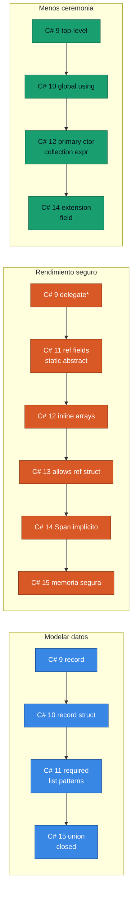

<div align="center">

# 10 · Lenguajes: C#, F# y Visual Basic

**Siete versiones de C# leídas como una sola historia: datos, rendimiento seguro y exhaustividad**

[⬅ 09 · .NET 11](09-net-11-la-reescritura-silenciosa.md) · [🏠 Índice](../README.md) · [11 · Runtime ➡](11-runtime-jit-y-gc.md)

</div>

> [!NOTE]
> El compilador elige por defecto la versión de C# del TFM: `net10.0` → C# 14, `net11.0` → C# 15. Los ejemplos de C# 15
> se validaron con el SDK `11.0.100-rc.3.26522.148`.

---

## Contenido

1. [Matriz de versiones](#1-matriz-de-versiones)
2. [Las tres líneas de evolución](#2-las-tres-líneas-de-evolución)
3. [Línea 1: modelar datos](#3-línea-1-modelar-datos)
4. [Línea 2: rendimiento seguro](#4-línea-2-rendimiento-seguro)
5. [Línea 3: menos ceremonia](#5-línea-3-menos-ceremonia)
6. [Un dominio, siete versiones](#6-un-dominio-siete-versiones)
7. [Uniones frente a las alternativas](#7-uniones-frente-a-las-alternativas)
8. [Trampas conocidas](#8-trampas-conocidas)
9. [F#](#9-f)
10. [Visual Basic](#10-visual-basic)
11. [Configuración recomendada](#11-configuración-recomendada)
12. [Referencias](#12-referencias)

---

## 1. Matriz de versiones

| .NET | C# | F# | Funciones principales de C# |
|:---:|:---:|:---:|---|
| 5 | 9 | 5 | `record`, `init`, top-level statements, patrones lógicos y relacionales, `delegate*` |
| 6 | 10 | 6 | `global using`, namespace de archivo, `record struct`, tipo natural de lambda, *interpolated handlers* |
| 7 | 11 | 7 | `static abstract`, cadenas sin formato, *list patterns*, `required`, `u8`, campos `ref` |
| 8 | 12 | 8 | Constructores primarios, expresiones de colección, alias, *inline arrays*, `ref readonly` |
| 9 | 13 | 9 | `params` de colección, `Lock`, `allows ref struct`, propiedades `partial`, `\e` |
| 10 | 14 | 10 | `extension`, `field`, conversiones de `Span`, `?.=`, operadores compuestos, constructores `partial` |
| 11 | 15 | 11 | `union`, `closed`, `with(...)` en colecciones, indexadores de extensión, saltos etiquetados |

---

## 2. Las tres líneas de evolución



---

## 3. Línea 1: modelar datos

La pregunta que guía esta línea: ¿puede el compilador impedir un estado inválido?

| Pregunta | Herramienta | Desde |
|---|---|---|
| ¿Igualdad por valor? | `record` | C# 9 |
| ¿Sin montículo? | `readonly record struct` | C# 10 |
| ¿Campo obligatorio? | `required` | C# 11 |
| ¿Forma de una lista? | `[primero, .., ultimo]` | C# 11 |
| ¿Conjunto finito de casos ajenos? | `union` | C# 15 |
| ¿Jerarquía sin extensiones externas? | `closed` | C# 15 |

> [!TIP]
> Con `union` y `closed`, el patrón "exhaustivo sin `default`" se vuelve la forma recomendada: al agregar un caso, cada
> `switch` afectado emite advertencia. **Sube esa advertencia a error** para que un caso olvidado rompa la compilación.

---

## 4. Línea 2: rendimiento seguro

Es la línea más profunda: durante décadas, rendir significaba `unsafe`. Cada versión movió una técnica de bajo nivel al
terreno seguro y verificable.

```csharp
// C# 11: scoped y campos ref
ref struct Lector
{
    private ref int _posicion;
    public Lector(ref int p) => _posicion = ref p;
}

// C# 12: inline array seguro, sin fixed
[System.Runtime.CompilerServices.InlineArray(4)]
struct Cuatro<T> { private T _e; }

// C# 13: genérico sobre ref struct
static int Largo<T>(T valor) where T : ILongitud, allows ref struct => valor.Longitud;

interface ILongitud { int Longitud { get; } }
```

```csharp
// C# 14: Span sin conversión explícita
static int Contar(ReadOnlySpan<char> texto) => texto.Length;

Console.WriteLine(Contar("hola"));
char[] letras = ['a', 'b'];
Console.WriteLine(Contar(letras));
```

| Función | Beneficio | Público objetivo |
|---|---|---|
| `Span<T>` | Vista sin copia | Todos, indirectamente |
| `stackalloc` en expresión | Pila sin `unsafe` | Bibliotecas |
| `static abstract` | Genéricos sin costo | Bibliotecas numéricas |
| `params ReadOnlySpan<T>` | Variádicas sin asignar | Autores de API |
| `[OverloadResolutionPriority]` | Preferir sobrecargas rápidas sin romper | Autores de API |
| Modelo de memoria 🟡 | `unsafe` marca el acceso, no el tipo | Auditoría |

---

## 5. Línea 3: menos ceremonia

```csharp
// 2019
using System;
using System.Collections.Generic;

namespace Tienda
{
    public class Servicio
    {
        private readonly ILogger _log;
        private string _nombre = "";

        public Servicio(ILogger log)
        {
            _log = log;
        }

        public string Nombre
        {
            get { return _nombre; }
            set { _nombre = value.Trim(); }
        }
    }
}
```

```csharp
// 2026
namespace Tienda;

public class Servicio(ILogger log)
{
    public string Nombre { get; set => field = value.Trim(); } = "";
}
```

De 20 líneas a 6, sin perder comportamiento.

---

## 6. Un dominio, siete versiones

Un pago que puede aprobarse, rechazarse o quedar pendiente:

| Versión | Modelado | Exhaustividad |
|---|---|---|
| C# 8 | Clase base, `enum` y `null` | Ninguna |
| C# 9 | `record` abstracto con derivados | Requiere `_ =>` |
| C# 11 | + `required` | Requiere `_ =>` |
| C# 15 | `union` o `closed` | **Verificada por el compilador** |

```csharp
public record Aprobado(string Autorizacion);
public record Rechazado(string Motivo);
public record Pendiente(DateTimeOffset Vence);

public union EstadoPago(Aprobado, Rechazado, Pendiente);

public static class Pagos
{
    public static string Mensaje(EstadoPago estado) => estado switch
    {
        Aprobado(var a) => $"Aprobado: {a}",
        Rechazado(var m) => $"Rechazado: {m}",
        Pendiente(var v) => $"Vence {v:d}",
    };
}
```

---

## 7. Uniones frente a las alternativas

| Criterio | `union` | `closed` | Herencia abierta | `OneOf` y similares | F# DU |
|---|:---:|:---:|:---:|:---:|:---:|
| Exhaustividad del compilador | ✅ | ✅ | ❌ | Parcial | ✅ |
| Casos con tipos ajenos | ✅ | ❌ | ❌ | ✅ | Con envoltura |
| Comportamiento compartido | ❌ | ✅ | ✅ | ❌ | Con miembros |
| JSON integrado | ✅ | Polimorfismo | Polimorfismo | Manual | Manual |
| Requiere .NET 11 | Sí | Sí | No | No | No |

---

## 8. Trampas conocidas

| Trampa | Síntoma | Solución |
|---|---|---|
| Parámetro de constructor primario capturado | Doble almacenamiento si además lo guardas en propiedad | Decide una sola fuente |
| `record` con colección | Igualdad compara la referencia de la lista | Implementa igualdad propia |
| `with` en `record` | Copia superficial | Cuidado con referencias |
| `required` y reflexión | Los deserializadores antiguos no lo respetan | System.Text.Json lo soporta desde .NET 7 |
| Expresiones de colección en `IEnumerable<T>` | El tipo concreto no está garantizado | No hagas cast |
| Conversión de `Span` en C# 14 | Cambia la sobrecarga elegida | Pruebas y revisión de analizadores |
| `field` como nombre | Pasa a ser palabra clave en accesores | Usa `@field` |
| `extension` y métodos clásicos | Ambigüedad si coexisten | Migra de forma gradual |
| `lock` sobre `Lock` como `object` | Pierde la optimización; el compilador advierte | Mantén el tipo `Lock` |
| Unión con casos de igual forma JSON | Ambigüedad al deserializar | `[JsonUnion]` |

---

## 9. F#

| Versión | Novedades |
|---|---|
| F# 5 | Cadenas interpoladas, `nameof`, slicing mejorado |
| F# 6 | `task {}` nativo, sintaxis de indexación `expr[idx]` |
| F# 7 | Abstractos estáticos, miembros requeridos |
| F# 8 | Atajos de lambda con `_.Prop`, actualización anidada de registros |
| F# 9 | Tipos de referencia anulables |
| F# 10 | Supresión de advertencias con alcance, modificadores de acceso en accesores, `ValueOption` en parámetros opcionales, `and!` en `task`, mejor recorte, compilación paralela en preview |
| F# 11 🆕 | Propagación de registros, constructores de registro, soporte preview de Runtime Async, SRTP en extensiones |

---

## 10. Visual Basic

Visual Basic sigue en **modo estable**: recibe lo necesario para consumir API modernas, sin evolución general del
lenguaje. En .NET 10 interpreta la restricción `unmanaged` y respeta `OverloadResolutionPriorityAttribute`, para que los
*overloads* con `Span` se elijan correctamente.

---

## 11. Configuración recomendada

```xml
<!-- Directory.Build.props en la raíz del repositorio -->
<Project>
  <PropertyGroup>
    <Nullable>enable</Nullable>
    <ImplicitUsings>enable</ImplicitUsings>
    <TreatWarningsAsErrors>true</TreatWarningsAsErrors>
    <AnalysisLevel>latest-recommended</AnalysisLevel>
    <EnforceCodeStyleInBuild>true</EnforceCodeStyleInBuild>
    <!-- CS8509: switch no exhaustivo -->
    <WarningsAsErrors>$(WarningsAsErrors);CS8509</WarningsAsErrors>
  </PropertyGroup>
</Project>
```

> [!WARNING]
> Evita `<LangVersion>latest</LangVersion>` en bibliotecas compartidas: el mismo código puede comportarse distinto según
> el SDK. Deja que el TFM decida, o fija una versión concreta.

---

## 12. Referencias

- [C# language version history](https://learn.microsoft.com/dotnet/csharp/whats-new/csharp-version-history)
- [What's new in C# 15](https://learn.microsoft.com/dotnet/csharp/whats-new/csharp-15)
- [What's new in C# 14](https://learn.microsoft.com/dotnet/csharp/whats-new/csharp-14)
- [What's new in C# 13](https://learn.microsoft.com/dotnet/csharp/whats-new/csharp-13)
- [What's new in C# 12](https://learn.microsoft.com/dotnet/csharp/whats-new/csharp-12)
- [What's new in F# 10](https://learn.microsoft.com/dotnet/fsharp/whats-new/fsharp-10)
- [Roslyn language feature status](https://github.com/dotnet/roslyn/blob/main/docs/Language%20Feature%20Status.md)

---

<div align="center">

[⬅ 09 · .NET 11](09-net-11-la-reescritura-silenciosa.md) · [🏠 Índice](../README.md) · [11 · Runtime ➡](11-runtime-jit-y-gc.md)

</div>
