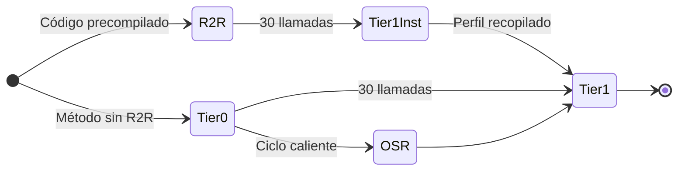
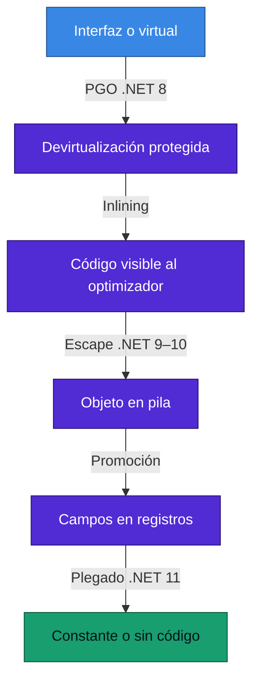
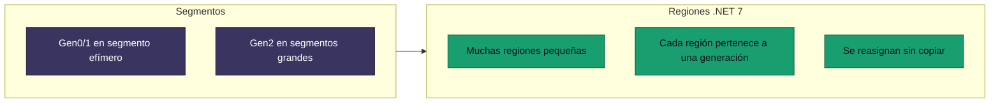

<div align="center">

# 11 · Runtime, JIT y GC

**Compilación por niveles, PGO, de-abstracción, regiones, DATAS, SIMD y Runtime Async: seis años bajo el capó**

[⬅ 10 · Lenguajes](10-lenguajes-csharp-fsharp-vb.md) · [🏠 Índice](../README.md) · [12 · AOT y despliegue ➡](12-aot-despliegue-y-contenedores.md)

</div>

---

## Contenido

1. [Línea de tiempo del runtime](#1-línea-de-tiempo-del-runtime)
2. [Compilación por niveles](#2-compilación-por-niveles)
3. [El proyecto de-abstracción](#3-el-proyecto-de-abstracción)
4. [Recolector de basura](#4-recolector-de-basura)
5. [SIMD y hardware](#5-simd-y-hardware)
6. [Excepciones](#6-excepciones)
7. [Asincronía en el runtime](#7-asincronía-en-el-runtime)
8. [Configuración que importa](#8-configuración-que-importa)
9. [Diagnóstico](#9-diagnóstico)
10. [Referencias](#10-referencias)

---

## 1. Línea de tiempo del runtime

| .NET | JIT | GC | Hardware | Otros |
|:---:|---|---|---|---|
| 5 | Mejoras generales | Mejoras | Windows Arm64 | `ValueTask` con *pooling* |
| 6 | PGO dinámico opcional | Modo conservador de memoria | Apple Silicon | Crossgen2 |
| 7 | **OSR** | **Regiones** | Mejor Arm64 | W^X por defecto, Native AOT |
| 8 | **PGO por defecto** | `RefreshMemoryLimit`, DATAS opcional | **AVX-512** | Native AOT web |
| 9 | Optimizaciones de ciclos | **DATAS por defecto** | SVE, AVX10v1 | **Excepciones nuevas**, CET |
| 10 | **De-abstracción**, 3-opt | Barrera de escritura Arm64 | AVX10.2 | Asignación en pila ampliada |
| 11 🆕 | Devirtualización de genéricos, *async* | Fiabilidad, >1024 CPU | FP16, SVE2, VNNI-512 | **Runtime Async**, línea base x86-64-v2 |

---

## 2. Compilación por niveles



| Etapa | Objetivo | Costo |
|---|---|---|
| ReadyToRun | Arrancar sin JIT | Calidad conservadora |
| Tier 0 | Compilar rápido | Sin optimizaciones |
| Instrumentado | Reunir tipos y ramas | Pequeña sobrecarga temporal |
| OSR | Escapar de un ciclo en Tier 0 | Una compilación adicional |
| Tier 1 | Máximo rendimiento | Compilación en hilo de fondo |

Microsoft reporta que PGO dinámico mejora **en promedio 15 %**; en cerca de 4 600 pruebas, **23 %** mejoró 20 % o más.

---

## 3. El proyecto de-abstracción

La evolución del JIT cuenta una historia: eliminar el precio de usar interfaces, delegados, genéricos y LINQ.



**Comprobación en nuestro laboratorio** (Apple M4, mediana, [datos completos](24-laboratorio.md)):

| `foreach` sobre `IEnumerable<int>` de 1 024 enteros | .NET 8 | .NET 9 | .NET 10 | .NET 11 RC3 |
|---|---:|---:|---:|---:|
| Tiempo | 565 ns | 622 ns | **267 ns** | 268 ns |
| Memoria asignada | 32 B | 32 B | **0 B** | 0 B |

Los **32 bytes del enumerador desaparecen en .NET 10**. Es asignación en pila visible con una herramienta común.

| Versión | Paso |
|---|---|
| .NET 9 | Asignación en pila de *boxes* |
| .NET 10 | Devirtualización de interfaces de array; enumeradores y arrays pequeños en pila; delegados y campos de struct en análisis de escape; inlining con `try-finally` |
| .NET 11 | Genéricos virtuales, métodos por defecto de interfaz, `Activator.CreateInstance<T>` con tipo exacto, plegado de `SequenceEqual` |

Ejemplo oficial de .NET 11, en el que el JIT puede reducir dos llamadas de interfaz a un `Console.WriteLine("test")`:

```csharp
IfaceGeneric<string> caller = new Caller<string>();
Iface obj = Activator.CreateInstance<Impl>();
caller.DefaultImpl(obj, "test");

interface Iface { void GenericMethod<T>(T value); }
interface IfaceGeneric<T>
{
    void DefaultImpl(Iface obj, T value) => obj.GenericMethod(value);
}
class Impl : Iface
{
    public void GenericMethod<T>(T value) => Console.WriteLine(value);
}
class Caller<T> : IfaceGeneric<T> { }
```

---

## 4. Recolector de basura

### 4.1 Modos

| Modo | Heaps | Perfil | Configuración |
|---|---|---|---|
| Workstation | Uno | Clientes, contenedores pequeños | Predeterminado en consola |
| Server | Uno por núcleo | Servicios con mucho rendimiento | Predeterminado en ASP.NET Core |
| Server + DATAS | Dinámico | Contenedores con carga variable | Predeterminado desde .NET 9 |
| Concurrente | Segundo plano | Reduce pausas Gen2 | Activo por defecto |

### 4.2 De segmentos a regiones



Las regiones son el requisito técnico de DATAS: el heap puede crecer y encogerse con unidades pequeñas.

### 4.3 Ajustes para contenedores

| Ajuste | Variable | Uso |
|---|---|---|
| Límite absoluto | `DOTNET_GCHeapHardLimit` | Memoria máxima del heap |
| Límite porcentual | `DOTNET_GCHeapHardLimitPercent` | Porcentaje del límite de cgroup |
| Modo conservador | `DOTNET_GCConserveMemory` | Compactar más, de 0 a 9 |
| Desactivar DATAS | `DOTNET_GCDynamicAdaptationMode=0` | Rendimiento máximo sin adaptación |
| Límite en caliente | `GC.RefreshMemoryLimit()` | Aplicar cambios sin reinicio |

> [!IMPORTANT]
> .NET respeta los límites de cgroup. Por defecto, el GC usa un límite de heap de 75 % de la memoria del contenedor.
> En .NET 11 se corrigió además el recorrido de límites de cgroup v2 en la raíz de la jerarquía.

### 4.4 Barrera de escritura Arm64

Cada vez que un objeto viejo apunta a uno joven, una barrera lo registra. En x64 el runtime ya cambiaba de
implementación según el GC; .NET 10 lo lleva a Arm64, con pausas de **8 % a más de 20 %** menores en pruebas de Microsoft.

---

## 5. SIMD y hardware

| Generación | API |
|---|---|
| .NET Core 3.0 | Intrínsecos x86 |
| .NET 5 | Intrínsecos Arm64 |
| .NET 7 | `Vector128` y `Vector256` multiplataforma |
| .NET 8 | `Vector512`, AVX-512 |
| .NET 9 | SVE, AVX10v1 |
| .NET 10 | AVX10.2 |
| .NET 11 🆕 | FP16, AVX-VNNI-512, SVE2, composición de carriles |

```csharp
using System.Runtime.Intrinsics;

static int SumarVectorizado(ReadOnlySpan<int> datos)
{
    var acc = Vector128<int>.Zero;
    int i = 0;
    for (; i <= datos.Length - Vector128<int>.Count; i += Vector128<int>.Count)
        acc += Vector128.Create(datos.Slice(i, Vector128<int>.Count));

    int total = Vector128.Sum(acc);
    for (; i < datos.Length; i++) total += datos[i];
    return total;
}
```

> [!TIP]
> Antes de escribir SIMD, usa `TensorPrimitives`, `Span.IndexOf`, `SearchValues` o `Enumerable.Sum`: ya están vectorizados.

---

## 6. Excepciones

Lanzar y capturar una excepción en el laboratorio de este atlas:

| | .NET 8 | .NET 9 | .NET 10 | .NET 11 RC3 |
|---|---:|---:|---:|---:|
| `throw` + `catch` | 17.8 µs | 11.0 µs | 2.2 µs | **0.53 µs** |

La nueva implementación, basada en NativeAOT, llegó en .NET 9, con mejora de **2 a 4 veces** según Microsoft. Nuestra
medición es de un solo patrón, `throw` y `catch` en el mismo método, y no debe generalizarse: una pila profunda cuesta más.

---

## 7. Asincronía en el runtime

| Mejora | Versión |
|---|---|
| `ValueTask` con *pooling* opcional | .NET 5 |
| `Task.WhenEach` | .NET 9 |
| Se omite la captura de `ExecutionContext` cuando no hay nada que restaurar | .NET 11 |
| Runtime Async | .NET 11 |

Prueba propia de 1 000 `await Task.Yield()` encadenados, **sin** activar Runtime Async en nuestro código:

| | .NET 8 | .NET 9 | .NET 10 | .NET 11 RC3 |
|---|---:|---:|---:|---:|
| Tiempo | 511 µs | 494 µs | 505 µs | **240 µs** |

Prueba de marcos en la pila, sobre tres métodos `async` tras un `Task.Yield`, en .NET 11 RC3:

| Modo | `new StackTrace().FrameCount` |
|---|---:|
| Máquina de estados | 10 |
| `runtime-async=on` | **6** |

Detalle del modelo en el [capítulo 09](09-net-11-la-reescritura-silenciosa.md#3-runtime-async).

---

## 8. Configuración que importa

| Ajuste | Propiedad MSBuild | Cuándo |
|---|---|---|
| Server GC | `<ServerGarbageCollection>true</ServerGarbageCollection>` | Servicios no web con mucho rendimiento |
| GC concurrente | `<ConcurrentGarbageCollection>false</ConcurrentGarbageCollection>` | Contenedores muy pequeños |
| Compilación por niveles | `<TieredCompilation>` | Déjala activa |
| PGO | `<TieredPGO>false</TieredPGO>` | Solo si reduces memoria de arranque y lo mides |
| Sin globalización | `<InvariantGlobalization>true</InvariantGlobalization>` | Imágenes sin ICU |

> [!WARNING]
> Desactivar `TieredCompilation` para "ganar" arranque suele empeorar el resultado. Mide antes.

---

## 9. Diagnóstico

| Herramienta | Uso |
|---|---|
| `dotnet-counters` | Métricas en vivo |
| `dotnet-trace` | Trazas de EventPipe |
| `dotnet-dump` | Volcados y análisis sin el sistema original |
| `dotnet-gcdump` | Análisis de heap |
| `dotnet-monitor` | Diagnóstico como servicio en contenedores |
| `DOTNET_JitDisasm=Metodo` | Ver ensamblador producido por el JIT, desde .NET 7 |
| `DOTNET_EnableCrashReport=1` | Informe de fallo en proceso en Linux y macOS 🆕 |

```bash
DOTNET_JitDisasm="Sum" DOTNET_JitStdOutFile=salida.asm dotnet run -c Release
```

---

## 10. Referencias

- [Performance Improvements in .NET 10](https://devblogs.microsoft.com/dotnet/performance-improvements-in-net-10/)
- [What's new in the .NET 11 runtime](https://learn.microsoft.com/dotnet/core/whats-new/dotnet-11/runtime)
- [Dynamic adaptation to application sizes](https://learn.microsoft.com/dotnet/standard/garbage-collection/datas)
- [Runtime configuration options for garbage collection](https://learn.microsoft.com/dotnet/core/runtime-config/garbage-collector)
- [.NET 10 de-abstraction plan](https://github.com/dotnet/runtime/issues/108913)

---

<div align="center">

[⬅ 10 · Lenguajes](10-lenguajes-csharp-fsharp-vb.md) · [🏠 Índice](../README.md) · [12 · AOT y despliegue ➡](12-aot-despliegue-y-contenedores.md)

</div>
