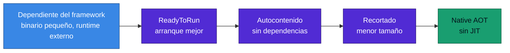
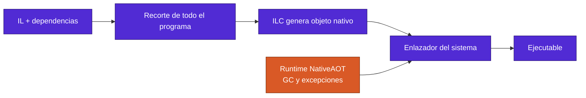

<div align="center">

# 12 · AOT, despliegue y contenedores

**ReadyToRun, recorte, Native AOT, imágenes base, publicación OCI y la decisión que más afecta tu factura**

[⬅ 11 · Runtime](11-runtime-jit-y-gc.md) · [🏠 Índice](../README.md) · [13 · Bibliotecas ➡](13-bibliotecas-base.md)

</div>

---

## Contenido

1. [El espectro de despliegue](#1-el-espectro-de-despliegue)
2. [Recorte](#2-recorte)
3. [Native AOT](#3-native-aot)
4. [Cuánto se gana: medición propia](#4-cuánto-se-gana-medición-propia)
5. [Imágenes de contenedor](#5-imágenes-de-contenedor)
6. [Publicar sin Dockerfile](#6-publicar-sin-dockerfile)
7. [Dockerfile de referencia](#7-dockerfile-de-referencia)
8. [Kubernetes](#8-kubernetes)
9. [Azure](#9-azure)
10. [Referencias](#10-referencias)

---

## 1. El espectro de despliegue



| Criterio | Framework | R2R | Autocontenido | Native AOT |
|---|:---:|:---:|:---:|:---:|
| Arranque | Base | Mejor | Base | Mínimo |
| Rendimiento sostenido | Máximo | Máximo | Máximo | Alto, sin PGO |
| Memoria | Mayor | Mayor | Mayor | Menor |
| Reflexión libre | ✅ | ✅ | ✅ | Limitada |
| Carga dinámica | ✅ | ✅ | ✅ | ❌ |
| Parches sin rebuild | ✅ | ✅ | ❌ | ❌ |

> [!NOTE]
> Native AOT no tiene JIT, así que no hay PGO dinámico. Un servicio de larga duración con mucha carga puede rendir mejor
> en JIT. Native AOT gana en **arranque, memoria y tamaño**.

---

## 2. Recorte

| Versión | Avance |
|---|---|
| .NET 5 | Recorte de ensamblados |
| .NET 6 | Recorte de tipos y miembros; advertencias activas |
| .NET 8 | Bibliotecas de ASP.NET Core anotadas |
| .NET 9 | Atributos para *feature switches* con soporte de recorte |
| .NET 10 | HTTP/3 deshabilitado por defecto con `PublishTrimmed`, reduce tamaño |

```csharp
using System.Diagnostics.CodeAnalysis;

public static class Fabrica
{
    // El recortador conserva los constructores públicos de T
    public static T Crear<[DynamicallyAccessedMembers(
        DynamicallyAccessedMemberTypes.PublicParameterlessConstructor)] T>() where T : new() => new();
}
```

| Advertencia | Significado |
|---|---|
| `IL2026` | Llamada a miembro con `[RequiresUnreferencedCode]` |
| `IL2067`–`IL2075` | Flujo de reflexión sin anotar |
| `IL3050` | Código con `[RequiresDynamicCode]`, incompatible con AOT |

> [!IMPORTANT]
> **Trata estas advertencias como errores.** Si la compilación no da ninguna, el comportamiento en Native AOT coincide
> con el de JIT. Cada una ignorada es un posible fallo en producción.

---

## 3. Native AOT

### 3.1 Cómo funciona



### 3.2 Límites

| Límite | Consecuencia |
|---|---|
| Sin `Assembly.LoadFile` | No hay complementos dinámicos |
| Sin `Reflection.Emit` | Sin generación de IL en ejecución |
| Sin C++/CLI ni COM integrado en Windows | Solo con `ComWrappers` y generadores |
| Compilación por plataforma | Sin compilación cruzada de SO en general |
| Requiere compilador C | Visual Studio con C++, o `clang` en Linux y macOS |

### 3.3 Soporte por modelo de aplicación

| Modelo | .NET 8 | .NET 10 | Nota |
|---|:---:|:---:|---|
| Consola, Worker | ✅ | ✅ | |
| Minimal APIs | ✅ | ✅ | Con JSON generado |
| gRPC | ✅ | ✅ | |
| Controladores MVC | ❌ | ❌ | Depende de reflexión |
| Blazor Server | ❌ | ❌ | |
| SignalR | Parcial | Parcial | |
| EF Core | ❌ | 🧪 | Precompilación experimental |
| Azure Functions aislada | Parcial | Parcial | Revisa la guía del servicio |
| Móvil | 🧪 | 🧪 | Opt-in en .NET 11 |

### 3.4 Plantilla mínima

```xml
<PropertyGroup>
  <PublishAot>true</PublishAot>
  <InvariantGlobalization>true</InvariantGlobalization>
  <StripSymbols>true</StripSymbols>
  <OptimizationPreference>Size</OptimizationPreference>
  <TrimmerSingleWarn>false</TrimmerSingleWarn>
</PropertyGroup>
```

| Opción | Efecto |
|---|---|
| `OptimizationPreference` | `Size` o `Speed` |
| `IlcInstructionSet` | Apunta a una CPU concreta |
| `StackTraceSupport=false` | Binario menor; en .NET 11 cambia `GetCallingAssembly` |
| `EventSourceSupport=false` | Menos tamaño, menos diagnóstico |

> [!WARNING]
> 🆕 En .NET 11 una publicación Native AOT omite la compilación completa previa, y las bibliotecas nativas en Unix reciben
> prefijo `lib`. Revisa los scripts de empaquetado.

---

## 4. Cuánto se gana: medición propia

Aplicación de consola "hola" y API Minimal mínima con JSON generado, en Apple M4 con macOS 27, últimos parches
disponibles. [Datos y método completos](24-laboratorio.md).

| Medida | .NET 8 | .NET 9 | .NET 10 | .NET 11 RC3 |
|---|---:|---:|---:|---:|
| Consola AOT: tamaño | 1.55 MB | 1.27 MB | **1.10 MB** | 1.22 MB |
| Consola AOT: ejecución total | 3.4 ms | 3.1 ms | 3.3 ms | 3.4 ms |
| Consola JIT: ejecución total | 18.9 ms | 19.7 ms | 18.8 ms | 18.3 ms |
| Web AOT: tamaño | 10.83 MB | 10.03 MB | **9.04 MB** | 9.32 MB |
| Web AOT: hasta primera respuesta | 33.2 ms | 32.1 ms | 33.1 ms | **14.9 ms** |
| Web AOT: memoria residente | 23.3 MB | 22.5 MB | 22.6 MB | 21.3 MB |
| Web JIT: hasta primera respuesta | 95.4 ms | 94.0 ms | 98.4 ms | 79.7 ms |
| Web JIT: memoria residente | 76.6 MB | 78.4 MB | 80.8 MB | 83.1 MB |

Lecturas:

- **Web AOT frente a JIT en .NET 10**: 3× menos tiempo hasta la primera respuesta y 3.6× menos memoria.
- **.NET 11 no reduce el tamaño respecto a .NET 10**: en esta prueba aumenta un poco.
- La mejora de primera respuesta de .NET 11 es notable, pero **no determinamos su causa**: repítela en tu entorno.

---

## 5. Imágenes de contenedor

### 5.1 Imagen predeterminada por versión

| .NET | Etiqueta | Base |
|---|---|---|
| 8 | `8.0` | Debian 12 bookworm |
| 9 | `9.0` | Debian 12 bookworm |
| 10 | `10.0` | **Ubuntu 24.04 noble** |
| 11 | `11.0` | **Ubuntu 26.04 resolute** 🆕 |

### 5.2 Variantes

| Variante | Sufijo | Tiene shell | Globalización | Uso |
|---|---|:---:|:---:|---|
| Completa | ninguno | ✅ | ✅ | Desarrollo y depuración |
| Alpine | `-alpine` | ✅ | Con `-extra` | Imágenes pequeñas con musl |
| Chiseled | `-noble-chiseled`, `-resolute-chiseled` | ❌ | Con `-extra` | Producción |
| Composite | `-composite` | Según base | Según base | Mejor arranque en ASP.NET Core |
| Azure Linux distroless | `-azurelinux3.0-distroless`, `-azurelinux4.0-distroless` 🆕 | ❌ | Con `-extra` | Entornos Azure |
| Nano Server | `-nanoserver-ltsc2025` | Limitado | ✅ | Windows |

> [!WARNING]
> Las imágenes *chiseled* no tienen shell: un `HEALTHCHECK` con `curl` o un `exec` de depuración no funcionarán. Usa sondas
> HTTP del orquestador y contenedores efímeros de depuración. Sin `-extra`, faltan `icu` y `tzdata`, y hay bibliotecas que
> fallan por esto, como algunos clientes de SQL Server.

---

## 6. Publicar sin Dockerfile

```bash
dotnet publish -t:PublishContainer \
  -p:ContainerRepository=tienda/api \
  -p:ContainerImageTag=1.4.2 \
  -p:ContainerFamily=noble-chiseled
```

| Propiedad | Función |
|---|---|
| `ContainerBaseImage` | Imagen base exacta |
| `ContainerFamily` | Variante, como `noble-chiseled` |
| `ContainerRepository`, `ContainerImageTag` | Nombre y etiqueta |
| `ContainerRegistry` | Registro destino |
| `ContainerUser` | Usuario; por defecto no root |
| `ContainerImageFormat` | Docker u OCI (.NET 10) |
| `ContainerPort` | Puertos expuestos |

**Novedades en .NET 11** 🆕:

- Imágenes **reproducibles** con `SOURCE_DATE_EPOCH`.
- **Podman** multiarquitectura.
- Prefiere runtimes nativos: `wslc` en Windows y `container` en macOS, antes que Docker y Podman.
- Omite capas si el manifiesto ya existe en el destino.

---

## 7. Dockerfile de referencia

```dockerfile
# syntax=docker/dockerfile:1
FROM mcr.microsoft.com/dotnet/sdk:10.0 AS build
WORKDIR /src

COPY Directory.Packages.props *.sln ./
COPY src/Api/Api.csproj src/Api/
RUN --mount=type=cache,target=/root/.nuget/packages dotnet restore src/Api/Api.csproj

COPY src/ src/
RUN --mount=type=cache,target=/root/.nuget/packages \
    dotnet publish src/Api/Api.csproj -c Release -o /app --no-restore

FROM mcr.microsoft.com/dotnet/aspnet:10.0-noble-chiseled
WORKDIR /app
COPY --from=build /app .
USER $APP_UID
EXPOSE 8080
ENTRYPOINT ["dotnet", "Api.dll"]
```

> [!TIP]
> Fija las imágenes por **digest** en producción y actualízalas de forma automatizada. Con 97 CVE únicos en 2026, una
> etiqueta olvidada envejece rápido.

---

## 8. Kubernetes

```yaml
apiVersion: apps/v1
kind: Deployment
metadata:
  name: api
spec:
  replicas: 3
  selector: { matchLabels: { app: api } }
  template:
    metadata: { labels: { app: api } }
    spec:
      securityContext:
        runAsNonRoot: true
        runAsUser: 1654
      containers:
        - name: api
          image: registro.ejemplo/tienda/api@sha256:<digest>
          ports: [{ containerPort: 8080 }]
          resources:
            requests: { cpu: "250m", memory: "256Mi" }
            limits: { memory: "512Mi" }
          env:
            - { name: DOTNET_GCHeapHardLimitPercent, value: "75" }
          securityContext:
            allowPrivilegeEscalation: false
            readOnlyRootFilesystem: true
            capabilities: { drop: ["ALL"] }
          startupProbe:
            httpGet: { path: /health/startup, port: 8080 }
          readinessProbe:
            httpGet: { path: /health/ready, port: 8080 }
          livenessProbe:
            httpGet: { path: /health/live, port: 8080 }
```

| Detalle | Razón |
|---|---|
| Puerto 8080 | Predeterminado desde .NET 8 |
| UID 1654 | Usuario `app` de las imágenes |
| `readOnlyRootFilesystem` | Requiere un `emptyDir` si usas `/tmp` |
| Sin límite de CPU o con cuidado | Un límite bajo reduce los hilos e impacta el ThreadPool |
| `terminationGracePeriodSeconds` | Revisa cierres: .NET 10 cambió los manejadores de señales predeterminados |

---

## 9. Azure

| Servicio | .NET 10 | Nota |
|---|:---:|---|
| Azure Functions aislada | 🟢 | Fin 14-nov-2028 |
| Azure Functions *in-process* | ❌ | Termina el 10-nov-2026 |
| Functions Linux Consumption | ❌ | .NET 9 fue la última versión; migra a Flex Consumption |
| Container Apps, AKS | 🟢 | Tu imagen decide |

Para una vista completa de cómputo en Azure, consulta **Azure Atlas**, el proyecto hermano de este repositorio.

---

## 10. Referencias

- [Native AOT deployment](https://learn.microsoft.com/dotnet/core/deploying/native-aot/)
- [Trim self-contained applications](https://learn.microsoft.com/dotnet/core/deploying/trimming/trim-self-contained)
- [Containerize a .NET app with dotnet publish](https://learn.microsoft.com/dotnet/core/containers/sdk-publish)
- [.NET container images](https://github.com/dotnet/dotnet-docker)
- [Default .NET images use Ubuntu](https://learn.microsoft.com/dotnet/core/compatibility/containers/10.0/default-images-use-ubuntu)
- [Ubuntu Chiseled images](https://github.com/dotnet/dotnet-docker/blob/main/documentation/ubuntu-chiseled.md)

---

<div align="center">

[⬅ 11 · Runtime](11-runtime-jit-y-gc.md) · [🏠 Índice](../README.md) · [13 · Bibliotecas ➡](13-bibliotecas-base.md)

</div>
