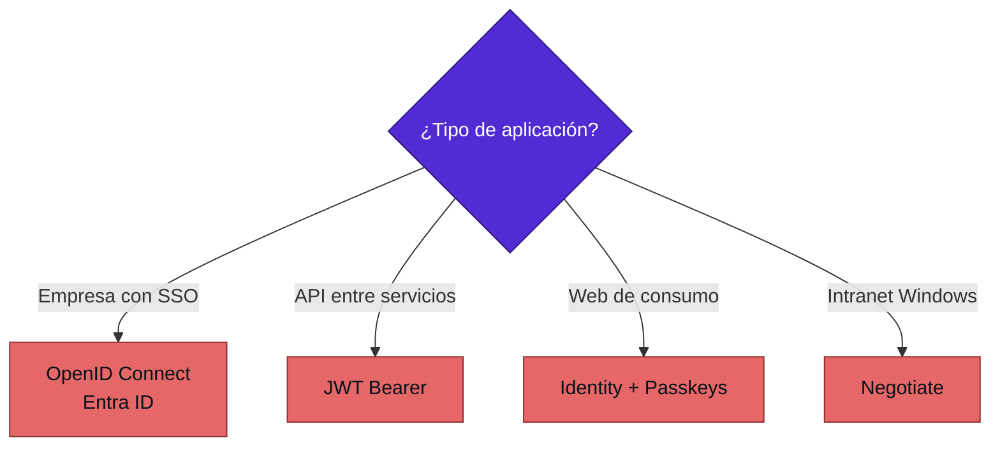
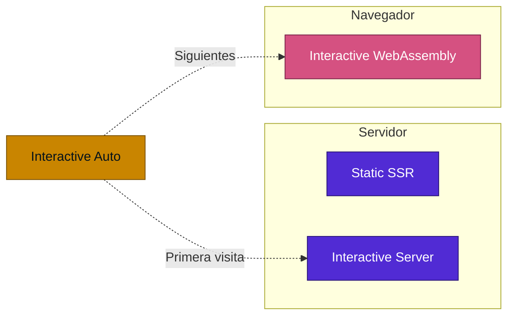

<div align="center">

# 14 · ASP.NET Core y Blazor

**Kestrel, Minimal APIs, OpenAPI, autenticación, SignalR, gRPC y los modos de renderizado de Blazor**

[⬅ 13 · Bibliotecas](13-bibliotecas-base.md) · [🏠 Índice](../README.md) · [15 · Datos ➡](15-datos-y-ef-core.md)

</div>

---

## Contenido

1. [Evolución por versión](#1-evolución-por-versión)
2. [Anatomía de una solicitud](#2-anatomía-de-una-solicitud)
3. [Una API de 2026](#3-una-api-de-2026)
4. [Minimal APIs o controladores](#4-minimal-apis-o-controladores)
5. [OpenAPI](#5-openapi)
6. [Validación](#6-validación)
7. [Autenticación y autorización](#7-autenticación-y-autorización)
8. [Tiempo real: SignalR, SSE y WebSocket](#8-tiempo-real-signalr-sse-y-websocket)
9. [gRPC](#9-grpc)
10. [Caché y limitación de tasa](#10-caché-y-limitación-de-tasa)
11. [Blazor](#11-blazor)
12. [Kestrel](#12-kestrel)
13. [Referencias](#13-referencias)

---

## 1. Evolución por versión

| .NET | Web | Blazor |
|:---:|---|---|
| 5 | Mejoras de Kestrel y gRPC | Aislamiento CSS, carga diferida |
| 6 | **Minimal APIs**, `WebApplication` | AOT en WebAssembly, componentes dinámicos |
| 7 | **Rate limiting, output caching**, filtros, grupos, HTTP/3 | `bind:after`, mejoras en `QuickGrid` en preview |
| 8 | **Native AOT**, Identity API, métricas, `IExceptionHandler` | **Blazor Web App**, SSR, streaming |
| 9 | **`MapStaticAssets`, OpenAPI integrado, HybridCache** | `RendererInfo`, reconexión mejorada |
| 10 | **Passkeys, validación, SSE, OpenAPI 3.1** | Precarga, estado persistente |
| 11 🆕 | **OTel nativo, OpenAPI 3.2**, Zstandard, uniones, validación asíncrona | `DisplayName`, `BasePath`, componentes de IA 🧪 |

---

## 2. Anatomía de una solicitud


> [!IMPORTANT]
> **El orden del middleware es lógica de seguridad.** `UseAuthentication` antes de `UseAuthorization`; CORS antes de que
> responda un endpoint; `UseExceptionHandler` al inicio para que atrape todo.

---

## 3. Una API de 2026

```csharp
// Paquetes: Microsoft.AspNetCore.OpenApi y Microsoft.AspNetCore.Authentication.JwtBearer
// AddServiceDefaults y MapDefaultEndpoints vienen del proyecto ServiceDefaults de Aspire
using Microsoft.AspNetCore.Http.HttpResults;
using Microsoft.AspNetCore.RateLimiting;

var builder = WebApplication.CreateBuilder(args);

builder.AddServiceDefaults();                // Aspire: OTel, salud, resiliencia
builder.Services.AddOpenApi();
builder.Services.AddValidation();
builder.Services.AddProblemDetails();
builder.Services.AddAuthentication().AddJwtBearer();
builder.Services.AddAuthorization();
builder.Services.AddRateLimiter(o => o.AddFixedWindowLimiter("api", l =>
{
    l.PermitLimit = 100;
    l.Window = TimeSpan.FromMinutes(1);
}));

var app = builder.Build();

app.UseExceptionHandler();
app.UseAuthentication();
app.UseAuthorization();
app.UseRateLimiter();

app.MapOpenApi();
app.MapDefaultEndpoints();

var pedidos = app.MapGroup("/api/v1/pedidos")
    .RequireAuthorization()
    .RequireRateLimiting("api");

pedidos.MapGet("/{id:int}", async Task<Results<Ok<Pedido>, NotFound>> (int id, IRepositorio repo, CancellationToken ct) =>
    await repo.BuscarAsync(id, ct) is { } p ? TypedResults.Ok(p) : TypedResults.NotFound());

pedidos.MapPost("/", async (NuevoPedido dto, IRepositorio repo, CancellationToken ct) =>
{
    var creado = await repo.CrearAsync(dto, ct);
    return TypedResults.Created($"/api/v1/pedidos/{creado.Id}", creado);
});

app.Run();
```

| Pieza | Por qué |
|---|---|
| `TypedResults` y `Results<...>` | Respuestas en la firma: OpenAPI las documenta sin atributos |
| `MapGroup` | Comparte políticas y prefijo |
| `CancellationToken` | Se cancela si el cliente se desconecta |
| `AddProblemDetails` | Errores RFC 9457 |
| `AddValidation` | Validación generada en compilación |

---

## 4. Minimal APIs o controladores

| Criterio | Minimal APIs | Controladores |
|---|:---:|:---:|
| Native AOT | ✅ | ❌ |
| Arranque | Mejor | Normal |
| Filtros | Endpoint filters | Filtros MVC |
| `ModelState` | Validación nueva | ✅ |
| *Content negotiation* | Limitada | ✅ |
| *OData*, vistas | ❌ | ✅ |
| Aplicación grande | Con grupos y extensiones | Convención natural |

Para proyectos nuevos, Minimal APIs. Una aplicación con muchos controladores estables no necesita reescribirse.

---

## 5. OpenAPI

| Versión | Estado |
|---|---|
| .NET 9 | `Microsoft.AspNetCore.OpenApi` integrado |
| .NET 10 | OpenAPI **3.1** por defecto |
| .NET 11 🆕 | OpenAPI **3.2** por defecto, depende de `Microsoft.OpenApi` 3.3.1 con cambios disruptivos |

```csharp
builder.Services.AddOpenApi(o =>
{
    // Tus herramientas aún no soportan 3.2
    o.OpenApiVersion = Microsoft.OpenApi.OpenApiSpecVersion.OpenApi3_1;
});
```

> [!WARNING]
> Antes de migrar a .NET 11, valida que tus generadores de clientes y gateways acepten 3.2. Las uniones se describen
> como `anyOf` y los SSE con `itemSchema`.

---

## 6. Validación

```csharp
builder.Services.AddValidation();

public record NuevoPedido(
    [property: Required, StringLength(100)] string Cliente,
    [property: Range(0.01, 1_000_000)] decimal Total);
```

🆕 **Validación asíncrona en .NET 11** con `AsyncValidationAttribute`:

```csharp
public sealed class CorreoUnicoAttribute : AsyncValidationAttribute
{
    protected override ValidationResult? IsValid(object? value, ValidationContext context) =>
        throw new InvalidOperationException("Valida con IsValidAsync.");

    protected override async Task<ValidationResult?> IsValidAsync(
        object? value, ValidationContext context, CancellationToken ct)
    {
        var usuarios = context.GetRequiredService<IUsuarios>();
        return value is string correo && await usuarios.ExisteAsync(correo, ct)
            ? new ValidationResult("Ese correo ya está registrado.")
            : ValidationResult.Success;
    }
}
```

Los atributos asíncronos del mismo miembro se inician juntos y los elementos de colección se validan en paralelo.

---

## 7. Autenticación y autorización

| Capacidad | Versión | Uso |
|---|:---:|---|
| `AddBearerToken`, `MapIdentityApi` | 8 | SPA y móvil sin servidor externo |
| **Passkeys** | 10 | WebAuthn en Identity |
| `TimeProvider` en Identity | 11 | Pruebas |
| Enlace de canal TLS en Negotiate | 11 | Protección de Windows Auth |
| Device Bound Sessions 🧪 | 11 | Cookies robadas no renuevan sesión |



---

## 8. Tiempo real: SignalR, SSE y WebSocket

| Tecnología | Dirección | Reconexión | Ideal para |
|---|---|:---:|---|
| **SSE** | Servidor a cliente | Automática en navegador | Notificaciones, respuestas de LLM |
| **WebSocket** | Bidireccional | Manual | Protocolos propios |
| **SignalR** | Bidireccional, con grupos | ✅ | Chat y paneles |
| **gRPC streaming** | Bidireccional | Manual | Entre servicios |

```csharp
app.MapGet("/precios", (CancellationToken ct) =>
    TypedResults.ServerSentEvents(Fuente(ct), eventType: "precio"));

static async IAsyncEnumerable<decimal> Fuente(
    [EnumeratorCancellation] CancellationToken ct)
{
    while (!ct.IsCancellationRequested)
    {
        yield return Random.Shared.Next(90, 110);
        await Task.Delay(1000, ct);
    }
}
```

> [!NOTE]
> 🆕 **SignalR en .NET 11** puede actualizar la autenticación sin desconectar, algo crítico para sesiones largas con
> tokens de corta duración. Las uniones funcionan solo con el protocolo JSON.

---

## 9. gRPC

| Función | Versión |
|---|:---:|
| Compatible con Native AOT | 8 |
| Transcodificación JSON | 7 |
| Swagger de transcodificación | 7 |
| Balanceo en cliente | 6 |
| Reintentos | 6 |

Elige gRPC entre servicios internos con contrato fuerte, y REST en los bordes públicos.

---

## 10. Caché y limitación de tasa

| Nivel | Componente | Clave |
|---|---|---|
| Respuesta HTTP | Output cache | URL y variantes |
| Datos | `HybridCache` | L1 local + L2 distribuida |
| Consultas | EF Core | Compilación de consultas |

| Algoritmo | Comportamiento |
|---|---|
| Ventana fija | Simple, permite picos en el borde |
| Ventana deslizante | Más suave |
| Token bucket | Permite ráfagas controladas |
| Concurrencia | Limita solicitudes simultáneas |

🆕 .NET 11 añade `Retry-After` en limitación de tasa, y un proveedor de políticas de *output cache*.

---

## 11. Blazor



| Modo | Interactividad | Estado | Costo de servidor | Offline | Primera carga |
|---|:---:|---|---|:---:|---|
| Static SSR | ❌ | Por solicitud | Bajo | ❌ | Rápida |
| Server | ✅ | Circuito | Alto por usuario | ❌ | Rápida |
| WebAssembly | ✅ | Cliente | Bajo | ✅ | Más lenta |
| Auto | ✅ | Ambos | Medio | Parcial | Rápida |

**Regla práctica:** empieza por Static SSR y añade interactividad solo donde haga falta. Una página de catálogo no
necesita un circuito por visitante.

| Novedad | Versión |
|---|:---:|
| Blazor Web App | 8 |
| `RendererInfo` | 9 |
| `[PersistentState]` declarativo | 10 |
| Persistencia de circuitos | 10 |
| Precarga de activos WASM | 10 |
| `DisplayName`, `BasePath`, `RelativeToCurrentUri` | 11 |
| Componentes de IA 🧪 | 11 |

---

## 12. Kestrel

| Mejora | Versión |
|---|---|
| HTTP/3 | 7 |
| Expulsión de *pools* de memoria | 10 |
| Parser HTTP/1.1 sin excepciones | 11: **20–40 %** más rendimiento con solicitudes mal formadas |
| HTTP/3 sin esperar `SETTINGS` | 11: menor latencia inicial |
| Tiempos de espera de encabezados finales | 11 |

---

## 13. Referencias

- [What's new in ASP.NET Core in .NET 11](https://learn.microsoft.com/aspnet/core/release-notes/aspnetcore-11)
- [What's new in ASP.NET Core in .NET 10](https://learn.microsoft.com/aspnet/core/release-notes/aspnetcore-10.0)
- [What's new in ASP.NET Core in .NET 9](https://learn.microsoft.com/aspnet/core/release-notes/aspnetcore-9.0)
- [Minimal APIs overview](https://learn.microsoft.com/aspnet/core/fundamentals/minimal-apis/overview)
- [ASP.NET Core Blazor render modes](https://learn.microsoft.com/aspnet/core/blazor/components/render-modes)
- [ASP.NET Core support for Native AOT](https://learn.microsoft.com/aspnet/core/fundamentals/native-aot)

---

<div align="center">

[⬅ 13 · Bibliotecas](13-bibliotecas-base.md) · [🏠 Índice](../README.md) · [15 · Datos ➡](15-datos-y-ef-core.md)

</div>
