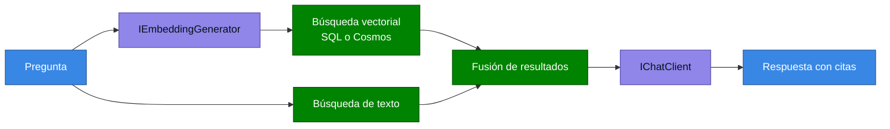

<div align="center">

# 15 · Datos y EF Core

**De muchos a muchos a búsqueda vectorial híbrida: siete versiones de Entity Framework Core**

[⬅ 14 · ASP.NET Core](14-aspnet-core-y-blazor.md) · [🏠 Índice](../README.md) · [16 · Clientes ➡](16-clientes-maui-wpf-winforms.md)

</div>

---

## Contenido

1. [Evolución](#1-evolución)
2. [Modelar: entidades, owned y tipos complejos](#2-modelar-entidades-owned-y-tipos-complejos)
3. [Consultar](#3-consultar)
4. [Escribir en lote](#4-escribir-en-lote)
5. [JSON en bases relacionales](#5-json-en-bases-relacionales)
6. [Búsqueda vectorial y RAG](#6-búsqueda-vectorial-y-rag)
7. [Filtros, multitenencia y seguridad](#7-filtros-multitenencia-y-seguridad)
8. [Cosmos DB](#8-cosmos-db)
9. [Migraciones](#9-migraciones)
10. [Rendimiento](#10-rendimiento)
11. [EF Core, Dapper o ADO.NET](#11-ef-core-dapper-o-adonet)
12. [Referencias](#12-referencias)

---

## 1. Evolución

| EF Core | Funciones insignia |
|:---:|---|
| 5 | Muchos a muchos, TPT, `AsSplitQuery`, `Include` filtrado |
| 6 | Tablas temporales, modelos compilados, *migration bundles* |
| 7 | `ExecuteUpdate`, `ExecuteDelete`, columnas JSON, TPC |
| 8 | Tipos complejos, colecciones primitivas, `SqlQuery<T>` |
| 9 | Cosmos renovado, consultas precompiladas 🧪, bloqueo de migraciones, `UseSeeding` |
| 10 | **Vectores**, **JSON nativo**, `LeftJoin`, filtros con nombre, `ExecuteUpdate` en JSON |
| 11 🆕 | `VECTOR_SEARCH`, híbrida, `MaxBy`, `FullJoin`, tipos complejos en TPT/TPC, lotes transaccionales en Cosmos |

---

## 2. Modelar: entidades, owned y tipos complejos

| Concepto | Identidad | Compartir instancia | Tabla propia | Recomendación |
|---|:---:|:---:|:---:|---|
| Entidad | ✅ | ✅ | ✅ | Agregados |
| Owned | Oculta | ❌ | Opcional | Heredado |
| **Tipo complejo** | ❌ | ✅ | ❌ | **Objetos de valor** |

```csharp
[ComplexType]
public record Direccion(string Calle, string Ciudad, string Pais);

public class Cliente
{
    public int Id { get; set; }
    public required Direccion Envio { get; set; }
    public required Direccion Facturacion { get; set; }
}
```

**Herencia:**

| Estrategia | Tablas | Lectura | Escritura | Cuándo |
|---|---|---|---|---|
| TPH | Una | Rápida | Rápida | Predeterminada |
| TPT | Una por tipo, con `JOIN` | Lenta | Lenta | Normalización estricta |
| TPC | Una por tipo concreto | Buena | Buena | Consultas por tipo concreto |

---

## 3. Consultar

```csharp
// Proyección: solo lo necesario
var resumen = await db.Pedidos
    .AsNoTracking()
    .Where(p => p.Fecha >= desde)
    .Select(p => new PedidoResumen(p.Id, p.Cliente.Nombre, p.Total))
    .ToListAsync(ct);

// .NET 10: LeftJoin
var informe = db.Clientes.LeftJoin(db.Pedidos,
    c => c.Id, p => p.ClienteId,
    (c, p) => new { c.Nombre, Total = (decimal?)p!.Total });

// .NET 11: MaxByAsync traducido a TOP(1) ... ORDER BY
var blog = await db.Blogs.MaxByAsync(b => b.Posts.Count(), ct);
```

| Riesgo | Síntoma | Solución |
|---|---|---|
| N+1 | Una consulta por fila | `Include` o proyección |
| Explosión cartesiana | Muchas filas por varios `Include` | `AsSplitQuery` |
| Seguimiento innecesario | Memoria y CPU | `AsNoTracking` |
| Evaluación en cliente | Excepción de traducción | Reescribe la consulta |
| `Contains` sobre lista | Planes inestables | EF Core 10 mejora la parametrización |

---

## 4. Escribir en lote

```csharp
// Una sola sentencia SQL
await db.Productos
    .Where(p => p.Categoria == categoria)
    .ExecuteUpdateAsync(s =>
    {
        s.SetProperty(p => p.Precio, p => p.Precio * 1.10m);
        if (descontinuar) s.SetProperty(p => p.Activo, false);
    }, ct);
```

> [!NOTE]
> EF Core 10 acepta una **lambda normal** en `ExecuteUpdateAsync`, así que ya no hace falta construir árboles de
> expresión para aplicar cambios condicionales.

> [!WARNING]
> `ExecuteUpdate` y `ExecuteDelete` **omiten el seguimiento de cambios**, interceptores de `SaveChanges` y eventos de
> dominio. Si tu auditoría vive ahí, no se ejecutará.

---

## 5. JSON en bases relacionales

| Versión | Avance |
|---|---|
| EF Core 7 | Columnas JSON |
| EF Core 8 | Colecciones primitivas como JSON |
| EF Core 10 | Tipo `json` nativo de SQL Server y `ExecuteUpdate` en JSON |
| EF Core 11 🆕 | `JSON_CONTAINS`, `EF.Functions.JsonPathExists`, índices JSON |

---

## 6. Búsqueda vectorial y RAG

```csharp
public class Documento
{
    public int Id { get; set; }
    public required string Texto { get; set; }

    [Column(TypeName = "vector(1536)")]
    public SqlVector<float> Embedding { get; set; }
}

var similares = await db.Documentos
    .OrderBy(d => EF.Functions.VectorDistance("cosine", d.Embedding, consulta))
    .Take(5)
    .ToListAsync(ct);
```

| Función | Versión | Uso |
|---|---|---|
| Tipo `vector` y `VectorDistance` | EF Core 10 | Búsqueda exacta |
| `VECTOR_SEARCH()` e índices vectoriales | EF Core 11 🆕 | Búsqueda aproximada a escala |
| Búsqueda híbrida | EF Core 11 🆕 | Vector y texto con fusión |
| Propiedades vectoriales no cargadas por defecto | EF Core 11 🆕 | Evita traer embeddings grandes |



---

## 7. Filtros, multitenencia y seguridad

```csharp
// EF Core 10: filtros nombrados
modelBuilder.Entity<Pedido>()
    .HasQueryFilter("Borrado", p => !p.Borrado)
    .HasQueryFilter("Tenant", p => p.TenantId == _tenant.Id);

// Desactiva uno solo
var auditoria = db.Pedidos.IgnoreQueryFilters(["Borrado"]);
```

| Mejora de seguridad | Versión |
|---|---|
| Constantes redactadas en logs | EF Core 10 |
| Advertencia por concatenación en API de SQL crudo | EF Core 10 |

> [!CAUTION]
> Un filtro de *tenant* es defensa en profundidad, no un límite de seguridad. `IgnoreQueryFilters`, SQL crudo y
> `ExecuteUpdate` mal escritos pueden cruzar datos. Considera además Row-Level Security en la base.

---

## 8. Cosmos DB

| Versión | Avance |
|---|---|
| EF Core 9 | Claves de partición jerárquicas, mejor LINQ, rediseño |
| EF Core 10 | Texto, híbrida, vectores GA, evolución del modelo |
| EF Core 11 🆕 | Tipos complejos, índices, **lotes transaccionales**, ejecución masiva, tokens de sesión, serializador modernizado |

> [!WARNING]
> Cosmos no es relacional: la clave de partición condiciona el costo y la escala. Una consulta sin partición es *cross-partition*.

---

## 9. Migraciones

| Práctica | Razón |
|---|---|
| No migrar al inicio de la aplicación en producción | Condiciones de carrera entre réplicas |
| Usar *bundles* o scripts idempotentes en CI/CD | Control |
| Separar cambios expandir y contraer | Despliegues sin interrupción |
| EF Core 9 añade bloqueo | Evita aplicar migraciones en paralelo |

```bash
dotnet ef migrations bundle --self-contained -r linux-x64
./efbundle --connection "$CADENA"
dotnet ef migrations script --idempotent -o migracion.sql
```

🆕 **EF Core 11**: crear y aplicar en un paso, excluir claves foráneas, archivo de configuración para `dotnet ef`,
comodines de contexto y opciones sin conexión en `migrations remove`.

---

## 10. Rendimiento

| Técnica | Efecto |
|---|---|
| `AddDbContextPool` | Reutiliza instancias |
| Consultas compiladas | Evita el costo de traducción |
| `AsNoTracking` | Menos memoria |
| Modelos compilados | Mejor arranque con modelos grandes |
| Proyección a DTO | Menos columnas |
| `ExecuteUpdate` | Sin cargar datos |
| Batching | Predeterminado en `SaveChanges` |

---

## 11. EF Core, Dapper o ADO.NET

| Criterio | EF Core | Dapper | ADO.NET |
|---|:---:|:---:|:---:|
| Productividad | Alta | Media | Baja |
| Control del SQL | Medio | Alto | Total |
| Migraciones | ✅ | ❌ | ❌ |
| Native AOT | 🧪 | Con generador | ✅ |
| Seguimiento de cambios | ✅ | ❌ | ❌ |
| Consultas complejas de reporte | Regular | ✅ | ✅ |

Un patrón sano: EF Core para escritura y dominio, SQL directo para reportes críticos.

---

## 12. Referencias

- [What's new in EF Core 11](https://learn.microsoft.com/ef/core/what-is-new/ef-core-11.0/whatsnew)
- [What's new in EF Core 10](https://learn.microsoft.com/ef/core/what-is-new/ef-core-10.0/whatsnew)
- [What's new in EF Core 9](https://learn.microsoft.com/ef/core/what-is-new/ef-core-9.0/whatsnew)
- [What's new in EF Core 8](https://learn.microsoft.com/ef/core/what-is-new/ef-core-8.0/whatsnew)
- [Efficient querying](https://learn.microsoft.com/ef/core/performance/efficient-querying)

---

<div align="center">

[⬅ 14 · ASP.NET Core](14-aspnet-core-y-blazor.md) · [🏠 Índice](../README.md) · [16 · Clientes ➡](16-clientes-maui-wpf-winforms.md)

</div>
