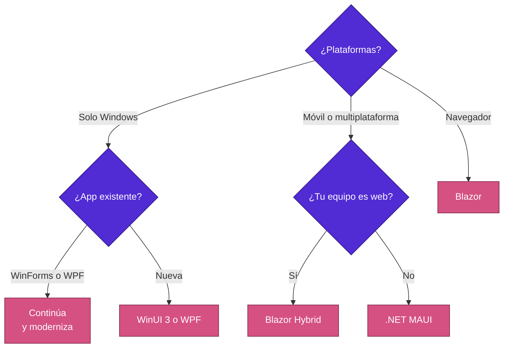
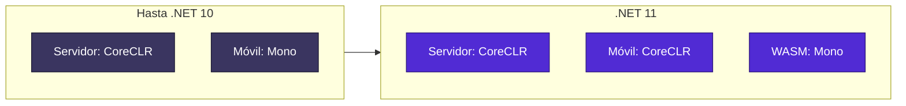

<div align="center">

# 16 · Clientes: MAUI, WPF y Windows Forms

**El reemplazo de Mono por CoreCLR, XAML generado y la vida larga del escritorio de Windows**

[⬅ 15 · Datos](15-datos-y-ef-core.md) · [🏠 Índice](../README.md) · [17 · Cloud native ➡](17-cloud-native-aspire-y-observabilidad.md)

</div>

---

## Contenido

1. [Elegir tecnología de cliente](#1-elegir-tecnología-de-cliente)
2. [.NET MAUI por versión](#2-net-maui-por-versión)
3. [De Mono a CoreCLR](#3-de-mono-a-coreclr)
4. [XAML](#4-xaml)
5. [Blazor Hybrid](#5-blazor-hybrid)
6. [WPF](#6-wpf)
7. [Windows Forms](#7-windows-forms)
8. [Soporte](#8-soporte)
9. [Referencias](#9-referencias)

---

## 1. Elegir tecnología de cliente



| Tecnología | Plataformas | UI | Mejor para |
|---|---|---|---|
| .NET MAUI | Android, iOS, macOS, Windows | XAML nativo | Una base de código móvil |
| Blazor Hybrid | Las de MAUI, WPF, WinForms | Web en WebView | Reutilizar UI web |
| WPF | Windows | XAML | Escritorio empresarial |
| Windows Forms | Windows | Diseñador | Herramientas internas |
| WinUI 3 | Windows | XAML | Aplicaciones modernas |
| Avalonia, Uno | Multiplataforma (terceros) | XAML | Linux de escritorio y pixel-perfect |

---

## 2. .NET MAUI por versión

| Versión | Foco |
|---|---|
| .NET 6 (GA en mayo de 2022) | Sucesor de Xamarin.Forms |
| .NET 7 | Mapa, mejoras de escritorio |
| .NET 8 | Calidad, Native AOT en iOS 🧪, teclado |
| .NET 9 | `HybridWebView`, `TitleBar`, se distribuye como NuGet y workload |
| .NET 10 | Generador de XAML, integración con Aspire, Android 16 e iOS 26, `MediaPicker` múltiple |
| .NET 11 🆕 | **CoreCLR**, Material 3, `x:Code`, Hot Reload incremental, pines agrupados |

> [!IMPORTANT]
> Xamarin dejó de tener soporte en mayo de 2024. Si aún tienes una aplicación Xamarin en producción, las tiendas pueden
> rechazar actualizaciones por requisitos de SDK.

---

## 3. De Mono a CoreCLR

### 3.1 Cronología

| Previa | Cambio |
|---|---|
| .NET 11 Preview 3 | Android API mínima sube de 21 a **24** |
| .NET 11 Preview 4 | CoreCLR predeterminado en plataformas MAUI; Mono disponible |
| .NET 11 Preview 7 | CoreCLR predeterminado en aplicaciones .NET 11; NativeAOT opt-in |
| .NET 11 RC1 | NativeAOT con *registrar* estático recortable por defecto |

### 3.2 Beneficios y costos

Microsoft señala ventajas en depuración, perfilado, Hot Reload, tamaño y rendimiento de la app. Sin una medición propia,
no se publican aquí cifras.



### 3.3 Cambios disruptivos

| Cambio | Impacto |
|---|---|
| Android x86 no soportado | Emuladores x86 antiguos dejan de funcionar |
| API mínima 24 | Dispositivos con Android 5 y 6 quedan fuera |
| Propiedades de proyecto de Mono | Dejan de aplicar; revisa `.csproj` |
| Ajustes de runtime de Mono | Dejan de aplicar |
| API de *embedding* de Mono | No soportadas |
| Depuración vía `ICorDebug` | Herramientas de terceros deben actualizarse |
| Eventos de traza de CoreCLR | Reemplazan a los de Mono |
| Comportamiento de informes de fallos | Revisa tu SDK de reporte |
| `UnwindNativeCode` | Sin soporte en Apple |
| Bloqueo de archivos en iOS y tvOS | Deshabilitado por defecto para evitar que el sistema termine la app |

> [!WARNING]
> Revisa cada SDK nativo que uses: analítica, reporte de fallos y pagos. Cualquier cosa que dependa de Mono debe probarse.

---

## 4. XAML

```xml
<ContentPage xmlns="http://schemas.microsoft.com/dotnet/2021/maui"
             xmlns:x="http://schemas.microsoft.com/winfx/2009/xaml"
             x:Class="MiApp.MainPage">
    <x:Code><![CDATA[
        void AlPulsar(object sender, EventArgs e)
        {
            // C# en línea
        }
    ]]></x:Code>
    <Button Clicked="AlPulsar" Text="Pulsar" />
</ContentPage>
```

| Función | Versión | Valor |
|---|:---:|---|
| Bindings compilados | Previa | Rendimiento y seguridad de tipos |
| Generador de XAML | 10 | Menos trabajo en tiempo de ejecución |
| Espacios de nombres XML globales | 10 | Archivos más limpios |
| `x:Code` | 11 | Código pequeño junto al marcado |
| Diccionarios de recursos diferidos | 11 | Mejor arranque |
| Hot Reload incremental | 11 | Parches con generador |
| `RelativeSource` compilado y compatible con AOT | 11 | |

---

## 5. Blazor Hybrid

La UI Blazor se ejecuta en proceso nativo dentro de un `BlazorWebView`, sin WebAssembly ni servidor. Tiene acceso
completo a las API nativas. Desde .NET 9 existe una plantilla que comparte UI entre MAUI y una aplicación web. .NET 11
añade caché de contenido estático para `BlazorWebView`.

---

## 6. WPF

| Versión | Novedad |
|---|---|
| Core 3.0 | WPF en .NET moderno |
| .NET 9 | Tema Fluent |
| .NET 10 | Rendimiento y Fluent |
| .NET 11 🆕 | Endurecimiento nativo; C++/CLI de `/clr:pure` a `/clr:netcore` |

---

## 7. Windows Forms

| Versión | Novedad |
|---|---|
| .NET 6 | Fuente predeterminada, `ApplicationConfiguration` |
| .NET 8 | Mejoras de enlace a datos |
| .NET 9 | API asíncronas, modo oscuro 🧪 |
| .NET 10 | Portapapeles, `UITypeEditors` portados |
| .NET 11 🆕 | Estilos visuales modernos, experiencias de quiosco |

> [!NOTE]
> `BinaryFormatter` se retiró en .NET 9. Por eso .NET 10 marca como obsoletas API de portapapeles que dependían de él y
> propone alternativas con tipos explícitos. Es uno de los cambios que más afecta a aplicaciones antiguas.

---

## 8. Soporte

.NET MAUI tiene **política de soporte propia** porque depende de Xcode y las herramientas de Android SDK. Se distribuye
como workload y NuGet, lo que permite fijar versiones. Comprueba además los requisitos anuales de Apple y Google Play.

---

## 9. Referencias

- [What's new in .NET MAUI for .NET 11](https://learn.microsoft.com/dotnet/maui/whats-new/dotnet-11)
- [What's new in .NET MAUI for .NET 10](https://learn.microsoft.com/dotnet/maui/whats-new/dotnet-10)
- [.NET MAUI support policy](https://dotnet.microsoft.com/platform/support/policy/maui)
- [What's new in WPF in .NET 11](https://learn.microsoft.com/dotnet/desktop/wpf/whats-new/net110)
- [What's new in Windows Forms for .NET 11](https://learn.microsoft.com/dotnet/desktop/winforms/whats-new/net110)

---

<div align="center">

[⬅ 15 · Datos](15-datos-y-ef-core.md) · [🏠 Índice](../README.md) · [17 · Cloud native ➡](17-cloud-native-aspire-y-observabilidad.md)

</div>
