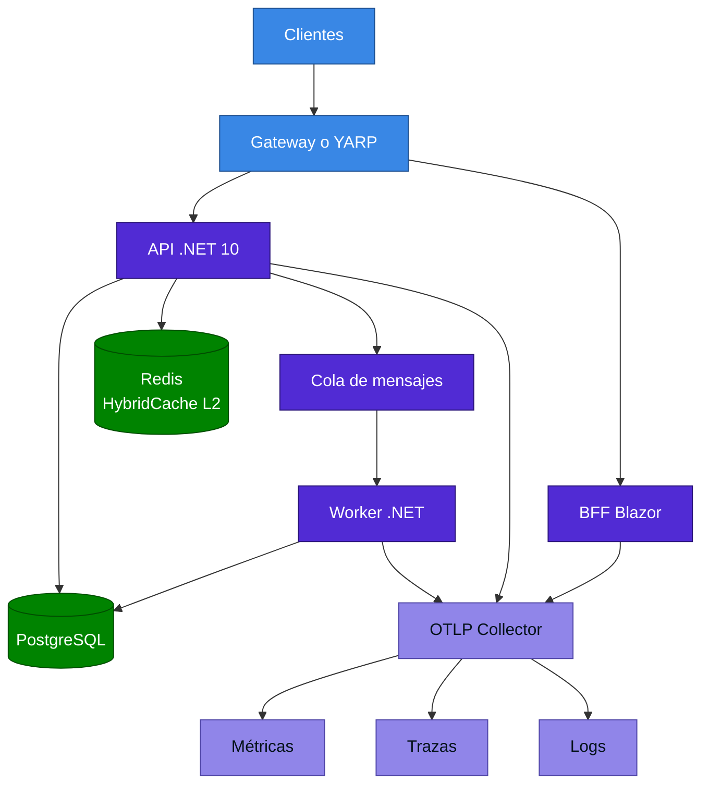

<div align="center">

# 17 · Cloud native, Aspire y observabilidad

**OpenTelemetry nativo, orquestación políglota, resiliencia y la arquitectura de un servicio .NET moderno**

[⬅ 16 · Clientes](16-clientes-maui-wpf-winforms.md) · [🏠 Índice](../README.md) · [18 · IA ➡](18-ia-en-net.md)

</div>

---

## Contenido

1. [Arquitectura de referencia](#1-arquitectura-de-referencia)
2. [Aspire](#2-aspire)
3. [Observabilidad: los tres pilares](#3-observabilidad-los-tres-pilares)
4. [OpenTelemetry en .NET](#4-opentelemetry-en-net)
5. [Salud y apagado](#5-salud-y-apagado)
6. [Resiliencia](#6-resiliencia)
7. [Configuración y secretos](#7-configuración-y-secretos)
8. [Lista de producción](#8-lista-de-producción)
9. [Referencias](#9-referencias)

---

## 1. Arquitectura de referencia



---

## 2. Aspire

### 2.1 Qué es y qué no es

Aspire describe una aplicación distribuida **en código**: dependencias, cadenas de conexión, puertos y telemetría.
Lanza todo en local con un panel y genera artefactos para desplegar. **No es un runtime de producción**, tampoco un
reemplazo de Kubernetes.

```csharp
var builder = DistributedApplication.CreateBuilder(args);

var cache = builder.AddRedis("cache");
var db = builder.AddPostgres("pg").AddDatabase("tienda");

var api = builder.AddProject<Projects.Tienda_Api>("api")
    .WithReference(cache)
    .WithReference(db)
    .WaitFor(db);

builder.AddProject<Projects.Tienda_Web>("web")
    .WithExternalHttpEndpoints()
    .WithReference(api);

builder.Build().Run();
```

### 2.2 Evolución

| Versión | Fecha | Hitos |
|---|---|---|
| Aspire 8 | Mayo de 2024 | GA, panel, integraciones |
| Aspire 9 | Noviembre de 2024 | Panel independiente, control de recursos |
| Aspire 13 | Noviembre de 2025 | Pierde ".NET" del nombre, AppHost de un archivo, orquestación políglota |
| 13.3 | Mayo de 2026 | Kubernetes y AKS, registros del navegador |
| 13.4 | 2026 | **AppHost en TypeScript GA** |
| 13.5 | 18-ago-2026 | Interactividad de AppHost; polyglot sin diagnóstico experimental |
| 13.6 | 2026 | Telemetría persistente, Java, Rust, configuración de TS desde `appsettings.json` |

Versión más reciente en NuGet al cierre: **`Aspire.Hosting.AppHost` 13.6.4**.

> [!NOTE]
> El salto de 9 a 13 existe porque la numeración dejó de seguir a .NET. Aspire publica con ritmo propio.

| Comando | Función |
|---|---|
| `aspire new` | Crear proyecto |
| `aspire run` | Ejecutar con panel |
| `aspire start` | Iniciar |
| `aspire publish` | Generar artefactos de despliegue |
| `aspire deploy` | Desplegar |

---

## 3. Observabilidad: los tres pilares

| Pilar | API en .NET | Responde |
|---|---|---|
| Logs | `ILogger` | ¿Qué ocurrió? |
| Métricas | `Meter` | ¿Cuánto y qué tan rápido? |
| Trazas | `ActivitySource` | ¿Dónde se fue el tiempo? |

.NET implementa las API de OpenTelemetry **en la propia BCL**: `Activity` y `Meter`. Las bibliotecas no dependen del SDK
de OpenTelemetry, solo la aplicación.

```csharp
public partial class ServicioPedidos(ILogger<ServicioPedidos> log, IMeterFactory medidores)
{
    private static readonly ActivitySource Fuente = new("Tienda.Pedidos");
    private readonly Counter<long> _creados =
        medidores.Create("Tienda.Pedidos").CreateCounter<long>("tienda.pedidos.creados");

    public void Crear(Pedido p)
    {
        using var actividad = Fuente.StartActivity("CrearPedido");
        actividad?.SetTag("pedido.id", p.Id);
        _creados.Add(1);
        LogCreado(p.Id);
    }

    [LoggerMessage(Level = LogLevel.Information, Message = "Pedido {Id} creado")]
    private partial void LogCreado(int id);
}
```

---

## 4. OpenTelemetry en .NET

```csharp
builder.Services.AddOpenTelemetry()
    .ConfigureResource(r => r.AddService("tienda-api"))
    .WithMetrics(m => m
        .AddMeter("Microsoft.AspNetCore.Hosting", "System.Net.Http", "Tienda.Pedidos")
        .AddRuntimeInstrumentation()
        .AddOtlpExporter())
    .WithTracing(t => t
        .AddSource("Microsoft.AspNetCore", "Tienda.Pedidos")  // .NET 11: sin paquete de instrumentación
        .AddHttpClientInstrumentation()
        .AddOtlpExporter());

builder.Logging.AddOpenTelemetry(l => l.AddOtlpExporter());
```

| Versión | Avance |
|---|---|
| .NET 6 | `Meter` |
| .NET 8 | Métricas de ASP.NET Core, `IMeterFactory` |
| .NET 9 | `Metrics.Gauge`, `Activity.AddLink` |
| .NET 10 | Propagador W3C predeterminado, URL de esquema |
| .NET 11 🆕 | **Atributos semánticos nativos en la actividad HTTP**, métricas de `MemoryCache`, reglas de `Activity`, OTel en CLI |

> [!WARNING]
> 🆕 Si combinas el paquete de instrumentación clásico con la fuente `Microsoft.AspNetCore` en .NET 11, revisa que no haya
> datos duplicados. Para desactivar los atributos nativos, usa el *switch*
> `Microsoft.AspNetCore.Hosting.SuppressActivityOpenTelemetryData`.

**Riesgo de cardinalidad:** nunca uses identificadores de usuario como etiqueta de métrica. Una etiqueta con millones de
valores multiplica series y costos. Los identificadores van en trazas.

---

## 5. Salud y apagado

```csharp
builder.Services.AddHealthChecks()
    .AddCheck("self", () => HealthCheckResult.Healthy(), tags: ["live"])
    .AddNpgSql(cadena, tags: ["ready"]);

app.MapHealthChecks("/health/live", new() { Predicate = r => r.Tags.Contains("live") });
app.MapHealthChecks("/health/ready", new() { Predicate = r => r.Tags.Contains("ready") });
```

| Sonda | Falla significa | No debe comprobar |
|---|---|---|
| Startup | Aún no inició | — |
| Liveness | Reiniciar | **Dependencias externas** |
| Readiness | Sacar del balanceo | — |

> [!CAUTION]
> Si la sonda de *liveness* comprueba la base de datos, una caída de la base **reinicia toda la flota** y agrava el
> incidente.

Cambios relacionados con apagado:

| Versión | Cambio |
|---|---|
| .NET 10 | `BackgroundService` ejecuta todo `ExecuteAsync` como `Task` |
| .NET 10 | El runtime ya no provee manejadores predeterminados de señales de terminación |
| .NET 11 | `RunAsync` y `StopAsync` relanzan fallos con comportamiento `StopHost` |

---

## 6. Resiliencia

```csharp
builder.Services.AddHttpClient<Catalogo>()
    .AddStandardResilienceHandler(o =>
    {
        o.Retry.MaxRetryAttempts = 3;
        o.AttemptTimeout.Timeout = TimeSpan.FromSeconds(2);
        o.TotalRequestTimeout.Timeout = TimeSpan.FromSeconds(10);
    });
```

| Estrategia | Función |
|---|---|
| Rate limiter | Protege al cliente y al servicio |
| Total timeout | Límite para toda la operación |
| Retry | Fallos transitorios, con *jitter* |
| Circuit breaker | Detiene llamadas a un servicio caído |
| Attempt timeout | Límite por intento |

> [!WARNING]
> Reintentar operaciones no idempotentes duplica efectos. Usa claves de idempotencia en `POST`.

---

## 7. Configuración y secretos

| Fuente | Orden típico |
|---|---|
| `appsettings.json` | 1 |
| `appsettings.{Environment}.json` | 2 |
| User secrets (desarrollo) | 3 |
| Variables de entorno | 4 |
| Línea de comandos | 5 |

Prefiere identidades administradas a secretos, y Key Vault para lo que no se pueda evitar. Las variables con `__`
equivalen a `:` en la jerarquía: `Correo__Host`.

---

## 8. Lista de producción

| Área | Comprobación |
|:---:|---|
| ✅ | `net10.0` y último parche |
| ✅ | Imagen sin root, fijada por digest |
| ✅ | Límites de memoria y `DOTNET_GCHeapHardLimitPercent` |
| ✅ | Sondas separadas |
| ✅ | OTLP para logs, métricas y trazas |
| ✅ | `IHttpClientFactory` con resiliencia |
| ✅ | `CancellationToken` en toda la cadena |
| ✅ | Migraciones fuera del arranque |
| ✅ | Tiempo de apagado mayor que la operación más larga |
| ✅ | NuGet Audit y SBOM en CI |

---

## 9. Referencias

- [Aspire](https://aspire.dev/)
- [What's new in Aspire 13.5](https://aspire.dev/whats-new/aspire-13-5/)
- [What's new in Aspire 13.6](https://aspire.dev/whats-new/aspire-13-6/)
- [.NET observability with OpenTelemetry](https://learn.microsoft.com/dotnet/core/diagnostics/observability-with-otel)
- [Build resilient HTTP apps](https://learn.microsoft.com/dotnet/core/resilience/http-resilience)
- [OpenTelemetry .NET](https://github.com/open-telemetry/opentelemetry-dotnet)

---

<div align="center">

[⬅ 16 · Clientes](16-clientes-maui-wpf-winforms.md) · [🏠 Índice](../README.md) · [18 · IA ➡](18-ia-en-net.md)

</div>
