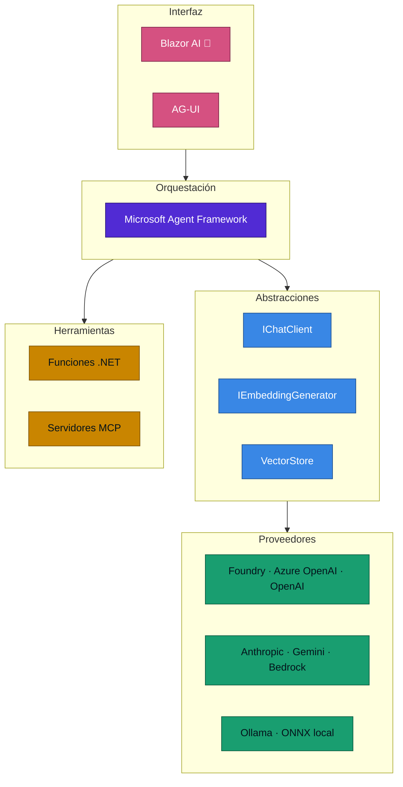
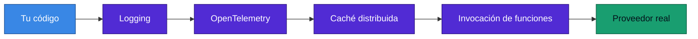
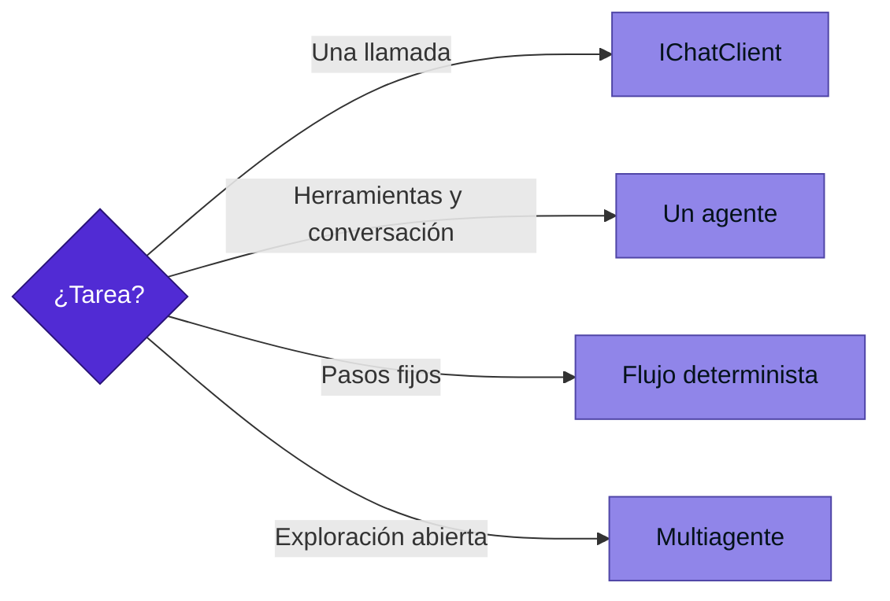

<div align="center">

# 18 · IA en .NET

**Microsoft.Extensions.AI, Agent Framework, MCP, vectores, tensores y evaluación: qué capa usar para cada problema**

[⬅ 17 · Cloud native](17-cloud-native-aspire-y-observabilidad.md) · [🏠 Índice](../README.md) · [19 · SDK y pruebas ➡](19-sdk-herramientas-y-pruebas.md)

</div>

> [!NOTE]
> La IA en .NET **no vive en el runtime**. Vive en paquetes NuGet con ritmo propio. Las versiones estables en NuGet al
> 4 de noviembre de 2026 eran: `Microsoft.Extensions.AI` 10.11.0, `Microsoft.Agents.AI` 1.27.0,
> `ModelContextProtocol` 2.3.1, `Microsoft.ML` 5.0.1 y `System.Numerics.Tensors` 10.0.14.

---

## Contenido

1. [El mapa por capas](#1-el-mapa-por-capas)
2. [Microsoft.Extensions.AI](#2-microsoftextensionsai)
3. [Herramientas y function calling](#3-herramientas-y-function-calling)
4. [Agentes](#4-agentes)
5. [Model Context Protocol](#5-model-context-protocol)
6. [Datos vectoriales y RAG](#6-datos-vectoriales-y-rag)
7. [Interfaces agénticas en Blazor](#7-interfaces-agénticas-en-blazor)
8. [Tensores y ejecución local](#8-tensores-y-ejecución-local)
9. [Evaluación](#9-evaluación)
10. [Riesgos en producción](#10-riesgos-en-producción)
11. [Qué usar](#11-qué-usar)
12. [Referencias](#12-referencias)

---

## 1. El mapa por capas



| Capa | Paquete | Madurez |
|---|---|---|
| Abstracciones | `Microsoft.Extensions.AI.Abstractions` | 🟢 Estable desde 9.5.0 |
| Middleware | `Microsoft.Extensions.AI` | 🟢 |
| Vectores | `Microsoft.Extensions.VectorData.Abstractions` | 🟢 |
| Agentes | `Microsoft.Agents.AI` | 🟢 1.0 en abril de 2026 |
| Protocolo | `ModelContextProtocol` | 🟢 |
| Evaluación | `Microsoft.Extensions.AI.Evaluation` | 🟢 |
| Tensores | `System.Numerics.Tensors` | 🟢 Estable en .NET 10 |
| UI agéntica | `Microsoft.AspNetCore.Components.AI` | 🧪 Prerelease en todo .NET 11 |

---

## 2. Microsoft.Extensions.AI

Una interfaz para cualquier modelo, igual que `ILogger` para cualquier registro: el código no conoce al proveedor.

```csharp
using Microsoft.Extensions.AI;

public class Resumidor(IChatClient chat)
{
    public async Task<string> ResumirAsync(string texto, CancellationToken ct)
    {
        var respuesta = await chat.GetResponseAsync(
        [
            new ChatMessage(ChatRole.System, "Resume en tres viñetas."),
            new ChatMessage(ChatRole.User, texto),
        ], cancellationToken: ct);

        return respuesta.Text;
    }

    public async IAsyncEnumerable<string> TransmitirAsync(string texto)
    {
        await foreach (var parte in chat.GetStreamingResponseAsync(texto))
            yield return parte.Text;
    }
}
```

**Tubería de middleware**, con la misma filosofía que ASP.NET Core:



```csharp
builder.Services.AddChatClient(proveedor)
    .UseDistributedCache()
    .UseFunctionInvocation()
    .UseOpenTelemetry()
    .UseLogging();
```

---

## 3. Herramientas y function calling

```csharp
using System.ComponentModel;
using Microsoft.Extensions.AI;

[Description("Devuelve el clima actual de una ciudad.")]
static string Clima([Description("Nombre de la ciudad")] string ciudad) =>
    $"{ciudad}: 24 °C";

var opciones = new ChatOptions { Tools = [AIFunctionFactory.Create(Clima)] };
```

`UseFunctionInvocation()` gestiona el ciclo: el modelo pide la herramienta, el código la ejecuta y se reenvía el resultado.

> [!CAUTION]
> Trata los argumentos que genera un modelo como **entrada no confiable**. Valida, limita y autoriza como con un cuerpo
> HTTP. Una herramienta que ejecuta SQL o borra datos necesita aprobación humana.

---

## 4. Agentes

**Microsoft Agent Framework** unifica las líneas de Semantic Kernel y AutoGen. Su versión 1.0 llegó en **abril de 2026**
para .NET y Python.

| Capacidad | Descripción |
|---|---|
| Agente individual | Instrucciones, modelo y herramientas |
| Middleware | Interceptar y gobernar llamadas |
| Memoria y contexto | Proveedores configurables |
| Flujos por grafo | Secuencial, concurrente, *handoff*, chat grupal, Magentic |
| Protocolos | MCP, AG-UI, y A2A según evolución |
| Plantilla | `aiagent-webapi` |



> [!TIP]
> Empieza siempre por la opción más simple. **Un multiagente multiplica costo, latencia y modos de fallo.** Si los pasos
> se conocen, escribe un flujo determinista.

**Semantic Kernel** sigue publicándose (1.81.0 en NuGet). Para proyectos nuevos de agentes, evalúa primero Agent Framework.

---

## 5. Model Context Protocol

MCP estandariza cómo un host de IA descubre y llama herramientas externas. El SDK oficial está en
`modelcontextprotocol/csharp-sdk`.

```bash
dotnet new mcpserver -o MiServidorMcp     # Incluido en el SDK de .NET 11
```

```csharp
using System.ComponentModel;
using Microsoft.Extensions.DependencyInjection;
using Microsoft.Extensions.Hosting;
using ModelContextProtocol.Server;

var builder = Host.CreateApplicationBuilder(args);
builder.Services.AddMcpServer()
    .WithStdioServerTransport()
    .WithToolsFromAssembly();

await builder.Build().RunAsync();

[McpServerToolType]
public static class Herramientas
{
    [McpServerTool, Description("Devuelve el eco de un mensaje.")]
    public static string Eco(string mensaje) => $"Eco: {mensaje}";
}
```

| Transporte | Uso |
|---|---|
| Stdio | Local, proceso hijo |
| HTTP | Remoto, multiusuario |

> [!WARNING]
> Con transporte HTTP, un servidor MCP es una **API pública**: necesita autenticación, autorización y límites.

---

## 6. Datos vectoriales y RAG

```csharp
using Microsoft.Extensions.VectorData;

public class Fragmento
{
    [VectorStoreKey] public int Id { get; set; }
    [VectorStoreData] public required string Texto { get; set; }

    [VectorStoreVector(1536, DistanceFunction = DistanceFunction.CosineSimilarity)]
    public ReadOnlyMemory<float> Vector { get; set; }
}
```

| Pieza de RAG | Decisión |
|---|---|
| Fragmentación | Tamaño, solapamiento y límites semánticos |
| Embeddings | No mezcles modelos en un índice |
| Almacén | SQL Server, PostgreSQL, Cosmos DB, Azure AI Search, Qdrant |
| Recuperación | **Híbrida**: texto y vector |
| Generación | Citas obligatorias, y "no lo sé" válido |
| Autorización | **Filtra antes de recuperar** |

EF Core también trae vectores: [capítulo 15](15-datos-y-ef-core.md#6-búsqueda-vectorial-y-rag).

---

## 7. Interfaces agénticas en Blazor

🧪 `Microsoft.AspNetCore.Components.AI` llegó con .NET 11 RC1, y seguirá en prerelease durante todo .NET 11. Ofrece
componentes para chat en streaming, texto enriquecido, herramientas, aprobación humana y estado compartido.

---

## 8. Tensores y ejecución local

| Tecnología | Uso |
|---|---|
| `TensorPrimitives` | Operaciones vectorizadas: similitud coseno, softmax |
| `Tensor<T>` | API tensorial estable en .NET 10 |
| `Microsoft.ML.Tokenizers` | Tokenizadores |
| ONNX Runtime | Inferencia local |
| ML.NET | Modelos clásicos |
| TorchSharp | PyTorch desde .NET |

```csharp
using System.Numerics.Tensors;

float[] a = [1f, 2f, 3f];
float[] b = [1f, 2f, 4f];
Console.WriteLine(TensorPrimitives.CosineSimilarity(a, b));
```

`Half` con instrucciones de hardware en .NET 11 y AVX-VNNI-512 apuntan a inferencia en CPU.

---

## 9. Evaluación

`Microsoft.Extensions.AI.Evaluation` permite medir respuestas en pruebas automatizadas: relevancia, coherencia, seguridad.

| Nivel | Qué mide | Cuándo |
|---|---|---|
| Determinista | Formato, esquema, palabras clave | Cada commit |
| Modelo como juez | Calidad y fundamentación | Cada versión de prompt |
| Humano | Satisfacción y utilidad | Muestreo periódico |

---

## 10. Riesgos en producción

| Riesgo | Mitigación |
|---|---|
| Inyección de prompt | Aislar contenido externo, mínimos permisos |
| Exfiltración de datos | Filtrado por usuario antes de recuperar |
| Costo sin control | Límites de tokens, caché, modelo menor |
| Latencia | Streaming, rutas deterministas |
| Alucinación | Citas, evaluación, "no lo sé" |
| Cambio de modelo | Evaluación fija antes de cambiar |
| Datos en telemetría | No registrar prompts sensibles por defecto |

---

## 11. Qué usar

| Necesidad | Solución |
|---|---|
| Resumir o clasificar | `IChatClient` |
| Chat con tus documentos | `IChatClient` + `IEmbeddingGenerator` + búsqueda híbrida |
| Exponer tu sistema a Copilot u otros agentes | Servidor MCP |
| Agente con herramientas | Agent Framework |
| Inferencia local | ONNX Runtime u Ollama |
| Modelo clásico en datos tabulares | ML.NET |

---

## 12. Referencias

- [Develop .NET apps with AI features](https://learn.microsoft.com/dotnet/ai/overview)
- [Microsoft.Extensions.AI libraries](https://learn.microsoft.com/dotnet/ai/microsoft-extensions-ai)
- [Microsoft Agent Framework](https://github.com/microsoft/agent-framework)
- [MCP C# SDK](https://github.com/modelcontextprotocol/csharp-sdk)
- [Build an MCP server in C#](https://learn.microsoft.com/dotnet/ai/quickstarts/build-mcp-server)
- [Microsoft ships production-ready Agent Framework 1.0](https://visualstudiomagazine.com/articles/2026/04/06/microsoft-ships-production-ready-agent-framework-1-0-for-net-and-python.aspx)

---

<div align="center">

[⬅ 17 · Cloud native](17-cloud-native-aspire-y-observabilidad.md) · [🏠 Índice](../README.md) · [19 · SDK y pruebas ➡](19-sdk-herramientas-y-pruebas.md)

</div>
