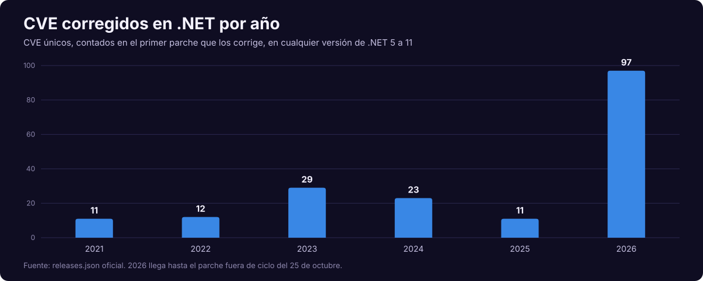
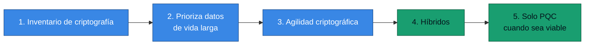

<div align="center">

# 20 · Seguridad y cadena de suministro

**CVE en cifras, endurecimiento del runtime, criptografía poscuántica y defensa de NuGet**

[⬅ 19 · SDK y pruebas](19-sdk-herramientas-y-pruebas.md) · [🏠 Índice](../README.md) · [21 · Migración ➡](21-migracion-y-cambios-disruptivos.md)

</div>

---

## Contenido

1. [2026: el año que cambió el volumen](#1-2026-el-año-que-cambió-el-volumen)
2. [Qué implica para tu operación](#2-qué-implica-para-tu-operación)
3. [Endurecimiento de la plataforma](#3-endurecimiento-de-la-plataforma)
4. [Criptografía](#4-criptografía)
5. [Poscuántica: plan práctico](#5-poscuántica-plan-práctico)
6. [Web](#6-web)
7. [Cadena de suministro](#7-cadena-de-suministro)
8. [Deserialización y parsers](#8-deserialización-y-parsers)
9. [Lista de control](#9-lista-de-control)
10. [Referencias](#10-referencias)

---

## 1. 2026: el año que cambió el volumen

<p align="center">
  
</p>

| Año | CVE únicos |
|---|---:|
| 2021 | 11 |
| 2022 | 12 |
| 2023 | 29 |
| 2024 | 23 |
| 2025 | 11 |
| **2026** (hasta el 25 de octubre) | **97** |

Conteo propio sobre `releases.json` de .NET 5 a 11: cada CVE se cuenta una vez, en el primer parche que lo corrige.

**Por parche, en .NET 10 durante 2026:**

| Parche | Fecha | CVE |
|---|---|---:|
| 10.0.3 | 10-feb | 1 |
| 10.0.4 | 10-mar | 3 |
| 10.0.6 | 14-abr | 4 |
| 10.0.7 | 21-abr | 1 |
| 10.0.8 | 12-may | 4 |
| 10.0.9 | 9-jun | 3 |
| 10.0.10 | 14-jul | **17** |
| 10.0.11 | 11-ago | 10 |
| 10.0.12 | 8-sep | 6 |
| 10.0.13 | 13-oct | **44** |
| 10.0.14 | 25-oct | 4 |

> [!IMPORTANT]
> Las fuentes consultadas **no explican** el aumento. No debe interpretarse como que .NET se volvió más inseguro: un mayor
> número de CVE puede reflejar más capacidad de encontrar y reportar fallos. Lo verificable es el efecto operativo:
> **más parches con más urgencia**.

---

## 2. Qué implica para tu operación

| Antes | Ahora |
|---|---|
| Actualizar cada trimestre podía bastar | Ciclo mensual como mínimo, con vía rápida |
| Parches en el segundo martes | También fuera de ciclo: **25 de octubre** |
| Reconstruir imágenes "cuando toque" | Reconstrucción automática |
| Un servidor de versión fija | Inventario de runtimes |


| Modo de despliegue | Quién parchea el runtime |
|---|---|
| Dependiente del framework en un host | Administrador del sistema |
| Imagen de contenedor | Tu pipeline, al reconstruir |
| Autocontenido | Tu pipeline, al republicar |
| Native AOT | Tu pipeline, al recompilar |
| PaaS | El proveedor, según su calendario |

> [!CAUTION]
> Native AOT y autocontenido **no reciben parches del sistema**. Sin reconstrucción automática, un binario queda vulnerable
> indefinidamente.

---

## 3. Endurecimiento de la plataforma

| Función | Versión | Efecto |
|---|:---:|---|
| W^X | 6 preview, 7 por defecto | Memoria nunca escribible y ejecutable a la vez |
| CET | 9 por defecto en Windows | Pila de sombra por hardware contra ROP |
| `BinaryFormatter` retirado | 9 | Se elimina una clase entera de fallos |
| `HttpClientFactory` redacta encabezados | 9 | Menos secretos en logs |
| Redacción de consultas en URI | 9 | Igual |
| EF Core redacta constantes | 10 | Datos fuera de logs |
| OpenSSL 1.1.1 o superior en Unix | 10 | Sin bibliotecas antiguas |
| `SslStream` sin descargas AIA en servidor | 11 🆕 | Sin solicitudes salientes durante el handshake |
| AIA limitado a dos descargas por cadena en Linux | 11 🆕 | Menor superficie |
| TLS endurecido | 11 🆕 | Validación y alertas |
| Mutex con alcance de usuario en Unix | 11 🆕 | Aislamiento entre usuarios |
| CRC32 en ZIP, sumas en TAR | 11 🆕 | Detección de corrupción |
| Modelo de memoria de C# | 11 🟡 | `unsafe` auditable |

---

## 4. Criptografía

| Necesidad | Recomendación |
|---|---|
| Hash | SHA-256 o superior |
| Contraseñas | `PasswordHasher`, PBKDF2 con `Rfc2898DeriveBytes.Pbkdf2`, o Argon2 de terceros |
| Cifrado autenticado | `AesGcm` o `ChaCha20Poly1305` |
| Comparar secretos | `CryptographicOperations.FixedTimeEquals` |
| Números aleatorios | `RandomNumberGenerator` |
| Firma clásica | ECDSA o RSA-PSS |
| Intercambio de claves | `ECDiffieHellman`, `X25519DiffieHellman` 🆕 |
| Claves en la nube | Key Vault y HSM |

```csharp
using System.Security.Cryptography;

byte[] clave = RandomNumberGenerator.GetBytes(32);
byte[] nonce = RandomNumberGenerator.GetBytes(AesGcm.NonceByteSizes.MaxSize);
byte[] texto = "secreto"u8.ToArray();
byte[] cifrado = new byte[texto.Length];
byte[] etiqueta = new byte[AesGcm.TagByteSizes.MaxSize];

using var aes = new AesGcm(clave, etiqueta.Length);
aes.Encrypt(nonce, texto, cifrado, etiqueta);
```

> [!WARNING]
> Nunca reutilices un *nonce* con la misma clave en AES-GCM: rompe la confidencialidad y la autenticidad.

---

## 5. Poscuántica: plan práctico

| Algoritmo | Función | Estándar | .NET | Estado |
|---|---|---|:---:|---|
| ML-KEM | Acordar claves | FIPS 203 | 10 | 🟢 |
| ML-DSA | Firmar | FIPS 204 | 10 | 🟢 |
| SLH-DSA | Firmar, conservador | FIPS 205 | 10 | 🧪 `SYSLIB5006` |
| Composite ML-DSA | Híbrido | IETF | 10 | 🧪 `SYSLIB5006` |
| Composite ML-KEM | Híbrido | — | 11 | 🧪 `SYSLIB5006` |
| HPKE | Cifrado híbrido | — | 11 | 🧪 `SYSLIB5006` |
| ML-KEM en `EnvelopedCms` | Mensajes CMS | — | 11 | 🟡 RC |

Disponibles donde el sistema tenga **OpenSSL 3.5+** o **CNG con PQC**.



La motivación es *almacenar ahora, descifrar después*: lo capturado hoy podría descifrarse con hardware futuro.

---

## 6. Web

| Riesgo | Control |
|---|---|
| Sesiones robadas | Cookies `Secure`, `HttpOnly`, `SameSite`; DBSC 🧪 |
| Contraseñas | **Passkeys** (.NET 10) |
| CSRF | Antiforgery también en Minimal APIs |
| Abuso | `AddRateLimiter` |
| XSS | Razor codifica por defecto; CSP |
| Encabezados | HSTS y `X-Content-Type-Options` |
| Datos en logs | Redacción con `Microsoft.Extensions.Compliance` |

🆕 La plantilla Blazor de .NET 11 retira un manejador JS en línea de `NavMenu` para mejorar el cumplimiento de CSP.

---

## 7. Cadena de suministro

| Control | Versión | Cómo |
|---|---|---|
| NuGet Audit | SDK 8 | Avisos de vulnerabilidades en `restore` |
| Auditoría transitiva por defecto | 10 | Dependencias indirectas |
| Fuente de auditoría sin HTTP inseguro | 10 | Se rechaza por defecto |
| Antigüedad mínima de paquete | 11 🆕 | `--min-publish-age-hours` |
| Advertencia NU5052 de ID restringidos | 11 🆕 | Reduce suplantación |
| Mapeo de orígenes | Vigente | Cada paquete, desde un solo origen |
| `packages.lock.json` | Vigente | Resolución reproducible |
| Imágenes reproducibles | 11 🆕 | `SOURCE_DATE_EPOCH` |

```xml
<PropertyGroup>
  <NuGetAudit>true</NuGetAudit>
  <NuGetAuditMode>all</NuGetAuditMode>
  <NuGetAuditLevel>low</NuGetAuditLevel>
  <RestorePackagesWithLockFile>true</RestorePackagesWithLockFile>
  <CheckSdkVulnerabilities>true</CheckSdkVulnerabilities>
</PropertyGroup>
```

```xml
<!-- nuget.config: evita la confusión de dependencias -->
<packageSourceMapping>
  <packageSource key="nuget.org">
    <package pattern="*" />
  </packageSource>
  <packageSource key="interno">
    <package pattern="MiEmpresa.*" />
  </packageSource>
</packageSourceMapping>
```

```bash
# Retrasa paquetes recién publicados: margen para detectar uno malicioso
dotnet nuget update source nuget.org --min-publish-age-hours 72
```

> [!TIP]
> La antigüedad mínima resuelve un caso real: un paquete comprometido suele detectarse en horas o días. Esperar 72 horas
> no cuesta nada en la mayoría de las actualizaciones. **Exceptúa los parches de seguridad urgentes.**

---

## 8. Deserialización y parsers

| Práctica | Razón |
|---|---|
| No deserializar tipos arbitrarios | Evita ejecución de código |
| Evitar `TypeNameHandling` en Newtonsoft | Clase conocida de RCE |
| Usar `RegexOptions.NonBacktracking` o tiempo límite | ReDoS |
| Rechazar propiedades duplicadas en JSON | Confusión de parsers |
| Límite de tamaño de entrada | Agotamiento |
| `XmlReaderSettings.DtdProcessing = Prohibit` | XXE |
| CBOR con profundidad máxima | Predeterminado en .NET 11 |

---

## 9. Lista de control

| ✅ | Control |
|:---:|---|
| ☐ | Sin versiones fuera de soporte tras el 10-nov-2026 |
| ☐ | Último parche en todos los entornos |
| ☐ | Reconstrucción automática de imágenes |
| ☐ | `NuGetAuditMode=all` y *lock files* |
| ☐ | `packageSourceMapping` |
| ☐ | SBOM por versión |
| ☐ | Contenedor sin root ni shell |
| ☐ | Sin `BinaryFormatter`, ni `TypeNameHandling` |
| ☐ | Secretos fuera del código |
| ☐ | Inventario de criptografía para PQC |

---

## 10. Referencias

- [.NET releases.json](https://github.com/dotnet/core/tree/main/release-notes)
- [.NET 11 RC3 release notes](https://github.com/dotnet/core/blob/main/release-notes/11.0/preview/rc3/11.0.0-rc.3.md)
- [Post-quantum cryptography in .NET](https://learn.microsoft.com/dotnet/core/whats-new/dotnet-10/libraries#post-quantum-cryptography-pqc)
- [Auditing package dependencies](https://learn.microsoft.com/nuget/concepts/auditing-packages)
- [Package source mapping](https://learn.microsoft.com/nuget/consume-packages/package-source-mapping)
- [Microsoft Security Response Center](https://msrc.microsoft.com/update-guide)

---

<div align="center">

[⬅ 19 · SDK y pruebas](19-sdk-herramientas-y-pruebas.md) · [🏠 Índice](../README.md) · [21 · Migración ➡](21-migracion-y-cambios-disruptivos.md)

</div>
