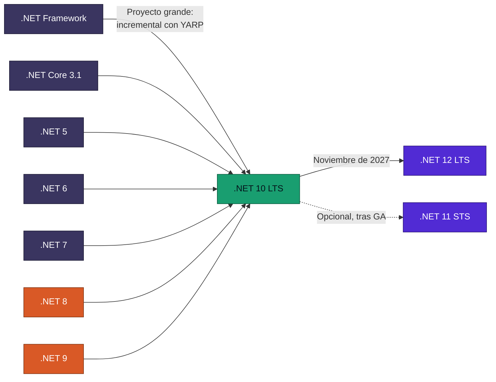
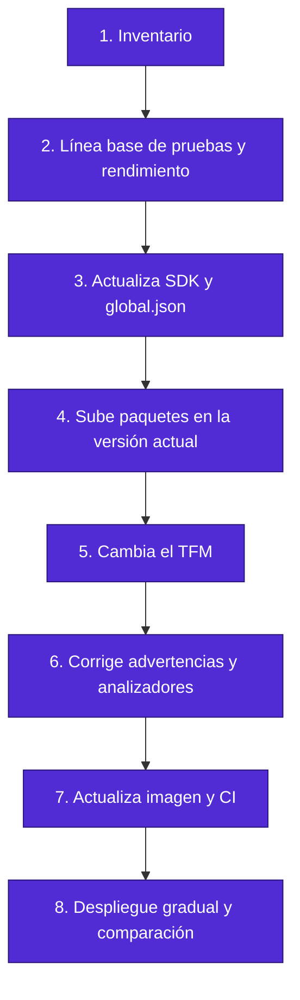
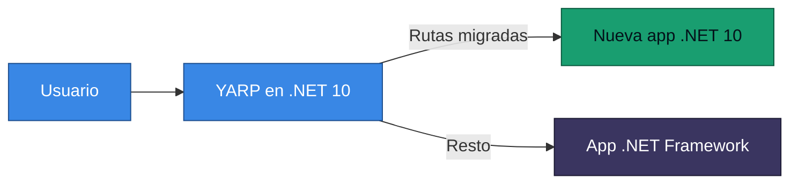

<div align="center">

# 21 · Migración y cambios disruptivos

**Cómo llegar a .NET 10 desde cualquier punto, y qué se rompe en cada salto**

[⬅ 20 · Seguridad](20-seguridad-y-cadena-de-suministro.md) · [🏠 Índice](../README.md) · [22 · Decisiones ➡](22-guias-de-decision.md)

</div>

---

## Contenido

1. [Principios](#1-principios)
2. [Rutas](#2-rutas)
3. [Metodología en ocho pasos](#3-metodología-en-ocho-pasos)
4. [Cambios por versión](#4-cambios-por-versión)
5. [De .NET Framework a .NET 10](#5-de-net-framework-a-net-10)
6. [Azure Functions: in-process a isolated](#6-azure-functions-in-process-a-isolated)
7. [Xamarin a MAUI](#7-xamarin-a-maui)
8. [Newtonsoft a System.Text.Json](#8-newtonsoft-a-systemtextjson)
9. [Lista de pruebas de regresión](#9-lista-de-pruebas-de-regresión)
10. [Referencias](#10-referencias)

---

## 1. Principios

| Principio | Aplicación |
|---|---|
| **Salta directo** | De .NET 6 a .NET 10 sin escalas; lee los cambios acumulados |
| Separa SDK y TFM | Actualiza el SDK primero |
| Migra de hojas a raíz | Bibliotecas antes que aplicaciones |
| Un cambio por PR | Facilita revertir |
| Mide | Compara latencia y memoria antes y después |
| Multi-target temporal | `net8.0;net10.0` durante la transición de bibliotecas |

---

## 2. Rutas



| Origen | Esfuerzo típico | Mayor obstáculo |
|---|---|---|
| .NET 9 | Bajo | C# 14 y Span |
| .NET 8 | Bajo a medio | Paquetes y `BinaryFormatter` |
| .NET 6 o 7 | Medio | Puerto 8080, imágenes, EF Core |
| .NET 5 | Medio | Paquetes sin mantenimiento |
| .NET Core 3.1 | Medio a alto | Modelo de hospedaje, EF Core |
| .NET Framework | Alto | WCF, Web Forms, `System.Web` |

---

## 3. Metodología en ocho pasos



```bash
# Paquetes con vulnerabilidades, desactualizados u obsoletos
dotnet list package --vulnerable --include-transitive
dotnet list package --outdated
dotnet list package --deprecated
```

---

## 4. Cambios por versión

### 4.1 Hacia .NET 8

| Cambio | Acción |
|---|---|
| Puerto de contenedor 8080 | Actualiza Service, probes y proxy |
| Usuario `app` | Revisa permisos de archivos |
| `Microsoft.AspNetCore.Mvc.Newtonsoft` y paquetes | Actualiza |

### 4.2 Hacia .NET 9

| Cambio | Acción |
|---|---|
| **`BinaryFormatter` lanza excepción** | Reemplaza serialización |
| `params` con Span cambia sobrecargas | Recompila y prueba |
| Coma flotante a entero satura | Revisa cálculos |
| `HttpClientFactory` usa `SocketsHttpHandler` | Revisa configuración |
| `HttpClientFactory` redacta encabezados | Ajusta si dependías de esos logs |
| Sobrecargas enteras de `TimeSpan.From*` | Revisa llamadas con ambigüedad en F# |
| `X509Certificate2` con constructores obsoletos | Usa `X509CertificateLoader` |
| Variables de entorno sobre `runtimeconfig.json` | Revisa precedencia |
| CET por defecto | Revisa código nativo incompatible |

### 4.3 Hacia .NET 10

| Cambio | Acción |
|---|---|
| Imagen predeterminada Ubuntu | Revisa `apt-get`, usuarios y paquetes |
| Resolución con `Span` | Recompila y prueba |
| `field` contextual | Renombra o usa `@field` |
| `System.Linq.Async` choca | Quita o ajusta |
| NuGet audita transitivos | Prepara excepciones con plazo |
| `PackageReference` sin versión | Es error |
| Paquetes prunables | Atiende `NU1510` |
| `dotnet new sln` genera `.slnx` | Revisa scripts |
| `BackgroundService` | Revisa lo que hay antes del primer `await` |
| Valores `null` en configuración | Revisa valores predeterminados |
| Propagador W3C | Revisa trazas con sistemas antiguos |
| Señales de terminación | Prueba el apagado |
| `Uri` sin límite de longitud | Revisa límites propios |
| `MailAddress` con puntos consecutivos | Revisa validación |
| Archivos únicos y bibliotecas nativas | Revisa rutas |

### 4.4 Hacia .NET 11 🆕

| Cambio | Acción |
|---|---|
| Línea base de CPU | Audita hardware |
| `IHost` relanza fallos de `BackgroundService` | Revisa `try/catch` de `RunAsync` |
| Redondeo correcto en `Math.Round`, `decimal`, `BigInteger` | Regresión numérica |
| Saturación a enteros pequeños | Revisa conversiones |
| Cadenas vacías en configuración | Revisa capas |
| Algunos `Microsoft.Extensions` en framework compartido | Revisa referencias |
| OpenAPI 3.2 | Valida herramientas |
| `Microsoft.OpenApi` 3.x | Revisa transformadores |
| CoreCLR móvil | Plan completo de pruebas |
| Prefijo `lib` en Unix AOT | Actualiza scripts |
| `dnx` omite `global.json` | Revisa ejecución de herramientas |
| Restore no busca versiones superiores en carpeta global | Puede fallar sin conexión |
| `Newtonsoft.Json` fuera de VSTest | Declara la dependencia |
| Métricas de HttpClient con contadores observables | Revisa paneles |

---

## 5. De .NET Framework a .NET 10



Patrón **Strangler Fig**: un proxy delante de ambas aplicaciones permite migrar ruta por ruta.

| Componente | Destino |
|---|---|
| `System.Web` | Pipeline de ASP.NET Core |
| Web Forms | Blazor o Razor Pages |
| WCF servidor | CoreWCF o gRPC |
| `web.config` | `appsettings.json` |
| `HttpContext.Current` | `IHttpContextAccessor` o paso explícito |
| Entity Framework 6 | Funciona en .NET moderno; EF Core a largo plazo |
| `packages.config` | `PackageReference` |
| `.csproj` antiguo | Estilo SDK |
| Biblioteca compartida | `netstandard2.0` durante la transición |

> [!WARNING]
> GitHub Copilot y `upgrade-assistant` ayudan con el trabajo mecánico. **Las decisiones de arquitectura siguen siendo tuyas.**

---

## 6. Azure Functions: in-process a isolated

> [!CAUTION]
> El modelo *in-process* termina el **10 de noviembre de 2026**. .NET 10 solo se soporta con *isolated worker*.

| Antes | Después |
|---|---|
| `Microsoft.NET.Sdk.Functions` | `Microsoft.Azure.Functions.Worker.Sdk` |
| `FUNCTIONS_WORKER_RUNTIME=dotnet` | `dotnet-isolated` |
| `[FunctionName]` | `[Function]` |
| `Microsoft.Azure.WebJobs.*` | `Microsoft.Azure.Functions.Worker.Extensions.*` |
| `ILogger` por parámetro | DI |
| `FunctionsStartup` | `Program.cs` |

```csharp
var builder = FunctionsApplication.CreateBuilder(args);
builder.ConfigureFunctionsWebApplication();
builder.Build().Run();

public class Pedidos(ILogger<Pedidos> log)
{
    [Function("ObtenerPedido")]
    public IActionResult Run(
        [HttpTrigger(AuthorizationLevel.Function, "get", Route = "pedidos/{id:int}")] HttpRequest req,
        int id)
    {
        log.LogInformation("Pedido {Id}", id);
        return new OkObjectResult(new { id });
    }
}
```

Si usas Linux Consumption, migra además a **Flex Consumption**: no recibirá .NET 10.

---

## 7. Xamarin a MAUI

| Xamarin | MAUI |
|---|---|
| Varios proyectos | Un proyecto |
| Renderers | Handlers |
| `Xamarin.Essentials` | Integrado |
| `MessagingCenter` | `WeakReferenceMessenger` del Community Toolkit |
| `Device.BeginInvokeOnMainThread` | `MainThread.BeginInvokeOnMainThread` |
| Paquete de compatibilidad | Se retira en .NET 11 |

---

## 8. Newtonsoft a System.Text.Json

| Diferencia | Newtonsoft | System.Text.Json |
|---|---|---|
| Mayúsculas al leer | Insensible | Sensible, salvo `Web` |
| Comentarios y comas finales | Permitidos | Requiere opción |
| Referencias | Opción | `ReferenceHandler` |
| Polimorfismo | `TypeNameHandling` (inseguro) | `[JsonPolymorphic]` |
| `JObject` | Sí | `JsonNode` |
| Native AOT | ❌ | ✅ |
| Propiedades con `[JsonProperty]` | Sí | `[JsonPropertyName]` |

No hace falta migrar todo. En API internas estables, `Newtonsoft.Json` sigue funcionando.

---

## 9. Lista de pruebas de regresión

| Área | Prueba |
|---|---|
| Arranque | Sin excepciones y con tiempo comparable |
| Apagado | `SIGTERM` drena solicitudes |
| Numéricos | Montos y redondeos contra referencia |
| Fechas | Zonas horarias y formatos |
| Cultura | Imágenes sin ICU |
| JSON | Formas de API exactas |
| Certificados | Cadenas y AIA en Linux |
| Rendimiento | Latencia p95 y memoria |
| Observabilidad | Paneles y alertas siguen funcionando |
| Contenedor | Usuario, puerto, sondas |

---

## 10. Referencias

- [Breaking changes in .NET](https://learn.microsoft.com/dotnet/core/compatibility/breaking-changes)
- [Breaking changes in .NET 10](https://learn.microsoft.com/dotnet/core/compatibility/10)
- [Breaking changes in .NET 11](https://learn.microsoft.com/dotnet/core/compatibility/11)
- [Port from .NET Framework to .NET](https://learn.microsoft.com/dotnet/core/porting/)
- [Migrate C# apps from in-process to isolated worker](https://learn.microsoft.com/azure/azure-functions/migrate-dotnet-to-isolated-model)
- [Migrate from Newtonsoft.Json to System.Text.Json](https://learn.microsoft.com/dotnet/standard/serialization/system-text-json/migrate-from-newtonsoft)

---

<div align="center">

[⬅ 20 · Seguridad](20-seguridad-y-cadena-de-suministro.md) · [🏠 Índice](../README.md) · [22 · Decisiones ➡](22-guias-de-decision.md)

</div>
