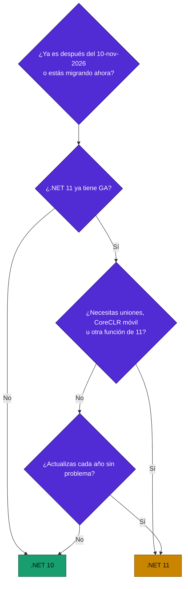
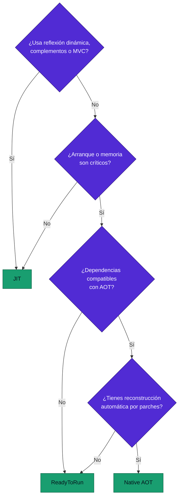

# 22 · Guías de decisión

**Árboles y matrices para elegir versión, despliegue, UI, datos, tiempo real, caché, mensajería e IA**

[⬅ 21 · Migración](21-migracion-y-cambios-disruptivos.md) · [🏠 Índice](../README.md) · [23 · Catálogo ➡](23-catalogo-a-z.md)

---

## Contenido

1. [¿Qué versión de .NET?](#1-qué-versión-de-net)
2. [¿JIT o Native AOT?](#2-jit-o-native-aot)
3. [¿Qué imagen de contenedor?](#3-qué-imagen-de-contenedor)
4. [¿Qué tecnología web?](#4-qué-tecnología-web)
5. [¿Cómo modelar estados?](#5-cómo-modelar-estados)
6. [¿Qué serialización?](#6-qué-serialización)
7. [¿Qué caché?](#7-qué-caché)
8. [¿Cómo comunicar servicios?](#8-cómo-comunicar-servicios)
9. [¿Monolito o microservicios?](#9-monolito-o-microservicios)
10. [¿Actualizo ahora?](#10-actualizo-ahora)
11. [Decisiones rápidas](#11-decisiones-rápidas)

---

## 1. ¿Qué versión de .NET?

| Situación | Elección | Razón |
|---|---|---|
| Producción empresarial nueva | **.NET 10** | LTS con un año de parches |
| Migración urgente desde 8 o 9 | **.NET 10** | Disponible y estable hoy |
| Producto con despliegue continuo | .NET 11 tras GA | Mismo fin de soporte que .NET 10 |
| App MAUI | Prueba 11 ya | CoreCLR exige validación |
| Biblioteca pública | `netstandard2.0` si hace falta y `net10.0` | Alcance |
| Cliente instalado por usuarios | .NET 10 | Menos actualizaciones forzadas |

> [!TIP]
> Dato poco comentado: **.NET 10 y .NET 11 terminan casi el mismo mes**, noviembre de 2028. Desde la GA de .NET 11,
> elegir STS ya no da menos tiempo de soporte que la LTS vigente. La decisión real es madurez frente a funciones.

---

## 2. ¿JIT o Native AOT?

| Carga | Recomendación |
|---|---|
| API de larga duración | JIT con PGO |
| Función con arranques en frío | Native AOT o R2R |
| CLI distribuida | Native AOT |
| Sidecar con mucha densidad | Native AOT |
| Aplicación con complementos | JIT |

---

## 3. ¿Qué imagen de contenedor?

| Prioridad | Imagen |
|---|---|
| Superficie mínima | `10.0-noble-chiseled` |
| Con globalización completa | `10.0-noble-chiseled-extra` |
| Depuración sencilla | `10.0` |
| Arranque de ASP.NET Core | Variante `-composite` |
| Tamaño mínimo con shell | `10.0-alpine` |
| Azure | `10.0-azurelinux3.0-distroless` |
| Native AOT | `runtime-deps` chiseled |

---

## 4. ¿Qué tecnología web?

| Necesidad | Solución |
|---|---|
| API HTTP | Minimal APIs |
| Sitio con contenido | Razor Pages o Blazor SSR |
| App interactiva en C# | Blazor Web App |
| Front-end JS existente | React o Angular con BFF .NET |
| Tiempo real bidireccional | SignalR |
| Flujo de servidor a cliente | SSE |
| Entre servicios | gRPC |
| Proxy inverso en .NET | YARP |

---

## 5. ¿Cómo modelar estados?

| Pregunta | Herramienta |
|---|---|
| ¿Solo nombres, sin datos? | `enum` |
| ¿Casos con datos y comportamiento común, en un ensamblado? | `closed` (.NET 11) |
| ¿Casos ajenos o tipos primitivos? | `union` (.NET 11) |
| ¿Extensible por terceros? | Interfaz |
| ¿Aún en .NET 10? | `abstract record` |

---

## 6. ¿Qué serialización?

| Caso | Elección |
|---|---|
| API pública | JSON con `System.Text.Json` generado |
| Entre servicios internos | Protobuf con gRPC |
| Caché | MessagePack o JSON |
| Eventos | CloudEvents + JSON o Avro |
| Datos de larga vida | Esquema versionado |
| Nunca | `BinaryFormatter` |

---

## 7. ¿Qué caché?

| Necesidad | Solución |
|---|---|
| Datos locales de una instancia | `IMemoryCache` |
| Datos compartidos y protección contra estampida | **`HybridCache`** |
| Respuesta HTTP | Output cache |
| Contenido público | CDN y `Cache-Control` |
| Datos inmutables en arranque | `FrozenDictionary` |

---

## 8. ¿Cómo comunicar servicios?

| Patrón | Tecnología | Acoplamiento |
|---|---|---|
| Solicitud y respuesta | HTTP, gRPC | Alto en el tiempo |
| Comando | Cola | Medio |
| Evento | Pub/Sub | Bajo |
| Flujo | Kafka, Event Hubs | Bajo |
| Dentro de un proceso | `Channel<T>` | Ninguno de red |

> [!IMPORTANT]
> Publicar en una cola y guardar en base no es atómico. Usa el patrón **Transactional Outbox**.

---

## 9. ¿Monolito o microservicios?

| Señal | Hacia |
|---|---|
| Un equipo | Monolito modular |
| Dominio aún en descubrimiento | Monolito modular |
| Escalas muy diferentes por módulo | Separar ese módulo |
| Equipos que se bloquean entre sí | Microservicios |
| Requisitos regulatorios de aislamiento | Separar |

Empieza por un **monolito modular**: módulos con límites claros, una sola unidad de despliegue. Separar después es mucho
más barato que unir.

---

## 10. ¿Actualizo ahora?

| Elemento | Respuesta |
|---|---|
| Parche de seguridad | Sí, en días |
| SDK | Sí, en la siguiente iteración |
| Versión mayor LTS | Sí, dentro del primer año |
| STS | Solo con actualización anual |
| RC con *go-live* | Solo con beneficio claro y pruebas |
| Paquete recién publicado | Espera un margen, salvo seguridad |

---

## 11. Decisiones rápidas

| Pregunta | Respuesta corta |
|---|---|
| ¿`record` o `class`? | `record` para datos, `class` para comportamiento e identidad |
| ¿`Task` o `ValueTask`? | `Task`, salvo medición que justifique lo contrario |
| ¿`IEnumerable` o `List` en API? | `IReadOnlyList<T>` si ya está materializado |
| ¿`DateTime` o `DateTimeOffset`? | `DateTimeOffset` para instantes; `DateOnly` para fechas |
| ¿`decimal` o `double`? | `decimal` para dinero |
| ¿`lock` o `SemaphoreSlim`? | `Lock` sin `await`; `SemaphoreSlim` con `await` |
| ¿Excepción o resultado? | Excepción para lo inesperado; unión para lo esperado |
| ¿`Guid` v4 o v7? | v7 para claves ordenadas en base |
| ¿`HttpClient` nuevo? | Nunca por solicitud |
| ¿`ConfigureAwait(false)`? | En bibliotecas, sí; en apps ASP.NET Core no hace falta |
| ¿Newtonsoft o STJ? | STJ en proyectos nuevos |
| ¿Dapper o EF Core? | EF Core por defecto; SQL directo donde lo justifique |

---

[⬅ 21 · Migración](21-migracion-y-cambios-disruptivos.md) · [🏠 Índice](../README.md) · [23 · Catálogo ➡](23-catalogo-a-z.md)

