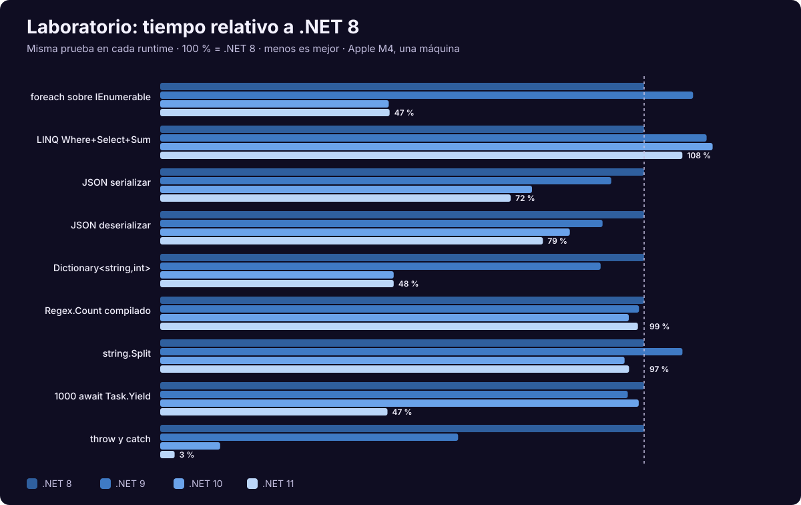

<div align="center">

# 24 · Laboratorio

**Mediciones propias de .NET 8, 9, 10 y 11 RC3, con código reproducible y sus limitaciones a la vista**

[⬅ 23 · Catálogo](23-catalogo-a-z.md) · [🏠 Índice](../README.md) · [25 · Referencia ➡](25-referencia-rapida-y-glosario.md)

</div>

> [!IMPORTANT]
> Son resultados de **una sola máquina**, en Arm64 y con pruebas sintéticas pequeñas. Sirven para ver tendencias y
> comprobar afirmaciones, no para predecir tu aplicación. .NET 11 está en **RC3** y sus cifras pueden cambiar.
> El código está en [`laboratorio/`](../laboratorio/) para que puedas repetirlas.

---

## Contenido

1. [Entorno y método](#1-entorno-y-método)
2. [Microbenchmarks](#2-microbenchmarks)
3. [Qué dicen los datos](#3-qué-dicen-los-datos)
4. [Native AOT frente a JIT](#4-native-aot-frente-a-jit)
5. [Runtime Async](#5-runtime-async)
6. [Limitaciones](#6-limitaciones)
7. [Cómo medir bien](#7-cómo-medir-bien)

---

## 1. Entorno y método

| Elemento | Valor |
|---|---|
| Fecha | 4 de noviembre de 2026 |
| Equipo | Apple M4, 10 núcleos, 24 GB |
| Sistema | macOS 27.0.1, Arm64 |
| SDK | `11.0.100-rc.3.26522.148` |
| Runtimes | 8.0.33 · 9.0.22 · 10.0.14 · 11.0.0-rc.3 |
| Herramienta | BenchmarkDotNet 0.15.8 |
| Modo | En proceso, 8 iteraciones de calentamiento, 20 de medición |
| Compilación | Release, `LangVersion` 12 en todos, para aislar el runtime |
| GC | Workstation |
| Estadístico | Mediana |

Cada runtime corrió de forma secuencial, sin otras cargas de medición en paralelo.

---

## 2. Microbenchmarks

<p align="center">
  
</p>

**Tiempo (mediana):**

| Prueba | .NET 8 | .NET 9 | .NET 10 | .NET 11 RC3 | 11 frente a 8 |
|---|---:|---:|---:|---:|---:|
| `throw` y `catch` | 17 792 ns | 10 953 ns | 2 203 ns | **530 ns** | **33.6× más rápido** |
| `foreach` sobre `IEnumerable` | 565 ns | 622 ns | 267 ns | 268 ns | 2.1× |
| `Dictionary<string,int>` (1 000 búsquedas) | 6 874 ns | 6 256 ns | 3 317 ns | 3 316 ns | 2.1× |
| 1 000 `await Task.Yield` | 510 896 ns | 493 616 ns | 505 215 ns | **239 914 ns** | 2.1× |
| JSON serializar (100 objetos) | 16 684 ns | 15 550 ns | 12 818 ns | 12 085 ns | 1.4× |
| JSON deserializar (100 objetos) | 40 531 ns | 37 047 ns | 34 309 ns | 32 053 ns | 1.3× |
| `string.Split` | 9 335 ns | 10 075 ns | 8 958 ns | 9 044 ns | 1.03× |
| `Regex.Count` compilado | 66 237 ns | 65 530 ns | 64 139 ns | 65 386 ns | 1.01× |
| LINQ `Where`+`Select`+`Sum` | 1 136 ns | 1 283 ns | 1 297 ns | 1 226 ns | **0.93×** |

**Memoria asignada por operación:**

| Prueba | .NET 8 | .NET 9 | .NET 10 | .NET 11 RC3 |
|---|---:|---:|---:|---:|
| `foreach` sobre `IEnumerable` | 32 B | 32 B | **0 B** | **0 B** |
| JSON deserializar | 48 986 B | 48 184 B | 48 184 B | 48 184 B |
| `throw` y `catch` | 224 B | 216 B | 216 B | 216 B |
| 1 000 `await Task.Yield` | 96 168 B | 96 170 B | 96 169 B | 96 239 B |

Datos completos, con desviación, en [`data/laboratorio.csv`](../data/laboratorio.csv).

---

## 3. Qué dicen los datos

| Hallazgo | Interpretación | Confianza |
|---|---|---|
| `foreach` cae a la mitad y la asignación llega a **0 B** en .NET 10 | Coincide con la de-abstracción y asignación en pila documentadas | Alta |
| `throw`/`catch` mejora en cada versión | .NET 9 coincide con el nuevo modelo documentado; **no encontramos explicación oficial** para el salto de .NET 10 y 11 en esta prueba | Media |
| `await Task.Yield` se reduce a la mitad en .NET 11 **sin** activar Runtime Async | Compatible con la documentación: las bibliotecas ya usan Runtime Async y se omite `ExecutionContext` cuando no hay nada que restaurar | Media |
| `Dictionary` mejora 2× en .NET 10 | **No determinamos la causa** | Baja |
| JSON mejora de forma gradual | Efecto acumulado del JIT y de las bibliotecas | Media |
| Regex sin cambios | Carga dominada por el motor ya optimizado | Media |
| **LINQ tarda 8 % más que en .NET 8** | Regresión en esta prueba y máquina. Con desviación de hasta 4.7 %, merece verificarse | Media |
| `string.Split` empeora en .NET 9 y se recupera | Variación puntual | Baja |

> [!NOTE]
> No todo mejora en cada versión. Un resultado honesto incluye las regresiones, y por eso conviene **medir tu carga real**
> antes de asumir la ganancia.

---

## 4. Native AOT frente a JIT

**Consola "hola":**

| Medida | .NET 8 | .NET 9 | .NET 10 | .NET 11 RC3 |
|---|---:|---:|---:|---:|
| Tamaño AOT | 1.55 MB | 1.27 MB | 1.10 MB | 1.22 MB |
| Ejecución AOT | 3.4 ms | 3.1 ms | 3.3 ms | 3.4 ms |
| Ejecución JIT | 18.9 ms | 19.7 ms | 18.8 ms | 18.3 ms |

**API Minimal con `CreateSlimBuilder` y JSON generado:**

| Medida | .NET 8 | .NET 9 | .NET 10 | .NET 11 RC3 |
|---|---:|---:|---:|---:|
| Tamaño AOT | 10.83 MB | 10.03 MB | 9.04 MB | 9.32 MB |
| Primera respuesta AOT | 33.2 ms | 32.1 ms | 33.1 ms | **14.9 ms** |
| Primera respuesta JIT | 95.4 ms | 94.0 ms | 98.4 ms | 79.7 ms |
| Memoria AOT | 23.3 MB | 22.5 MB | 22.6 MB | 21.3 MB |
| Memoria JIT | 76.6 MB | 78.4 MB | 80.8 MB | 83.1 MB |

| Conclusión en .NET 10 | Factor |
|---|---:|
| Consola: AOT frente a JIT | 5.7× más rápido |
| Web: primera respuesta | 3.0× más rápido |
| Web: memoria | 3.6× menos |

Los datos de "primera respuesta" incluyen el arranque del proceso y un sondeo HTTP cada 2 ms; "memoria" es RSS tras
esa primera respuesta. La aplicación JIT tiene un ejecutable pequeño porque depende del runtime instalado, y por eso no
se compara tamaño.

---

## 5. Runtime Async

Tres métodos `async` encadenados con `await Task.Yield()`, leyendo `new StackTrace().FrameCount` tras reanudar en .NET 11 RC3:

| Compilación | Marcos |
|---|---:|
| Clásica | 10 |
| `<Features>runtime-async=on</Features>` | **6** |

La documentación oficial muestra un caso de 13 a 5 marcos, sin `Task.Yield`.

---

## 6. Limitaciones

- Una máquina, una arquitectura. x64 y Linux pueden cambiar el orden de resultados.
- El modo en proceso de BenchmarkDotNet aísla menos que un proceso por prueba.
- Sin carga concurrente ni red: esto **no mide rendimiento de un servidor web**.
- El mismo binario IL se compiló con el SDK 11 para todos los runtimes.
- La prueba `throw`/`catch` es de una sola profundidad.
- Las bibliotecas JSON y Regex dependen del tamaño y forma de los datos.
- Native AOT se midió en macOS, no en contenedor Linux.

---

## 7. Cómo medir bien

| Regla | Razón |
|---|---|
| Usa BenchmarkDotNet para microbenchmarks | Gestiona calentamiento y estadística |
| Usa `-c Release` | Debug no sirve |
| Mide p95 y p99 en servicios | La media oculta la cola |
| Prueba con datos reales | Forma y tamaño cambian resultados |
| Usa la arquitectura de producción | Arm64 y x64 difieren |
| Compara un cambio por vez | Atribución |
| Considera asignaciones y no solo tiempo | Presión de GC |
| Prueba durante horas | Fugas y fragmentación |

```bash
dotnet-counters monitor --process-id <pid> System.Runtime Microsoft.AspNetCore.Hosting
```

---

<div align="center">

[⬅ 23 · Catálogo](23-catalogo-a-z.md) · [🏠 Índice](../README.md) · [25 · Referencia ➡](25-referencia-rapida-y-glosario.md)

</div>
